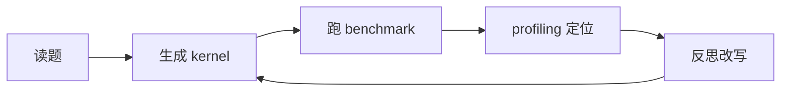

# 从硬件到算子的优化主线

## 1. 算子优化要回答的问题

一个常见的起点是：同一份推理脚本，换一张显卡后延迟明显变化；调 batch size 有时变好、有时更差；换推理引擎，有的模型收益肉眼可见，有的纹丝不动。到这一步，问题已经不是「会不会调用模型」，而是一连串没人能一句话说清的疑问：

- GPU 上真正执行的是哪些 kernel，它们慢在哪；
- 当前瓶颈是访存、计算，还是别的什么；
- 一个算子从 naive 到优化版，到底改了什么才变快；
- 改动是真的更快，还是只是测量方式变了；
- 「测量 → 定位 → 改 → 再测」这套流程能否交给 Agent 自动跑。

这些问题全都落在 GPU 算子优化的范围里。它不是一个知识点，而是把算法、kernel、访存模式与硬件资源串起来的一整条工程链路——只盯其中一层，往往看不清完整问题。

## 2. 三个关键词

| 关键词 | 含义 | 训练方式 |
|---|---|---|
| Profiling-Driven | 先学会看数据，再学改代码 | 写 benchmark、看 timeline、读 profiling 报告 |
| 刷题导向 | 每个算子都是从 naive 到优化的完整案例 | Reduction / Softmax / GEMM / Attention 一路优化下来 |
| Agent-Driven | 把「人做的优化流程」交给 Agent 自动化 | 搭一个能自动 profiling、改代码、跑分的 Agent |

三条里最容易走偏的是第一条。很多优化练习失败的原因不在代码，而在测量：没有预热、没有重复统计、没有同步，得到的时间根本不是 kernel 的时间。所谓「伪优化」，绝大多数是这样产生的。

第二条的要点是完整路径，而不是成品代码。一个算子只贴最终版本，读者学到的只是「这样写快」，学不到「为什么前一版慢、瓶颈信号长什么样、哪一步改动带来了收益」。这也是把 profiling 篇放在算子篇前面的原因：先会看数据，写 kernel 时才带着瓶颈意识。

第三条容易被误解成「让大模型随便生成一段 kernel」。在算子优化场景里，有价值的 Agent 必须会读硬件信息、跑 benchmark、调 profiling、根据瓶颈信号决定方向、改写 kernel、复测，并把失败的尝试也记录下来——失败的记录往往比成功那次更值钱。

## 3. 为什么以 RX 9070 XT 为实验平台

市面上多数 GPU 资料默认从 CUDA 起步，这很自然：生态成熟、案例丰富。选择 AMD Radeon RX 9070 XT（RDNA4）不是为了绕开 CUDA，而是借另一条技术路线把优化视角练得更通用。

两个现实理由：

- **易获得**：消费级显卡，不像数据中心卡那样昂贵稀缺；
- **软件栈可用**：原生 Linux + ROCm 经社区与官方验证可跑（Windows 上目前没有官方 ROCm 支持）。

更关键的是，算子优化里真正核心的问题并不归某个厂商独有：数据是否连续访问、算子是计算瓶颈还是访存瓶颈、kernel launch 开销是否值得关注、profiling 结果能否撑起结论。变的只是工具名与术语——AMD 侧会接触 CU、wavefront、LDS、HIP、rocprof、Triton on AMD。

需要提前划清的边界：这不是一份 CUDA 到 ROCm 的逐 API 翻译手册。HIP 与 CUDA 的对应关系只在必要时提一笔，注意力应该花在更值钱的四个问题上——这个算子为什么慢、慢的证据在哪里、当前硬件上能尝试什么优化、优化后怎么确认结果可信。

## 4. 全书主线

从理解硬件出发，经 profiling 建立证据，再手写算子优化，最后把流程交给 Agent：

| 阶段 | 内容 | 学完能做什么 |
|---|---|---|
| 入门 | 环境验证、GPU 体系结构、第一个程序 | 跑通环境，建立硬件直觉 |
| Profiling | benchmark、rocprof、Roofline | 用数据说明算子慢在哪里 |
| 算子 | Element-Wise、Reduction、Softmax、GEMM、Attention、RMSNorm | 把 naive kernel 优化到接近硬件极限 |
| Agent | Agent 入门、工具封装、多轮优化 | 让 Agent 生成、测量、裁决并记录候选 |

贯穿始终的底线只有一条：**优化的输入数据必须可信**。benchmark 不可信、profiling 没保存、硬件上下文没写清楚，最后的结论再漂亮也不能当工程结论用。

## 5. 适合谁、需要什么基础

| 基础 | 需要到的程度 |
|---|---|
| Python | 能运行脚本、看懂函数与基本包管理 |
| Linux 命令行 | 进目录、跑命令、看日志、理解环境变量 |
| 深度学习概念 | 知道 tensor、batch、矩阵乘、Softmax、Attention 是什么 |

不同背景的读法差别很大：

- **AI 应用 / 算法工程师**：目标是搞清「模型为什么慢」，不要跳过 profiling 篇。
- **刚接触 GPU 编程**：从最小例子顺序读，算子篇是核心训练场。
- **有 CUDA 经验**：快速浏览入门篇，重点攻算子篇与 Agent 篇。
- **做 LLM × Infra 方向**：通读，重点是 Agent 与真实模型优化。

初学者别跳过测量。连测都测不准时，优化很容易退化成赌博——赢了输了都不知道。

## 6. 与相邻方向的边界

这套内容聚焦「单卡上的算子优化 + Agent 自动化」。超出单卡的问题不在范围内：多卡通信、分布式训练、服务化与动态 batching、集群部署，各有专门的教程承接。理解这条边界很重要——很多「算子优化做完还是慢」的案例，瓶颈其实在通信或调度层，而那是另一套方法论。

## 写在最后

主线定下来之后，第一个动手问题是：怎样确认实验环境可以继续往后跑。下一篇[环境准备与三道门](2-环境准备与三道门)用三个最小验证把驱动、框架与编译链路依次打通。
