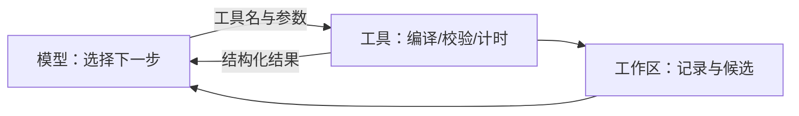

# 算子优化 Agent

## 1. 从一次手动优化到闭环

手动优化一个 kernel 的流程是：读任务、写第一版、编译、验正确性、计时、想下一步、改代码、再测。把这套流程交给程序，Agent 的职责就清楚了——**围绕目标选择行动、读取反馈、继续行动**。

关键在反馈。只让模型返回一段代码，并没有完成优化：它可能漏掉边界掩码，也可能写出正确但更慢的实现。程序必须把编译错误、正确性结果、计时数据交回模型，下一版才可能变好。反馈既可以是成功结果，也可以是明确的失败原因；失败本身不会让下一轮更好，能否据此调整假设才是关键。

关于「学习」要避免误解：模型会在后续上下文里读到失败记录，但整个流程没有训练、没有更新参数。变化的是当前任务的上下文与候选源码——可以理解为同一个助手读过新的实验记录后，重新制定计划。

## 2. 两个参照物：基线与已接受版本

优化过程中必须同时保留两份代码：

- **基线（Baseline）**：原始实现，回答「相对于什么变快了」；
- **已接受版本（Incumbent）**：当前工作区里的 `best.py`，回答「现在最好的是什么」。

第一轮时两者相同；之后只有通过裁决的候选才能替换 incumbent。混用这两个参照物，就会出现「相对上一版提升 5%」被写成「相对基线提升 5%」的错误。

完整的实验组织分三段：准备（读任务、跑基线、建立瓶颈假设）、实验（生成候选、编译、验正确性、计时、裁决）、收尾（独立复测、写报告）。代码由模型选择工具，而不是逐格执行的固定状态机。

## 3. 工具封装：把「失败」拆开

如果工具只返回「失败」两个字，模型无法判断该改索引、改语法，还是检查环境。工具接口的设计原则是：**返回结构化字段，让失败阶段可定位**。

任务规格单独放在 `task.json` 里，固定张量、入口、正确性与计时配置；候选源码通过参数传入。这样做的原因很实际——如果让模型每次调用时重新声明条件，它可能悄悄把 FP16 改成 FP32、把测试元素数减少，写起来更容易、计时更短，但已经偏离原任务。

工具链通常分四类：

| 工具 | 回答的问题 | 关键返回 |
|---|---|---|
| 编译 | 能否构建 | 编译错误原文 |
| 正确性校验 | 结果对不对 | 最大误差、是否通过 |
| 计时 | 这份源码有多快 | 中位耗时、重复次数 |
| 接受判定 | 能否替换 incumbent | 通过与拒绝的理由 |

「编译通过」与「答案正确」必须分开：漏掉尾部掩码和缺少依赖都表现为「跑不起来」，处理方式完全不同——前者查下标，后者修环境。

「测得更快」也不等于「可以替换」：只有正确性通过、耗时改善超过波动范围、实验条件与基线一致，才允许接受。

## 4. 一项假设对应一份候选

为了让每次修改可解释，一份候选只检验一个主要假设。例如基线使用 `block_size = 256`，候选可以研究增大它是否有效，但不能预先宣布更大的值更快——改变参数后 program 数量、编译器映射与资源需求都会变化，收益与代价都留给实验回答。

Agent 的结构可以分成三部分：

- **模型**：提出候选、解释下一步；
- **主循环**：安排工具调用、把结果写回上下文；
- **工作区**：保存基线、候选、记录与状态。

三者分开的好处是容错：模型提出一个糟糕方案时，已经确认可用的版本不会丢失，失败记录也留在工作区里供下一轮参考。

停止条件同样要程序化。模型说「完成」之后，程序要检查关键证据是否齐全：候选是否通过正确性、基线是否在同一台机器上重新校准、最终版本是否经过独立复测。缺一项就标成 `incomplete` 或 `complete_with_warning`，而不是直接展示一个漂亮数字。

## 5. 一次完整运行要看哪些产物

以向量加法为例，运行结束后的产物大致包括：

| 产物 | 内容 |
|---|---|
| `agent-status.json` | 运行状态：complete / warning / incomplete |
| `preflight.json` | 环境与任务自检 |
| `baseline-evaluation.json` | 搜索前的正确性与基线计时 |
| 候选记录 | 每轮假设、代码、测量结果、裁决 |
| 最终复测 | 原始基线与最终 best 的独立配对复测 |

`agent-status.json` 要第一个看：状态不是 `complete` 时，先定位缺失步骤；即使是 `complete`，也只说明完成检查通过，不保证性能变好。

最终复测不能省。搜索过程中的计时可能受缓存状态、频率波动影响，把原始基线与最终版本放在同一轮里独立配对复测（例如 5 次），才能回答「从起点到终点到底改进了多少」。这也解释了为什么不能覆盖基线——覆盖之后就没有可比对的另一端了。

## 6. 报告要写清证据与限制

一份可核对的报告至少包含四块：

1. **结论**：最终版本相对基线快了多少，在什么配置下成立；
2. **证据**：命令、日志位置、测量口径（预热、重复、统计量）；
3. **限制**：设备是否独占、是否锁频、结论适用于哪些 shape；
4. **失败记录**：哪些假设被否定，否定依据是什么。

第 4 块经常被忽略，但它恰恰是 Agent 相对人工调参的优势：人可以忘记失败的尝试，记录不会。

## 7. 这套范式能迁移到哪里

- **换算子**：把任务规格换成 GEMM、Softmax，工具链不变；
- **换工具**：计时工具可以替换成 rocprof trace，接受判定仍然由程序把关；
- **换模型**：模型只是「提出假设」的角色，换成更弱或更强的模型，闭环结构不变。

真正决定上限的不是模型，而是工具的质量：返回字段是否足以定位失败、计时是否可信、接受判定是否严格。

## 写在最后

从理解硬件到把流程交给 Agent，这条线走完一遍，方法论其实只有几句：先测准、再定位、一轮改一个变量、保留负记录、把证据和限制写清楚。GPU 算子优化如此，其它性能工作也大致如此。
