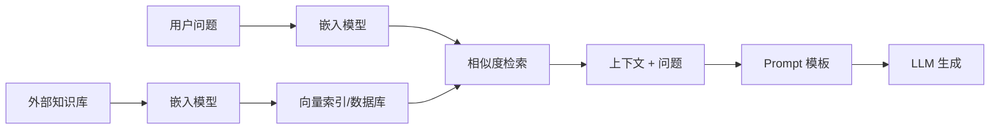

# RAG 入门与四步构建

## 1. RAG 要解决的问题

大语言模型的知识固化在权重里，是**参数化知识**：模糊、静态、无法细粒度更新。RAG（Retrieval-Augmented Generation）的思路是把外部知识库里的**非参数化知识**接进来——生成之前先检索相关材料，再让模型基于材料作答。

一句话概括：让模型学会「开卷考试」，既能用自己学到的，也能随时查资料。

## 2. 两阶段架构



**检索阶段**：嵌入模型把知识库编码成向量索引，存进向量数据库；查询时用同一模型把问题向量化，通过相似度搜索锁定最相关的片段。

**生成阶段**：把检索到的片段与原始问题按 Prompt 模板整合，约束模型「基于上下文回答」。

<div align="center">
  
  <p>图 1：RAG 双阶段架构</p>
</div>

## 3. 三代演进

| 维度 | 初级 RAG | 高级 RAG | 模块化 RAG |
|---|---|---|---|
| 流程 | 离线索引；在线检索→生成 | 检索前后各加优化步骤 | 积木式可编排 |
| 关键技术 | 基础向量检索 | 查询重写、结果重排 | 动态路由、查询转换、多路融合 |
| 局限 | 效果不稳、难优化 | 流程固定、优化点有限 | 系统复杂度高 |

<div align="center">
  
  <p>图 2：RAG 技术演进分类</p>
</div>

三代不是替代关系，而是复杂度分层：先用初级 RAG 跑通闭环，再按失败模式逐步引入重写、重排与路由。

## 4. RAG 还是微调

选型遵循「对模型改动最小、成本最低」的原则，顺序是：**提示工程 → RAG → 微调**。

- **提示工程**：任务简单、模型已有相关知识；
- **RAG**：模型缺特定或实时知识，需要外挂知识库；
- **微调**：要改变「如何做」（行为、风格、格式），而不是「知道什么」。

把两个维度放在一起看更清楚：横轴是「对 LLM 的修改程度」，纵轴是「对上下文的增强程度」。提示工程两端都浅，RAG 不改权重但大幅增强上下文，微调直接改参数。

## 5. RAG 的四类价值与风险分级

| LLM 局限 | RAG 的作用 |
|---|---|
| 静态知识 | 实时检索，知识库可动态更新（索引热插拔） |
| 幻觉 | 基于检索内容生成，可溯源到原文 |
| 领域专业性不足 | 接入医疗、法律等领域知识库 |
| 数据隐私 | 本地化部署知识库，敏感数据不出域 |

风险分级同样要提前想：翻译、语法检查这类低风险场景可靠度高；合同起草、法律咨询属中风险，需人工审核；证据分析、签证决策属高风险，必须有严格的质量控制与可追溯机制。

另一条常被忽略的成本优势：有外部知识辅助时，往往可以用更小的基础模型达到相近效果，推理成本随之下降。

## 6. 四步构建最小可行系统

**第一步，数据准备**：把 PDF、Word、Markdown 等多源数据标准化，按语义段落切分，避免在切块时把信息切断。

**第二步，索引构建**：切好的文本经嵌入模型转成向量，存入向量库，并关联来源、页码等元数据，便于后续引用。

**第三步，检索策略**：不要依赖单一向量检索，混合检索（向量 + 关键词）加结果重排通常更稳。

**第四步，生成集成**：设计清晰的 Prompt 模板，明确要求「只基于上下文回答，信息不足就说不知道」。

LangChain 版的核心代码只有几十行：

```python
from langchain_community.document_loaders import TextLoader
from langchain_text_splitters import RecursiveCharacterTextSplitter
from langchain_huggingface import HuggingFaceEmbeddings
from langchain_core.vectorstores import InMemoryVectorStore
from langchain_core.prompts import ChatPromptTemplate

docs = TextLoader("easy-rl-chapter1.md").load()
texts = RecursiveCharacterTextSplitter().split_documents(docs)

embeddings = HuggingFaceEmbeddings(
    model_name="BAAI/bge-small-zh-v1.5",
    model_kwargs={"device": "cpu"},
    encode_kwargs={"normalize_embeddings": True},
)
vectorstore = InMemoryVectorStore(embeddings)
vectorstore.add_documents(texts)

question = "文中举了哪些例子？"
retrieved = vectorstore.similarity_search(question, k=3)
context = "\n\n".join(doc.page_content for doc in retrieved)

prompt = ChatPromptTemplate.from_template(
    "请根据下面提供的上下文信息来回答问题。\n"
    "请确保你的回答完全基于这些上下文。\n"
    "如果上下文中没有足够的信息，请直接告知无法回答。\n\n"
    "上下文:\n{context}\n\n问题: {question}\n\n回答:"
)
answer = llm.invoke(prompt.format(question=question, context=context))
```

三个细节值得注意：

- `RecursiveCharacterTextSplitter()` 默认按「段落 → 行 → 空格 → 字符」的顺序递归切分，默认 `chunk_size=4000`、`chunk_overlap=200`；
- 用 `"\n\n"` 连接检索片段，让模型把每段视为独立来源，比单换行更清晰；
- `normalize_embeddings=True` 让余弦相似度计算更稳定。

LlamaIndex 版把四步压成几行：

```python
Settings.llm = OpenAILike(model="glm-4.7-flash-free", api_key=..., api_base=..., is_chat_model=True)
Settings.embed_model = HuggingFaceEmbedding("BAAI/bge-small-zh-v1.5")

documents = SimpleDirectoryReader(input_files=["easy-rl-chapter1.md"]).load_data()
index = VectorStoreIndex.from_documents(documents)
print(index.as_query_engine().query("文中举了哪些例子?"))
```

封装越深，可调的旋钮越少。做原型用低代码，做优化还是得回到显式流程。

## 7. 关于「RAG 已死」

长上下文能力提升后，社区出现两种声音：一是长上下文能暴力吞下海量文本，不再需要检索；二是 RAG 这个词太宽泛，模糊了技术细节。

这个判断忽略了两点。第一，长上下文解决的是「一次能塞多少」，不解决「该塞什么」——检索的本质是筛选，成本与信噪比问题依然存在。第二，概念会随技术演进不断吸收新模块：查询重写、多路召回、自我修正都属于同一个思想框架——**把模型的内在参数化知识与外部非参数化知识结合起来**。只要这个需求不变，名字叫 RAG 还是别的并不重要。

## 写在最后

四步跑通只是起点，真正的差异来自每一步的工程质量。下一篇[数据加载与文本分块](2-数据加载与文本分块)从最基础也最影响上限的一环开始：文档怎么读进来、怎么切开。
