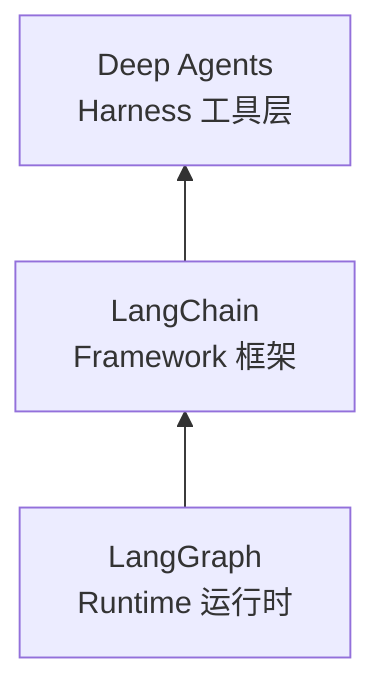

# 从 Agent Framework 到 Agent Harness

## 1. 一个真实的困境

假设要构建一个 AI 编程助手，它需要：读取项目源码、理解结构并制定修改计划、分步执行并追踪进度、把子任务委派给专门的 Agent、在多轮对话里记住用户偏好。

如果从零用 LangChain 搭，会发现自己一直在重复造轮子：手写文件读写工具、手写任务追踪、手写子 Agent 调度——而这些能力，几乎每一个「认真」的 Agent 应用都需要。这就是 Deep Agents 要解决的问题。

## 2. Agent 开发的三个层次



### 2.1 底层：Agent Runtime —— LangGraph

Runtime 解决「Agent 怎么可靠地运行」：

- **持久化执行**：运行到一半崩溃，能从断点恢复；
- **流式输出**：用户实时看到思考与操作过程；
- **人机协作**：关键操作前暂停，等待审批；
- **状态管理**：跨对话保存上下文。

LangGraph 就是这层运行时，提供基于图的执行引擎，支持上述生产级特性——可以理解为 Agent 世界的「操作系统」。同层还有 Temporal、Inngest 等持久化执行引擎。

### 2.2 中间层：Agent Framework —— LangChain

Framework 构建在 Runtime 之上，提供更高层开发体验：模型抽象、工具接口、Agent 循环、Middleware。LangChain 1.0 构建在 LangGraph 之上——利用图执行引擎与状态管理，对外提供更简洁 API；使用时通常不需要直接接触 LangGraph 底层。

```python
from langchain.agents import create_agent

agent = create_agent(
    model="gpt-4.1",
    tools=[web_search, calculator],
    system_prompt="You are a helpful assistant."
)
```

框架层的价值在**标准化**与**易上手**：不用关心执行引擎与状态持久化。同层还有 Vercel AI SDK、CrewAI、OpenAI Agents SDK、Google ADK、LlamaIndex。

### 2.3 上层：Agent Harness —— Deep Agents

Harness 是「开箱即用」的 Agent 套件，在 Runtime 与 Framework 基础上**预置了一整套经过验证的工具接口和中间件框架**。从 v0.7 起，Harness 仍提供这些能力，但不再替所有应用默认打开每一种策略。

打个比方：

- **Runtime** 提供工作台、电源、安全护具（基础设施）；
- **Framework** 提供锤子、锯子、钉子（标准化工具）；
- **Harness** 直接给一个装好工具的工具间，常用工具挂墙上，流程贴白板（开箱即用）。

Deep Agents 利用 LangChain 的核心构建块，运行在 LangGraph 之上，提供：虚拟文件系统（`read_file`/`write_file`/`edit_file`/`delete`/`ls`/`glob`/`grep`）、任务规划（按需启用 `TodoListMiddleware` 获得 `write_todos`）、子 Agent 委派（`task`）、Skills、上下文管理（摘要、大结果卸载）、记忆。同层还有 Claude Agent SDK、Manus。


<p>图 1：Agent 开发三层架构（LangSmith 贯穿提供可观测性）</p>

### 2.4 三层怎么选、怎么组合

| 层次 | 代表 | 核心价值 | 适用场景 |
|---|---|---|---|
| Runtime | LangGraph | 持久化执行、流式、HITL、状态管理 | 需要精细控制的长期运行 Agent 与复杂工作流 |
| Framework | LangChain | 模型抽象、工具接口、Agent 循环、Middleware | 快速上手、标准化 Agent 应用 |
| Harness | Deep Agents | 预置工具、中间件、子 Agent、记忆 | 复杂多步骤任务、自主性较高的 Agent |

三者不是替代关系，而是自底向上层层构建。差别还体现在「哪些工作框架预先做好、哪些决策要自己编码」：

| 需求 | 起点 | 主要负责什么 |
|---|---|---|
| 文件操作、上下文管理、子任务委派，让 Agent 自主完成多步骤任务 | `create_deep_agent()` | 配置业务工具、提示词、后端与要启用的能力 |
| 标准模型—工具循环，自行决定上下文策略与中间件组合 | `create_agent()` | 组合工具与 Middleware，定制每轮行为 |
| 流程含固定步骤、条件分支，需要精确控制执行路径 | `StateGraph` | 定义节点、边与路由，编排确定性步骤与 Agent 调用 |

还没必须自定义的流程，就先从 Deep Agents 开始；需求超出抽象提供的控制范围，再深入 LangChain 或 LangGraph。**三者可以组合**：在 LangGraph 里先用固定代码校验输入，再把研究任务交给 Deep Agent，最后进入人工审核节点；也可以把已有 LangGraph 工作流包装成 `CompiledSubAgent` 交给主 Agent 委派（第 6 篇展开）。

## 3. 为什么需要 Agent Harness

运行时与框架已经提供了构建 Agent 所需的一切，为什么还要 Harness？答案来自一个观察：**成功的 Agent 产品都长得差不多**。

Claude Code、Manus、Cursor 各有特色，但核心能力惊人地相似：

1. 都有文件系统操作能力：读写、搜索、编辑文件；
2. 都有任务规划能力：把大任务拆成小步骤；
3. 都有子任务委派能力：把部分工作交给子 Agent；
4. 都有上下文管理策略：防止对话过长导致模型「失忆」。

这不是巧合。任务足够复杂时，这些能力就是必需的。**Harness 的价值是把这些被验证过的模式固化下来，不需要每次都从头实现。**

## 4. 核心设计理念：Context Engineering

Deep Agents 的技术核心可以概括为 **Context Engineering**（上下文工程）。

### 4.1 传统做法的问题

传统 Agent 把所有信息塞进 prompt：

```text
System: 你是一个编程助手。
User: 请帮我重构 src/ 下的代码。
[附带: 20 个文件的完整内容，共 50000 tokens]
```

三个致命问题：**上下文窗口溢出**（有 token 上限，文件一多装不下）、**注意力稀释**（信息越多，对关键信息关注越低）、**不可扩展**（无法处理任意规模项目）。

### 4.2 Deep Agents 的做法

引入一个**虚拟文件系统**，让 Agent 像人一样工作：

- 需要读文件时调用 `read_file`，按需读取；
- 记录中间结果时调用 `write_file`；
- 需要搜索时用 `grep` / `glob`；
- 大文件只读需要的部分（`offset` / `limit`）。

这样上下文里只保留当前步骤真正需要的信息，其余存在文件系统中，需要时再取。

更巧妙的是，这个文件系统是**虚拟、可插拔**的：可以是内存临时存储（开发调试）、本地磁盘（真实文件）、持久化数据库（跨会话记忆）、远程沙箱（安全执行），甚至混合使用（不同路径路由到不同后端）。

> **Context Engineering 不是把所有信息喂给 LLM，而是为 LLM 构建一套高效获取和管理信息的基础设施。**


<p>图 2：Prompt Stuffing 与虚拟文件系统的对比</p>

## 5. 与竞品对比

| 维度 | Deep Agents | Claude Agent SDK | Codex SDK |
|---|---|---|---|
| 用途 | 通用 Agent（含编程） | 自定义 AI 编程 Agent | 预构建编程 Agent |
| 模型支持 | 模型无关（Anthropic/OpenAI/Google/开源等 100+） | 绑定 Claude | 绑定 OpenAI |
| SDK 语言 | Python + TypeScript | Python + TypeScript | TypeScript |
| 执行环境 | 本地 + 远程沙箱 + 虚拟文件系统 | 本地 | 本地 CLI；托管云端由 Agents API 提供 |
| 开源协议 | MIT | MIT（底层 Claude Code 专有） | Apache-2.0 |

核心工具层面三者非常接近——文件读写、Shell、搜索、规划、子 Agent、MCP、人机协作、Skills 都有覆盖；真正差异在架构：

**Deep Agents 独有**：模型灵活性（不锁定厂商）；**长期记忆**（Memory Store 跨会话、跨线程，另外两家不支持）；虚拟文件系统 + 可插拔后端；沙箱作为执行后端（调度循环与执行环境分离）；通过 LangGraph Platform 部署 + LangSmith 可观测性。

**Claude Agent SDK 独有**：与 Claude 深度集成、Hooks 系统、自定义 HTTP/WebSocket 层与容器化部署。
**Codex SDK 独有**：OS 级沙箱模式（`read-only`/`workspace-write`/`danger-full-access`）、内置 MCP Server 模式。


<p>图 3：三大 Agent Harness 对比</p>

**怎么选**：要模型灵活性与跨会话记忆 → Deep Agents；团队全面用 Claude → Claude Agent SDK；全面用 OpenAI → Codex SDK；需要完整生产部署与可观测性 → Deep Agents + LangSmith。

## 6. 技术全景：能力如何装配

核心关系：**Deep Agents 在 LangChain 的 Agent 循环周围装配 Middleware，最终由 LangGraph 执行。** Middleware 可以提供工具、扩展状态，也可以在模型调用与工具执行等环节介入；它们的 hooks 运行在编译后的执行图中。


<p>图 4：Deep Agents 整体架构</p>

从上到下四步：

1. **应用提供业务配置**：选模型、注册自定义工具、定义系统提示词、配置 Backend/Skills/记忆文件；
2. **`create_deep_agent()` 装配 Harness**：按参数与 profile 组装内置与自定义 Middleware，准备工具与状态定义；
3. **LangChain 构建 Agent 循环**：内部调用 `create_agent()`，把模型、工具、中间件、运行配置交给框架；
4. **LangGraph 执行编译后的图**：返回的 Agent 支持 `invoke()`/`stream()`；配置 Checkpointer 与 Store 后，分别保存线程状态与跨线程数据；LangSmith 观察、调试、评测。

**各项能力由谁负责**（官方把 Harness 能力分为四组）：

| 能力组 | 关键组件与职责 | 对应篇目 |
|---|---|---|
| 执行环境 | `FilesystemMiddleware` 提供文件工具，Backend 决定存哪里；沙箱后端支持 Shell；Interpreter 提供代码编排；自定义工具与 MCP 接入业务系统 | 4、11、13、16 |
| 上下文管理 | 摘要中间件缩短输入并保存可回查历史；大结果卸载到文件；`SkillsMiddleware` 提供技能元数据与读取指引；`MemoryMiddleware` 加载记忆文件；持久化 Backend 保存跨对话信息 | 4、8、9 |
| 任务委派 | `SubAgentMiddleware` 提供 `task`；`TodoListMiddleware` 提供显式计划与进度状态 | 5、6、7、17 |
| 人机控制 | `HumanInTheLoopMiddleware` 在指定工具调用前暂停；文件权限规则限制路径操作，也可触发审批 | 10、12 |

**Tool、Middleware、Backend 各司其职**：Tool 是模型可请求的动作；Middleware 提供能力并控制执行环节；Backend 实现文件操作与存储。模型请求 `read_file`，文件系统中间件提供该工具，工具再通过配置的 Backend 读内容——Backend 本身不是 Agent 循环。

记忆也要分清：`memory=` 指定启动时加载哪些记忆文件，能否跨线程保存取决于存储后端；Checkpointer 保存的是线程执行状态（第 9 篇展开）。

> **v0.7 能力与默认值**：图中展示整体能力与装配关系。标准配置会装配文件系统、子 Agent 与摘要等核心能力；任务规划要显式传 `TodoListMiddleware`；Skills、记忆加载、人工审批要相应配置；`execute` 需要支持执行的沙箱后端；Interpreter 也要单独启用。实际可执行操作还受 Backend 能力、权限与 Harness profile 影响——支持某项能力不代表每个任务都会调用它。默认基础提示词为空，业务提示词由应用定义。

## 7. 本篇验收

- [ ] 能说清 Runtime / Framework / Harness 三层的分工与包含关系；
- [ ] 能按需求判断该从 `create_deep_agent()`、`create_agent()` 还是 `StateGraph` 起步；
- [ ] 能解释 Harness 为什么存在（成功 Agent 的共性能力）；
- [ ] 能说明 Prompt Stuffing 的三个问题与虚拟文件系统的解法；
- [ ] 知道 Deep Agents 相对 Claude/Codex SDK 的独有优势；
- [ ] 能复述「应用配置 → 装配 Middleware → LangChain 循环 → LangGraph 执行」四步；
- [ ] 记住 v0.7 的默认值：Todo 需显式启用、基础提示词默认为空。

> **补记**：这一章真正要建立的是一张「坐标图」——遇到问题时先判断它在哪一层：执行可靠性归 LangGraph，循环与中间件归 LangChain，预置工具与策略归 Deep Agents。另一个容易被忽略的点：**Harness 不是「功能更多的框架」，而是把成功产品的共性模式固化下来**，因此它的默认值会随版本收敛（v0.7 就把 Todo 从默认成本改成按需选择）。

## 写在最后

下一篇[快速上手](3-快速上手)动手写第一个 Deep Agent：安装、接模型、定义工具、跑通研究助手，并理解一次 `invoke()` 背后的模型—工具循环。
