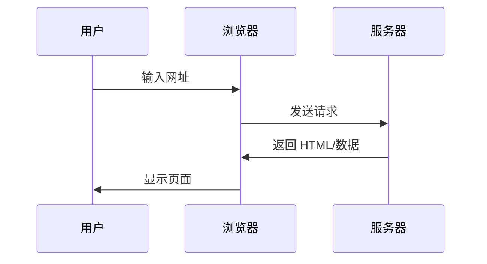

# 环境搭建与代码运行基础

https://raw.githubusercontent.com/swpucwf/MyBolgImage/main/img/vibe_01-environment-setup_index.png

<p>图 1：环境搭建与代码运行基础</p>

## 1. 这一章解决什么问题

想象一台干干净净的新电脑，除了浏览器什么都没有。不会写代码，但心里有一个 App 想法，打算指挥 AI 做一个 Demo。这时遇到的第一个困惑往往是 **AI 输出代码的格式**：有时是一段保存为 `index.html` 就能双击打开的代码；有时是 `.ts`、`.tsx` 后缀，还带着 `import`、`React` 这些词——照着保存，双击却打不开。

原因不在于 AI 写错了，而在于「怎么让它跑起来」需要理解一点运行环境。**环境搭建不是门槛，而是与 AI 协作的第一步**。这一章把这条链路拆成八块：代码格式、技术栈、浏览器与服务器、终端、包管理、模型与工具、创建项目、localhost 与端口。

## 2. 代码格式的四个阶段

网页像三明治，由三层组成：**HTML 结构层**（有什么内容）、**CSS 样式层**（长什么样）、**JavaScript 行为层**（怎么交互）。三者写进一个 `.html` 文件，就是单文件格式，双击就能运行。

这也解释了一个常见现象——为什么保存的网页有的能打开、有的打不开：

| 现象 | 原因 |
|---|---|
| 完全正常 | 单文件格式，所有代码都在一个 HTML 里 |
| 有样式但点不了 | CSS 在本地，JS 从服务器加载，断网失效 |
| 样式全无 | CSS 和 JS 都从服务器加载，本地只有空壳 |
| 完全打不开 | 现代单页应用，需要服务器才能运行 |

现代网站（微博、B 站）用 React/Next.js 开发：代码分离在不同文件，内容通过 JS 动态获取，保存下来的只是一个空 HTML 壳子。

**代码格式的演变**：


| 阶段 | 做法 | 适用场景 | 局限 |
|---|---|---|---|
| 单文件 HTML | 全部写在一个文件 | 简单 Demo、学习概念、快速原型 | 超过 200 行难维护 |
| 文件分离 | HTML + CSS + JS 分开 | 多页面共享样式 | 依赖关系要手动管理，无法用 npm 包 |
| 模块化 | `import`/`export` 组织代码 | 有重复逻辑或多人协作 | 浏览器需要构建工具支持 |
| TypeScript 工程化 | TS + 构建工具 | 复杂逻辑、长期维护项目 | 不能直接运行，必须先编译 |

TypeScript 是 JavaScript 的升级版，增加了类型检查：写代码时就能指出错误，而 JS 要运行后才崩溃。AI 偏爱 TS，因为类型系统减少错误、AI 更擅长生成类型安全的代码、也是现代前端标配。

> TypeScript 代码**不能直接在浏览器运行**，必须经过编译：`.ts/.tsx → 编译器 → .js → 浏览器执行`。开发时 `pnpm dev` 自动编译，上线时 `pnpm build` 打包优化。

**怎么选格式**：能用简单方案就不用复杂方案，但不要在复杂项目上强行用简单方案。让 AI 知道需求，它会选合适格式——「生成一个单文件 HTML 的计数器」得到双击可运行的文件；「生成一个任务管理应用」得到需要 `pnpm dev` 的 TS 项目。

## 3. 技术栈：为 AI 原生开发而选

**技术栈**是开发项目时使用的技术组合。现代 Web 应用分三层：前端（用户看到的界面）、后端（服务器端逻辑）、数据库（存储数据）。本教程用 **Next.js 全栈框架**——前后端在同一个项目里，一个命令全部启动。

| 层级 | 技术选型 | 作用 |
|---|---|---|
| 框架 | Next.js | 前后端一体 |
| 语言 | TypeScript | 类型安全 |
| 样式 | Tailwind CSS | 实用优先的 CSS |
| 组件库 | shadcn/ui | 可复用 UI 组件 |
| 用户认证 | better-auth | 类型安全的认证 |
| 数据库 ORM | Drizzle ORM | 类型安全的数据库操作 |
| 数据库 | PostgreSQL | 关系型数据库 |
| AI 集成 | Vercel AI SDK | 流式 AI 交互 |

常用「轮子」：表单验证 `zod`、表单管理 `react-hook-form`、数据请求 `@tanstack/react-query`、时间处理 `date-fns` 或 `dayjs`、HTTP 客户端 `axios` 或 `ofetch`、图标 `lucide-react`、工具函数 `lodash`。AI 不会从零写代码，而是组合这些现成积木。

**为什么选这套**：

1. **AI 理解成本低**：Next.js 全栈 = 前后端同一个项目，传统方式要两个项目、配跨域、启动两个服务；Next.js 只需一个 `pnpm dev`。项目结构越统一，AI 生成的代码越不容易出错；
2. **部署零成本**：传统租服务器 ¥50-200/月，Vercel/EdgeOne 免费；
3. **npm 生态**：超过 200 万个包，不需要重复造轮子；
4. **PostgreSQL 有免费托管**：Supabase、Neon、Railway，而 MySQL 几乎没有。

什么时候需要全栈？纯静态展示（公司官网）HTML+CSS 足够；当项目需要用户系统（登录、注册、权限）、数据持久化、业务逻辑（支付、通知、邮件）时，才考虑全栈。

**快速识别项目技术栈**：接手新项目时看 `package.json`——`next` 是全栈框架、`react` 是前端库、`typescript` 是类型系统、`drizzle-orm` 是数据库 ORM、`tailwindcss` 是样式、`ai` 是 Vercel AI SDK。知道技术栈就知道项目类型、需要哪些环境、遇到问题该搜什么关键词。

## 4. 浏览器与服务器：代码跑在哪里

- **浏览器**（Chrome、Firefox、Safari）运行在用户电脑上，只能理解 HTML、CSS、JavaScript；
- **服务器**是远程计算机，运行 Web 服务器软件（Nginx、Apache），响应浏览器请求并返回数据；
- **客户端** = 用户设备，**服务端** = 提供服务的一方。



| | 浏览器（客户端） | 服务器（服务端） |
|---|---|---|
| 职责 | 渲染页面、执行交互、请求数据 | 处理业务、查询数据库、返回结果 |
| 存储 | Cookie、LocalStorage | 文件系统、数据库 |
| 能运行 | HTML、CSS、JavaScript | Node.js、Python、Go |
| 不能运行 | TypeScript、后端语言 | 浏览器 API |

**为什么需要 Node.js**：TS 要编译才能在浏览器运行，编译需要一个运行环境——Node.js 在电脑上运行构建工具、编译 TS 为 JS、打包代码、启动开发服务器。涉及 TS 项目、npm 包、构建工具（Vite/Webpack/Next.js）、本地开发服务器时，就必须安装。

| | 开发环境（Localhost） | 生产环境（公网） |
|---|---|---|
| 位置 | 自己的电脑 | 远程服务器 |
| 地址 | `localhost:3000` | `https://example.com` |
| 代码 | 未压缩、带调试信息 | 压缩、混淆 |
| 错误 | 显示详细堆栈 | 只显示必要信息 |
| 更新 | 热重载（自动刷新） | 需要重新部署 |

写代码时要清楚代码在哪里执行：**前端代码**在浏览器运行（用户能看到）、**后端代码**在服务器运行（用户看不到）、**API 路由**是 Next.js 的特殊形态，既能访问服务器资源，又能响应前端请求。

## 5. 终端入门

三个常被混淆的概念：

- **终端（Terminal）**：看到的界面窗口，用来输入命令。Windows 上是 PowerShell/CMD，Mac 上是 Terminal/iTerm2；
- **Shell**：隐藏在终端后的命令解释器，读取输入并执行。常见的是 bash、zsh（Mac 默认）、PowerShell（Windows）；
- **命令行（CLI）**：通过文本指令操作计算机的方式，比图形界面更高效、更精确。

Windows 推荐 **PowerShell**：功能更强、命令更统一（`ls` 也能用）、微软官方推荐的现代终端。

提示符（prompt）不是命令的一部分：Mac/Linux 是 `$`，Windows PowerShell 是 `>`，输入命令时不要把它复制进去。

**基本文件操作**（Mac/Linux/Windows PowerShell 通用）：

```bash
pwd            # 查看当前目录
ls             # 列出文件（Windows CMD 用 dir）
cd folder-name # 切换目录
cd ..          # 返回上一级
cd ~           # 返回用户主目录
mkdir folder   # 创建目录
```

**常用快捷键**：

| 快捷键 | 作用 |
|---|---|
| `Ctrl + C` | 停止当前程序 / 中断当前输入 |
| `Ctrl + L` | 清屏 |
| `↑ / ↓` | 浏览历史命令 |
| `Tab` | 自动补全 |
| `Ctrl + A / Ctrl + E` | 光标移到行首 / 行尾 |

**环境变量与 PATH**：环境变量是操作系统存储的配置信息，`PATH` 告诉系统去哪些目录查找可执行程序。输入 `pnpm` 后，Shell 在 PATH 列出的目录中逐个查找名为 `pnpm` 的文件，找到就执行；全部找不到就显示 `command not found`。

**CLI 命令参数**：短参数一个减号加字母（`-v`、`-h`），长参数两个减号加单词（`--version`、`--help`），效果相同。

**命令报错排查顺序**：① 拼写检查（`pnpm instal` 少个 l、`l s` 多个空格）；② 确认工具已安装（`node -v`、`pnpm -v`）；③ 确认在正确目录（`pwd`、`ls package.json`）；④ 重新加载终端（刚安装或改过 PATH 后，`source ~/.zshrc` 或重开终端）。不确定问题出在哪，就把报错直接发给 AI——不需要记住所有错误，只需要知道排查顺序。

## 6. 包管理与项目配置

**Node.js** 是 JavaScript 运行时环境；**LTS**（长期支持版）比 Current 更稳定；**nvm** 用于在同一台电脑安装和切换多个 Node.js 版本；**pnpm** 是包管理器。

| 特性 | npm | pnpm |
|---|---|---|
| 速度 | 基准 | 快 2-3 倍 |
| 磁盘空间（10 项目） | ~5GB | ~1.5GB |

pnpm 用**硬链接**让所有项目共享同一份依赖文件，而不是每个项目复制一份。

**常用命令**：

| 命令 | 作用 |
|---|---|
| `pnpm init` | 初始化项目 |
| `pnpm install` | 安装所有依赖 |
| `pnpm add xxx` | 安装生产依赖 |
| `pnpm add -D xxx` | 安装开发依赖 |
| `pnpm remove xxx` | 卸载包 |
| `pnpm dev` | 运行脚本（等同 `pnpm run dev`） |

**全局安装 vs 项目安装**：

| | 全局安装 | 项目安装 |
|---|---|---|
| 命令 | `npm install -g xxx` | `pnpm add xxx` |
| 位置 | 系统目录，所有项目可用 | 当前项目 `node_modules` |
| 用途 | CLI 工具（Claude Code、http-server） | 项目依赖（React、lodash） |

**核心配置文件**（都放在项目根目录）：

- `package.json`：项目描述文件，记录依赖和脚本；`dependencies` 是生产依赖，`devDependencies` 是开发依赖；
- `pnpm-lock.yaml`：自动生成的锁文件，记录每个依赖的精确版本，确保所有人安装的版本完全一致；不要手动修改，必须提交到 Git；
- `.nvmrc`（可选）：指定项目推荐的 Node.js 版本，有此文件时 `nvm use` 自动切换。

npm 项目迁移到 pnpm 完全兼容：

```bash
rm -rf node_modules package-lock.json
pnpm install
```

核心理念：**nvm 解决版本冲突，pnpm 提升安装效率**——多项目可用不同 Node 版本、pnpm 复用依赖快速省空间、严格模式避免「幽灵依赖」。

## 7. 模型与工具

**模型**负责理解意图和生成内容，**工具**负责执行具体操作（读文件、跑命令、提交代码），工具需要接入模型才能工作。

| 分类 | 代表产品 |
|---|---|
| 国内模型 | GLM（智谱）、DeepSeek、Kimi、Doubao、MiniMax |
| 国际模型 | GPT（OpenAI）、Gemini（Google）、Claude（Anthropic） |

**对话框 vs 工具流**：对话框只能聊天、要复制代码回来自己粘贴、自己运行命令，适合提问学习；工具流能直接读写项目文件、自动改代码、自动执行命令，适合实际开发。**AI 编程工具 = AI 大脑 + 手脚**。

| 类型 | 代表产品 | 特点 |
|---|---|---|
| CLI 工具 | Claude Code、Codex CLI、Gemini CLI、Aider、OpenCode、Qoder CLI、iFlow CLI | 命令行运行，无图形界面 |
| IDE 工具 | Cursor、Windsurf、Zed、GitHub Copilot、Trae、Qoder、CodeBuddy | 图形界面，可视化操作 |

两者核心能力相同：都能操作项目文件、运行命令、操作 Git。教程推荐 CLI 工具，因为简洁、强大、更适合理解 AI 编程的本质；**最佳实践是在 IDE 里打开终端运行 CLI 工具**——左边浏览文件，底部让 CLI 干活。大部分 AI IDE 基于 VS Code 开发，界面和操作习惯一致，插件通用。

**为什么选 Claude Code + 国内模型**：发布在 npm 仓库无地域限制、可接入 GLM/DeepSeek、工作流强大（文件操作、代码搜索、Git 集成、子代理协作）、成本可控。

| 对比项 | Claude 官方 | GLM 编码套餐 |
|---|---|---|
| 价格 | 约 ¥110/¥540 每 1M Token | 约 API 价格的 0.1 折 |
| 单次调用 | ~¥0.22 | ~¥0.02 |
| 网络环境 | 需要中转 | 国内直连 |

**最低配置**：Claude Code + GLM + 系统自带终端 + 浏览器，就能开始开发。Git GUI（GitHub Desktop、Sourcetree）、数据库工具（DBeaver、Drizzle Studio）、API 测试（Postman、Thunder Client）都按需安装。

## 8. 创建项目

新手最容易犯的错误是拿到 AI 生成的代码后逐个文件手动创建。正确做法是用项目模板，让 AI 通过脚手架创建标准项目。

**文件夹与命名规范**：完整路径中每一级都不能有中文或空格——`C:/Users/张三/projects`（用户名是中文）、`C:/Users/李/my project`（有空格）都是错误示例。规则：小写英文字母、用连字符 `-` 分隔单词、避免中文和特殊字符。中文路径可能导致编码问题、路径解析错误、工具兼容性问题，常见报错 `ENOENT: no such file or directory`、`MODULE_NOT_FOUND`。

**创建项目**：

```bash
# Next.js（my-app 是项目名，可以改）
pnpm create next-app@latest my-app

# Vite + React
pnpm create vite@latest my-app -- --template react
```

创建时的推荐选项：TypeScript → Yes；ESLint → Yes；Tailwind CSS → 按需；src directory → Yes（结构更清晰）；App Router → Yes。

**Next.js 项目结构**：

```
my-next-app/
├── src/
│   ├── app/                 # 页面和 API
│   │   ├── page.tsx         # 首页
│   │   ├── layout.tsx       # 全局布局
│   │   └── api/             # API 接口
│   ├── components/          # UI 组件
│   └── lib/                 # 工具函数
├── public/                  # 静态资源
├── package.json             # 依赖管理
└── tsconfig.json            # TypeScript 配置
```

简单理解：`src/app/` 放页面和接口，`src/components/` 放可复用 UI 组件，`src/lib/` 放工具函数，`public/` 放图片等静态资源。AI 说「创建用户列表页面」，就在 `src/app/` 下建 `users/page.tsx`；说「创建一个按钮组件」，就在 `src/components/` 下建 `Button.tsx`。

**启动**：

```bash
cd my-app
pnpm dev
```

浏览器访问 `http://localhost:3000`，看到欢迎页面即创建成功。

已用中文路径怎么办：删除 `node_modules` → 新建英文文件夹 → 把剩余文件复制过去 → 在新文件夹运行 `pnpm install`。

## 9. Localhost 与端口

**localhost** 是电脑的「内部地址」，用于本地开发测试；`localhost` 自动解析为 `127.0.0.1`，两者等价。`http://localhost:3000` 就是本地运行的第 3000 端口服务。

| | 开发环境 | 生产环境 |
|---|---|---|
| 地址 | `localhost:3000` | `https://example.com` |
| 访问范围 | 只有自己 | 所有人 |
| 用途 | 开发调试 | 正式运营 |

**端口**像房子的门：一个 IP 可以有 65535 个端口，每个端口运行不同服务。IP 是**大楼地址**，端口是**房间号**。

| 端口 | 用途 |
|---|---|
| 3000 | Next.js、Express |
| 5173 | Vite |
| 8000/8080 | 通用备用端口 |
| 80 / 443 | HTTP / HTTPS（生产环境，可省略） |

端口号规则：0-1023 系统端口需管理员权限；1024-49151 注册端口，常见服务使用；49152-65535 动态端口，临时使用。

**启动与停止**：

```bash
cd my-app
pnpm install   # 首次运行，下载依赖
pnpm dev       # 启动开发服务器
```

启动后终端显示 `Local: http://localhost:3000`，`Network: http://192.168.1.100:3000`——Network 地址可让局域网设备（如手机）访问，方便测移动端。按 `Ctrl + C` 停止；关闭终端后页面失效是正常的，下次工作重新运行 `pnpm dev` 即可。

**端口占用**：报错 `EADDRINUSE: address already in use :::3000` 说明端口被占。Next.js 14+ 通常会自动尝试 3001、3002；自动检测失败时把报错发给 AI，或手动指定端口：

```bash
pnpm dev -- -p 3001
```

AI 处理时可能用的命令：Mac/Linux `lsof -ti:3000 | xargs kill -9`；Windows 先 `netstat -ano | findstr :3000` 查 PID，再 `taskkill /PID 12345 /F`。

**生产环境架构**：用户访问 `https://example.com`（80/443 端口）→ Nginx/OpenResty 反向代理 → 应用（3000 端口）。也可以直接 `http://服务器IP:3000`，但会暴露端口、不够美观，推荐用 Nginx 反向代理，用户只记域名。

## 10. 五分钟安装清单

### 10.1 Windows

**① 安装 Git**：下载 [Git for Windows](https://registry.npmmirror.com/-/binary/git-for-windows/v2.52.0.windows.1/Git-2.52.0-64-bit.exe)，双击后一直点「下一步」。

https://raw.githubusercontent.com/swpucwf/MyBolgImage/main/img/vibe_image-20260203180304836.png

<p>图 2：Git 安装界面</p>

**② 安装 Node.js**：下载 [Node v24.13.0](https://npmmirror.com/mirrors/node/v24.13.0/node-v24.13.0-x64.msi)，双击后一直点「下一步」。

https://raw.githubusercontent.com/swpucwf/MyBolgImage/main/img/vibe_image-20260203180429883.png

<p>图 3：Node.js 下载页</p>

**③ 验证安装**：`Win + X` 打开「终端（管理员）」或 PowerShell，执行：

```powershell
git --version
node -v
```

显示版本号即成功；提示「无法识别命令」时，关闭终端重开，仍不行则重启电脑。

https://raw.githubusercontent.com/swpucwf/MyBolgImage/main/img/vibe_image-20260203180527608.png

<p>图 4：验证 Git 与 Node 版本</p>

**④ 配置国内镜像并安装 pnpm**：

```powershell
npm config set registry https://registry.npmmirror.com/; npm install -g pnpm; pnpm setup; pnpm config set registry https://registry.npmmirror.com/
```

https://raw.githubusercontent.com/swpucwf/MyBolgImage/main/img/vibe_image-20260203180609407.png

<p>图 5：配置镜像源与安装 pnpm</p>

若报「无法加载脚本，因为在此系统上禁止运行脚本」，以管理员身份运行 PowerShell，执行 `Set-ExecutionPolicy RemoteSigned -Scope CurrentUser` 后重试。

https://raw.githubusercontent.com/swpucwf/MyBolgImage/main/img/vibe_image-20260203180635579.png

<p>图 6：PowerShell 执行策略设置</p>

**⑤ 安装 Claude Code**：

```powershell
npm install -g @anthropic-ai/claude-code
claude
```

看到欢迎界面即成功。

https://raw.githubusercontent.com/swpucwf/MyBolgImage/main/img/vibe_image-20260203180714506.png

<p>图 7：Claude Code 欢迎界面</p>

若提示「No suitable shell found」，说明 Git 没有正确安装。设置环境变量：`Win + S` 搜索「环境变量」→ 编辑系统环境变量 → 环境变量 → 系统变量中新建，变量名 `CLAUDE_CODE_GIT_BASH_PATH`，变量值 `C:\Program Files\Git\bin\bash.exe` → 确定保存 → 重启 PowerShell。仍无效则卸载 Git 重装。

https://raw.githubusercontent.com/swpucwf/MyBolgImage/main/img/vibe_image-20260203180856348.png

<p>图 8：搜索环境变量设置</p>

https://raw.githubusercontent.com/swpucwf/MyBolgImage/main/img/vibe_image-20260203180925214.png

<p>图 9：环境变量对话框</p>

https://raw.githubusercontent.com/swpucwf/MyBolgImage/main/img/vibe_image-20260203181030343.png

<p>图 10：新增 CLAUDE_CODE_GIT_BASH_PATH</p>

### 10.2 Mac / Linux

**① 安装 Git**：macOS 首次在终端输入 `git` 会提示安装 Xcode 命令行工具；或 `xcode-select --install`；最新版可 `brew install git`。Linux：`sudo apt update && sudo apt install git -y`（Ubuntu/Debian）或 `sudo yum install git -y`（CentOS/RHEL）。

**② 打开终端**：Mac `Cmd + Space` 输入 Terminal；Linux `Ctrl + Alt + T`。

**③ 执行初始化脚本**（自动安装 nvm、Node.js、pnpm 并配置国内镜像）：

```bash
# macOS
curl -fsSL https://cnb.cool/vibevibe/scripts/-/git/raw/main/init-node-mac.sh | sed 's/\r$//' | sh && npm install -g pnpm && pnpm config set registry https://registry.npmmirror.com/ && pnpm setup

# Linux
curl -fsSL https://cnb.cool/vibevibe/scripts/-/git/raw/main/init-node-linux.sh | sed 's/\r$//' | sh
```

执行完成后重新打开终端（或 `source ~/.bashrc` / `source ~/.zshrc`）使配置生效。

**④ 验证并安装 Claude Code**：

```bash
git --version
node -v
npm install -g @anthropic-ai/claude-code
claude
```

### 10.3 配置 GLM 模型

**① 获取 API Key**：访问[智谱开放平台](https://open.bigmodel.cn/)注册登录，在个人中心 [API Keys](https://bigmodel.cn/usercenter/proj-mgmt/apikeys) 创建新 Key。

https://raw.githubusercontent.com/swpucwf/MyBolgImage/main/img/vibe_image-20260203181347764.png

<p>图 11：智谱开放平台 API Keys 入口</p>

https://raw.githubusercontent.com/swpucwf/MyBolgImage/main/img/vibe_image-20260203181406471.png

<p>图 12：创建 API Key</p>

**② 一键自动配置**：

```bash
npx @z_ai/coding-helper
```

输入 API Key，工具自动完成所有配置。

https://raw.githubusercontent.com/swpucwf/MyBolgImage/main/img/vibe_1764741445765coding-tool-helper.gifattname%3Dcoding-tool-helper.gif

<p>图 13：coding-helper 自动配置过程</p>

**③ 验证**：再次执行 `claude`，此时会使用 GLM 模型回答。

需要频繁切换模型供应商（GLM、DeepSeek、OpenAI）时，可以用 [cc-switch](https://github.com/farion1231/cc-switch) 一键切换 API 配置、统一管理 MCP 与 Skills。

https://raw.githubusercontent.com/swpucwf/MyBolgImage/main/img/vibe_main-zh.png

<p>图 14：cc-switch 主界面</p>

### 10.4 关于 nvm（可选）

Mac/Linux 的初始化脚本已自动安装 nvm。Windows 想管理多版本可安装 [nvm-windows](https://nvm.uihtm.com/nvm-1.2.2-setup.zip)：

https://raw.githubusercontent.com/swpucwf/MyBolgImage/main/img/vibe_image-20260203181915052.png

<p>图 15：nvm-windows 下载</p>

```powershell
nvm node_mirror https://npmmirror.com/mirrors/node/
nvm npm_mirror https://npmmirror.com/mirrors/npm/

nvm install 24.13.0  # 安装指定版本
nvm use 24.13.0      # 使用指定版本
nvm list             # 查看已安装版本
```

单独安装过 Node.js 也可以再装 nvm：nvm 管理独立的 Node 版本，不影响原有安装。

## 11. 本篇验收

- [ ] 能说清 `.html` 与 `.ts` 文件为什么一个双击能开、一个必须编译；
- [ ] 知道技术栈分层，能通过 `package.json` 判断项目类型；
- [ ] 能区分浏览器与服务器的职责，知道 Node.js 为什么必须装；
- [ ] 掌握终端基本操作与 `command not found` 的排查顺序；
- [ ] 会用 nvm 与 pnpm，知道 `pnpm-lock.yaml` 为什么必须提交；
- [ ] 完成 Git、Node、pnpm、Claude Code 安装并配好模型；
- [ ] 能在英文路径下用脚手架创建项目，并在 `localhost:3000` 打开。

> **补记**：这一章信息密度很高，但可以压缩成一条主线——**AI 输出的是源码，源码需要运行环境，环境由「运行时（Node）+ 包管理（pnpm）+ 终端 + 编辑器/CLI」构成**。安装步骤会随版本变化，真正可迁移的是三类认知：代码格式决定运行方式、代码运行位置决定能力边界、报错排查永远按「拼写 → 安装 → 目录 → PATH」的顺序收窄。

## 写在最后

环境就绪，接下来是更关键的一层：[AI 调优指南](2-AI调优指南)——把 Claude Code 配置成顺手的工作流，理解 AI 经济学、规则、Skills 与 MCP，以及一套可复用的调试方法。
