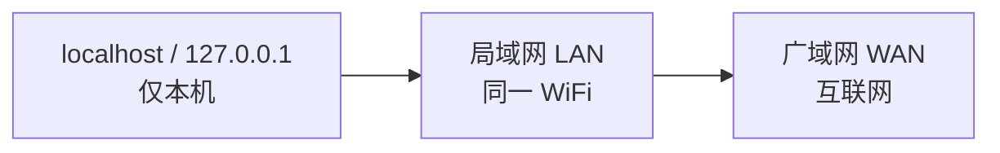
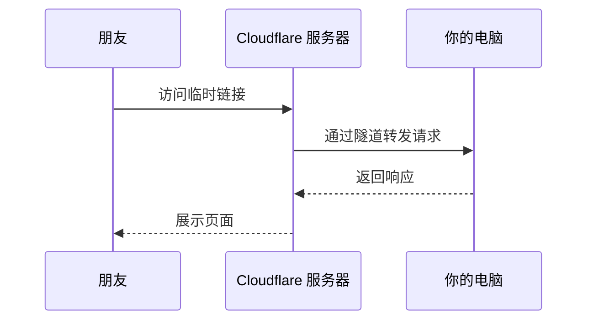

# 本地服务公网访问：从 localhost 到临时链接

https://raw.githubusercontent.com/swpucwf/MyBolgImage/main/img/vibe_mll05kjk-61c547a6df466500.jpg

<p>图 1：Localhost 与公网访问</p>

## 1. localhost 只有自己能打开

测试全绿后，小明把 `http://localhost:3000` 复制给朋友，一分钟后收到一个问号：「打不开啊？」他盯着屏幕困惑：明明在我电脑上好好的。

`localhost` 不是「我的电脑的地址」，而是「发出请求的设备自己」。小明在自己浏览器输入 `localhost:3000`，访问的是小明的电脑，上面跑着 Next.js，页面正常；朋友输入同一个地址，访问的是朋友的电脑，上面什么都没跑，所以拒绝连接。在手机浏览器输入 `localhost`，访问的也是手机自己。

技术上 localhost 对应 `127.0.0.1`，叫**回环地址**：数据包从本机发出又回到本机，从不经过网线或 WiFi。这正是不需要担心半成品暴露的原因——开发框架默认绑定 localhost，外部设备根本碰不到。

## 2. 网络三层



### 2.1 局域网：同一 WiFi 下互通

想在手机上测触摸手势和响应式布局，不必每次都部署。手机和电脑连同一个 WiFi，就在同一个**局域网**里，可以直接互访——像同一间办公室的人可以直接喊话；不同 WiFi 就像不同城市，喊话听不到。

找到电脑的局域网 IP（通常是 `192.168.x.x` 或 `10.x.x.x`）：

```bash
ipconfig        # Windows
ifconfig        # macOS
ip addr         # Linux
```

然后手机访问 `http://192.168.x.x:3000`（换成实际 IP）。注意不要用 `127.0.0.1`。

某些框架默认只监听 `127.0.0.1`，不接受局域网请求，可以指定监听所有网卡：

```bash
pnpm dev --hostname 0.0.0.0   # Next.js
pnpm dev --host               # Vite
```

`0.0.0.0` 的意思是「接受来自任何网络接口的请求」。

### 2.2 防火墙：手机还是打不开

90% 的情况是防火墙拦截。它像手机的「勿扰模式」——不是没有来电，是主动屏蔽了。`pnpm dev` 在 3000 端口监听，但防火墙可能不允许外部设备访问这个端口。

排查顺序：

1. 确认手机和电脑在同一个 WiFi（最常见的遗漏）；
2. 确认开发服务器监听 `0.0.0.0`；
3. 检查防火墙设置（最后的拦路虎）。

Windows 放行示例：

```powershell
New-NetFirewallRule -DisplayName "Node.js Dev Server" -Direction Inbound -Protocol TCP -LocalPort 3000 -Action Allow
```

macOS 在「系统设置 → 网络 → 防火墙 → 选项」中允许 Node.js 接受传入连接。

> 调试完成后建议关闭这条防火墙规则——开发端口长期暴露在局域网不是好习惯。

### 2.3 广域网：不同 WiFi 就到不了

局域网 IP 只在自己的路由器内部有效，朋友的网络里根本找不到这个地址。要让不同网络的人访问，需要一个**公网 IP**；但普通家庭宽带通常没有独立公网 IP，运营商用 **NAT** 让很多用户共享同一个公网 IP。

打个比方：公网 IP 像公寓楼门牌号，外卖员只能送到楼下大门（运营商的公网 IP），不能直接送到家门口（你的设备）。可以对比验证：浏览器搜「我的 IP」看到的公网 IP，和 `ipconfig` 查到的局域网 IP 完全不同。

## 3. 三条路：从「自己看」到「别人看」

| 方式 | 适用场景 | 条件 | 局限 |
|---|---|---|---|
| 局域网直连 | 自己手机测试、旁边朋友看一眼 | 同一 WiFi | 离开 WiFi 就访问不了 |
| 内网穿透 | 远方朋友临时看效果 | 本机开着 + 隧道工具 | 链接每次变、速度不稳 |
| 正式部署 | 任何人随时访问 | Git + 部署平台 | 需要完整流程（后续章节） |

## 4. 内网穿透：临时让朋友看看

朋友在另一个城市，局域网不通；正式部署又需要 Git、平台配置、域名。内网穿透就是中间方案：不用部署、不用域名，一行命令生成公网链接。

### 4.1 隧道怎么工作



朋友访问的是公网服务器上的临时地址，公网服务器把请求转发到你的电脑，再把响应传回。整个过程朋友不需要知道你的 IP，你也不需要有公网 IP。

生活类比：微信视频通话，你和朋友不在同一个网络，微信服务器帮你们中转音视频——内网穿透类似，只是中转网页请求。关键区别是**隧道由你主动建立**：电脑向公网服务器发起连接（出站），而不是公网服务器来找你（入站）。出站连接不受 NAT 和防火墙限制，所以能绕过「家庭宽带没有公网 IP」。

### 4.2 Cloudflare Tunnel（推荐）

免费、不需要注册、不限流量。

```bash
# Windows
winget install cloudflare.cloudflared
# macOS
brew install cloudflared
# Linux (Debian/Ubuntu)
curl -L https://github.com/cloudflare/cloudflared/releases/latest/download/cloudflared-linux-amd64.deb -o cloudflared.deb
sudo dpkg -i cloudflared.deb
```

确保项目在本地运行（如 3000 端口），另开一个终端：

```bash
cloudflared tunnel --url http://localhost:3000
```

终端会输出一个临时链接：

```text
https://random-words-here.trycloudflare.com
```

发给朋友即可。免费模式下每次启动生成新的随机链接，`Ctrl+C` 关闭后立即失效——临时方案就该有临时的样子。

也可以直接让 AI 一步到位：「帮我用 Cloudflare Tunnel 把本地 3000 端口暴露到公网，生成临时链接发给朋友。」

**常见问题**：

- 链接生成了但打不开 → 确认本地开发服务器确实在运行（cloudflared 只负责转发）；
- 终端连接错误 → 检查端口号（Vite 默认 5173，命令要改成 `--url http://localhost:5173`）；
- 速度慢 → 正常，请求要绕道 Cloudflare 服务器；国内速度不可接受可以换 cpolar。

### 4.3 备选方案

| 工具 | 需要注册 | 国内速度 | 特色 |
|---|---|---|---|
| Cloudflare Tunnel | 否 | 一般 | 最简单，免费无限制 |
| ngrok | 是 | 一般 | 自带 Web 调试面板（`localhost:4040`），免费版有连接数限制和警告页 |
| cpolar | 是 | 快 | 国内优化 |

三者核心操作几乎一样：安装 → 一行命令启动 → 拿到链接 → 发给朋友。没有特殊需求就用 Cloudflare Tunnel；需要调试面板用 ngrok；国内速度是瓶颈用 cpolar。

### 4.4 安全注意事项

隧道打开的那一刻，电脑就暂时暴露在公网上。虽然是临时的，但有几条必须注意：

- **用完立即关闭**：`Ctrl+C` 关掉进程，隧道即断；不要开着过夜或出门；
- **只暴露 Web 应用端口**：数据库端口（5432/3306）、管理后台、调试工具绝对不能通过隧道暴露；
- **确保认证已启用**：不要因为「只是给朋友看看」就临时关掉登录——链接是公开的，任何拿到链接的人都能访问；
- **不要通过隧道传输敏感数据**：适合演示 UI 和功能，不适合处理真实用户数据或密码。

> **一句话原则**：隧道是临时凿在墙上的洞，朋友看完了，立刻把洞补上。

**安全检查清单**：

- [ ] 登录功能已启用；
- [ ] 确认 `.env` 里的密钥不会被前端读取；
- [ ] 隧道只指向 Web 应用端口；
- [ ] 演示完成后立即关闭。

## 5. 从临时到正式

朋友终于看到了评分功能：「挺酷的！」但小明很快发现问题：每次重启链接就变、电脑必须一直开着、朋友说有时加载很慢、想让更多人看到却不可能给每个人发链接。

这些不是 bug，而是内网穿透的天然局限——电脑不是服务器，家庭网络不是数据中心。要让产品稳定地被所有人访问，需要**正式部署**：把代码放到专业服务器，24 小时运行、稳定地址、足够带宽。

但在部署之前还有一个前提：代码管理。代码现在只存在于自己电脑上，部署平台怎么拿到它？答案是 **Git**。路线图很清楚：

1. **Git**：把代码推到 GitHub，让部署平台能拉取；
2. **部署**：部署到 Vercel 等平台，获得稳定公网地址；
3. **域名与 HTTPS**：配置自定义域名，启用加密连接。

每一步都建立在前一步基础上。

## 6. 本篇验收

- [ ] 能解释 localhost 为什么别人打不开；
- [ ] 会查局域网 IP，并让手机访问电脑上的项目；
- [ ] 知道「手机打不开」的三步排查顺序；
- [ ] 能说清为什么家庭宽带需要内网穿透；
- [ ] 会用 Cloudflare Tunnel 生成临时链接并控制风险；
- [ ] 知道内网穿透只是临时方案，正式访问要靠部署。

> **补记**：这一章把「让别人看到」拆成三层可达范围——localhost 最安全、局域网次之、广域网最开放。三条路的选择标准不是技术高级程度，而是**访问范围与持续时间**：自己测试用局域网，临时演示用隧道，长期公开才上部署。隧道是临时洞，用完必须补。

## 写在最后

下一篇[Git 协作](11-Git协作)补齐部署的前提：为什么用 Git、远程仓库与协作、分支与工作流——让代码能被部署平台稳定拉取。
