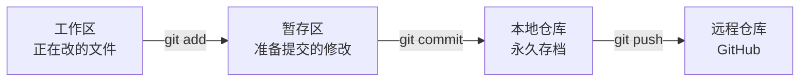
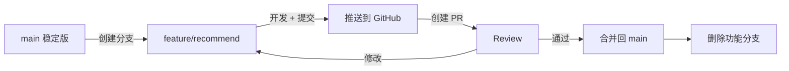

# Git 协作：版本控制与多人开发

https://raw.githubusercontent.com/swpucwf/MyBolgImage/main/img/vibe_mll07nf0-b9713c4841e17ce9.jpg

<p>图 1：Git 版本控制与协作开发</p>

## 1. 压缩包协作的困境

小明用内网穿透给朋友看了评分功能，朋友说：「挺酷的，我帮你做个猜你喜欢吧。」小明很高兴，把项目压缩成 zip 发过去。朋友改了几个文件又压回来——结果 `recommend.ts` 两个版本内容不一样，`package.json` 双方都改过。两个人对着微信逐行核对：「你第 47 行是什么？」「我这边没有第 47 行，我删了一段……」

其实项目里可能早就有 `.git` 目录——Claude Code 创建项目时通常会自动 `git init`，并在开发中提交代码。也就是说一直在用 Git，只是没意识到，用的只是「本地存档与回滚」这一半能力；缺的另一半是：**把代码推到云端，让别人也能拿到，还能同时改而不打架。**

## 2. Git 解决什么问题

### 2.1 「最终版」困境

写论文时桌面上会出现：`毕业论文.docx`、`毕业论文-修改版.docx`、`毕业论文-最终版.docx`、`最终版2`、`打死不改版`、`导师又让改了`。用文件名标记版本能用，但问题明显：哪个才是最新的？文件名骗人；想回到三天前？可能已被覆盖；两个版本差了什么？只能肉眼对比；多人同时改？彻底乱套。

代码比文档更麻烦：一个 Web 项目几百个文件，改一个功能可能联动十几个文件；文件之间有依赖，不能只回滚一个文件，必须把所有相关文件一起回到同一时间点，否则程序跑不起来。

Git 的核心：**用一种可靠的方式记录每一次修改，随时能回到任何历史版本**。它记录的不是「某个文件的某个版本」，而是「整个项目在某个时间点的完整快照」——所有文件一起保存、一起回滚，不会出现「A 回到昨天、B 还是今天」的错位。

### 2.2 commit：给代码存档

每次 commit 像游戏手动存档：记录当前所有文件状态，附带描述和时间戳。存档是 commit，读档是回滚，存档列表是 `git log`。

和游戏存档不同的是，Git 的存档是**增量**的，只记录变化部分，`.git` 通常只有几十 MB，所以可以放心频繁提交。

什么时候提交？简单标准：**每完成一件「可以用一句话描述」的事，就提交一次**——「添加评分组件」「修复搜索为空」「调整首页布局」。不要攒一天一次性提交，否则回滚粒度太粗，像打游戏一关只存一次档。

### 2.3 三区模型：我的修改在哪



- **工作区**是书桌：文件摊开正在改；
- **暂存区**是整理好的一摞纸：「这些是我要交的」；
- **本地仓库**是档案柜：交上去的永久保存。

日常开发中 AI 会代劳，但遇到「修改去哪了」「为什么提交里没这个文件」时，三区模型能定位：改了但 `git status` 显示未暂存 → 还在工作区；add 了没 commit → 在暂存区；commit 了没 push → 在本地仓库，还没同步云端。

### 2.4 回滚：无限的 Ctrl+Z

Ctrl+Z 有关掉文件就失效的限制；Git 只要提交过，就能回到一个月前的状态。

| 场景 | 做法 | 注意 |
|---|---|---|
| 改了半天方向错了、还没提交 | 丢弃工作区修改，恢复到上次提交 | 无风险，丢的只是草稿 |
| 已提交、想回上一个版本 | `git reset` 移回指针 | 会改写历史；未推送时最干净，但那次提交真没了 |
| 已推送到远程 | `git revert` 新建一个反向提交 | 不删历史，协作者 pull 不受影响 |

> 很多人在代码改坏后硬着头皮继续修，越修越乱。知道 Git 随时能回去，就敢大胆尝试——改坏了回滚，没什么大不了。

### 2.5 查看历史与提交信息

AI 频繁改文件时，「它刚才到底改了什么」看 diff 最快——绿色新增、红色删除，像 Word 的修订模式。养成「改完看 diff」的习惯，既能理解 AI 做了什么，也能及时发现不符合预期的修改。

查看历史还能回答「为什么这么写」：代码本身只告诉你「是什么」，提交历史告诉你「为什么」——也许三次提交前这段代码更简单，后来为了修空指针才变成现在这样。

提交信息格式：类型前缀 + 简短描述。

| 前缀 | 含义 | 示例 |
|---|---|---|
| `feat` | 新功能 | `feat: 添加电影评分功能` |
| `fix` | 修 bug | `fix: 修复搜索结果为空的问题` |
| `docs` | 文档 | `docs: 更新 API 接口文档` |
| `refactor` | 重构 | `refactor: 重构用户认证模块` |
| `style` / `chore` | 样式 / 杂务 | `chore: 升级依赖` |

这不是死规矩，而是让历史**可扫描**——几十条记录里能快速定位「加评分功能那次」。

## 3. 推上云端，开始协作

### 3.1 单点故障

代码只在自己电脑上：硬盘坏了、电脑丢了、系统重装，代码全没。这叫**单点故障**——整个系统依赖一个节点，节点挂了就归零。就像照片要同步云相册，代码的「云相册」是代码托管平台：GitHub（国际主流）、Gitee（国内访问快）、CNB。

远程仓库还解决协作：朋友拿不到代码、改了要压缩发回的问题，变成「各自开发、通过 GitHub 同步」。

### 3.2 SSH 认证：配一次，永久免密

GitHub 已禁用密码登录终端，改用 **SSH 密钥**：公钥是锁芯，放在 GitHub；私钥是钥匙，留在电脑。推送时 GitHub 用公钥验证私钥，确认身份后放行，全程自动，像指纹解锁手机。

配置是一次性的：让 AI 生成密钥 → 复制公钥到 GitHub 的 Settings → SSH and GPG keys → 测试连接。之后 push/pull 不再输入凭证。

公司网络限制 SSH 端口时，可以退而用 HTTPS + Personal Access Token（Token 是平台发的临时通行证），但 Token 会过期、需要保存；SSH 更适合作长期方案。

### 3.3 第一次推送与日常同步

```bash
git remote add origin git@github.com:xiaoming/personal-douban.git
git push -u origin main
```

`origin` 是远程仓库的昵称（像通讯录里存联系人），`-u` 把它设为默认，以后直接 `git push` 即可。命令不用背，AI 会处理，但知道它们在做什么，看终端输出就不会一头雾水。

日常节奏：

- **push**：我改好了，传上去；
- **pull**：别人改好了，拉下来。

Git 不要求实时同步，设计哲学是让人在本地自由开发、需要时再同步。建议每完成一个阶段性工作就 push——不必每次 commit 都 push，但别攒太久，没 push 的提交在电脑出问题时也会丢。

### 3.4 clone：朋友第一次获取代码

clone 和「下载 zip」的区别：zip 只给当前文件，clone 给**整个项目加全部提交历史**，目录自带 `.git`，可以直接 push/pull。这就是压缩包协作不靠谱的原因——没有历史、没有分支、没有远程关联，只是一堆孤立文件。

clone 后需要自己安装依赖（`pnpm install`）——这也是 `node_modules` 不提交的原因：体积巨大，且不同系统编译出的二进制不同。`package.json` 是菜谱，`node_modules` 是食材，分享菜谱就够了。

默认只有仓库创建者能 push，需要在 Settings → Collaborators 邀请朋友。

https://raw.githubusercontent.com/swpucwf/MyBolgImage/main/img/vibe_image-20260227003017220.png

<p>图 2：GitHub 仓库页面</p>

### 3.5 冲突：两个人改了同一行

大部分时候 Git 会自动合并：改不同文件直接合；同一文件不同位置也能自动处理。只有同一文件同一行才「举手投降」。

例如小明把满分从 5 改成 10，朋友改成 100。小明先 push 成功，朋友 push 被拒绝——「远程有更新，先 pull」。pull 后文件里出现：

```text
<<<<<<< HEAD
const MAX_SCORE = 100  // 朋友的修改（当前分支）
=======
const MAX_SCORE = 10   // 小明的修改（远程分支）
>>>>>>> origin/main
```

`<<<<<<< HEAD` 到 `=======` 是本地版本，`=======` 到 `>>>>>>> origin/main` 是远程版本。决定保留哪个（或都保留、或写新版本），删掉标记，提交推送即可。也可以直接告诉 AI「帮我解决冲突」，说明想保留哪边逻辑。

冲突在团队里并不常见，减少冲突最有效的方式是**分工明确**——你负责前端、朋友负责后端，各改各的文件。

### 3.6 `.gitignore` 与安全底线

第一次 push 把 `node_modules` 推上去，仓库 500MB、其中 490MB 是依赖——这就是没有清理清单。`.gitignore` 是「打包前的清理清单」：

```gitignore
node_modules/
.env
.env.local
.DS_Store
Thumbs.db
dist/
.next/
build/
```

> 已经被 Git 跟踪的文件，后加 `.gitignore` 不生效。需要 `git rm --cached` 先从仓库移除（保留本地文件），再提交。

**绝对不能提交**：API 密钥与 Access Token、数据库连接串、私钥文件（`.pem`、`.key`、`id_rsa`）、环境变量文件。一旦进入 Git 历史，删文件没用——历史里还在；GitHub 上有专门爬虫扫描公开仓库的密钥。

已经提交了怎么办：① 从 Git 历史彻底清除（`git filter-branch` 或 BFG）；② **立即轮换所有泄露的密钥**——这一步不能省，因为无法确定清除前是否已被看到。

## 4. 分支、PR 与团队工作流

### 4.1 分支：Git 版的「复制文件夹」

想试新功能又怕搞坏现有代码，第一反应是复制整个项目文件夹。思路对，方式太原始——Git 的分支更优雅：不会真的复制所有文件，只记录差异，几乎不占额外空间；可以随时切换，改好后精确合并回去。

项目默认有主分支 `main`（旧仓库可能叫 `master`），代表「当前稳定可用的版本」。开发新功能时从 `main` 开分支 `feature/recommend`，随便折腾：改坏了切回 `main` 一切如初，改好了合并回去。`main` 是正式版，功能分支是草稿本。

命名约定：`feature/xxx`（新功能）、`fix/xxx`（修 bug）、`refactor/xxx`（重构）——一眼看出分支在做什么。

### 4.2 GitHub Flow：最短的协作套路



小明从 `main` 建分支，和 AI 一起写推荐逻辑、加 API、调页面，每完成一个小步骤提交一次。朋友在另一个分支 `feature/user-profile` 开发个人主页，两人互不干扰——这就是分支的核心价值：**隔离**。

开发到阶段推送到 GitHub：云端有备份，朋友也能看到进展。

### 4.3 Pull Request：帮我看看再合并

为什么不直接合并？PR 就是「我改好了，你帮我看看再合并」，这个「看看」叫 **Code Review**。两个人也需要——不是因为流程正式，而是另一双眼睛真的能发现自己的盲区：你写了三天，脑子里全是实现细节，朋友一看就发现漏了一个边界情况。

PR 还有三个价值：**知识共享**（Review 时读了代码，谁都能维护）、**可追溯**（三个月后翻讨论就知道当时为什么这么写）、**暂停回顾**（diff 视图从全局审视几天的修改）。

https://raw.githubusercontent.com/swpucwf/MyBolgImage/main/img/vibe_image-20260227003046255.png

<p>图 3：合并 PR 后的分支状态</p>

流程：创建 PR（填标题与描述）→ 朋友看 Files changed（绿色新增、红色删除）→ 行内评论 → 修改再推送（PR 自动更新）→ Review 通过 → Merge pull request → 删除分支。

https://raw.githubusercontent.com/swpucwf/MyBolgImage/main/img/vibe_image-20260227003217565.png

<p>图 4：PR 的创建页面</p>

https://raw.githubusercontent.com/swpucwf/MyBolgImage/main/img/vibe_image-20260227003224983.png

<p>图 5：PR 的 Files changed 视图</p>

个人项目也有价值：合并前有「暂停、回顾」的机会，diff 视图帮你从全局审视。发起 PR 前还可以让 AI 先做一轮 Self-Review（逻辑错误、安全隐患、性能问题）。

如果配置了 CI/CD，PR 页面会显示测试与构建结果，不通过时 Merge 按钮变灰——自动化的质量门。

### 4.4 个人项目也需要分支吗

小项目直接 `main` 上开发完全没问题。但当项目变复杂——同时试两个方案、或在不影响线上版本的前提下做大重构——分支就有用了。

具体场景：项目已上线、用户正在使用，新功能要改好几天。直接在 `main` 改，半成品可能被部署上线；在分支开发，`main` 始终稳定可部署，新功能测试通过再合并。

折中做法：日常小修直接在 `main`，大功能或实验性改动开分支。Git 工作流是渐进式的——先养成频繁提交和及时推送的习惯，再引入分支与 PR。

### 4.5 跨平台协作

Windows 与 Mac 协作的经典坑：

| 坑 | 表现 | 解决 |
|---|---|---|
| 换行符（CRLF vs LF） | 只改一行，diff 显示整个文件都变了（假 diff） | `.gitattributes` 写 `* text=auto eol=lf` |
| 文件名大小写 | Windows 不区分，Mac 报「找不到文件」 | 约定统一小写或统一 PascalCase |
| 路径分隔符 | `.\components\Button` 只在 Windows 能跑 | 代码里永远用正斜杠 `/` |

这些不用一一记住，重要的是意识到它们存在——遇到「代码一样但跑不起来」，第一反应是跨平台兼容性，然后让 AI 排查。项目初期就配好 `.gitattributes` 和命名规范，能省很多麻烦。

## 5. 日常开发节奏

```
pull 最新代码 → 创建功能分支 → 小步开发、频繁 commit
→ push（备份 + 共享进展）→ 创建 PR → Review → 合并 → 删除分支
```

这套节奏不是死规矩，个人项目可以简化。但它能避免大部分「代码打架」的问题，用几次就会变成肌肉记忆——像开车，刚学时手忙脚乱，熟了之后动作都是自动的。

| 想做什么 | 告诉 AI |
|---|---|
| 开始新功能 | 从 main 创建分支开发 xxx 功能 |
| 保存进度 | 提交当前修改 |
| 同步云端 | 推送到 GitHub |
| 获取最新代码 | 拉取 main 分支最新代码 |
| 创建 PR | 在 GitHub 上创建 Pull Request |
| 解决冲突 | 帮我解决 Git 冲突 |
| 撤销修改 | 撤销对 xxx 文件的修改 |
| 回退版本 | 回到上一个能跑的版本 |

## 6. 本篇验收

- [ ] 能说清 Git 与「文件名标版本」的差别；
- [ ] 理解 commit、三区模型与 commit → push 的关系；
- [ ] 会区分「丢弃修改 / reset / revert」三种回滚；
- [ ] 能配好 SSH 并完成第一次 push；
- [ ] 理解 clone 与下载 zip 的区别；
- [ ] 能读懂并解决一次冲突；
- [ ] 知道 `.gitignore` 与「已跟踪文件」的坑；
- [ ] 能按 GitHub Flow 走「分支 → PR → Review → 合并」。

> **补记**：这一章真正的重点不是背命令，而是三个习惯：**每完成一件可描述的事就提交**、**完成阶段性工作就 push**、**改之前开分支、合之前做 Review**。Git 的价值在「敢改」——知道随时能回滚，才敢大胆尝试；而 `.gitignore` 与密钥红线，是这套自由的前提。

## 写在最后

下一篇[Serverless 部署与 CI/CD](12-Serverless部署与CI-CD)把 GitHub 上的代码变成公网可访问的站点：EdgeOne/Vercel 部署、自动化流水线与运维成本。
