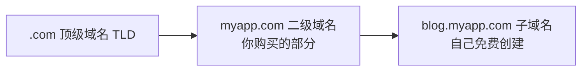

# 域名与 DNS：给站点一个正式地址

https://raw.githubusercontent.com/swpucwf/MyBolgImage/main/img/vibe_mll08c63-bcea35d79958ea70.jpg

<p>图 1：域名、DNS 与网络接入</p>

## 1. 403 的那扇门

应用部署成功，小明把 EdgeOne Pages 的默认链接发到群里，三分钟后朋友截图回复：**403 Forbidden**。他自己反复刷新一切正常，朋友那边就是打不开。

403 的意思就是「门关着，你没钥匙」——国内平台的默认链接有访问限制，只有项目所有者能看。想让别人也能访问，得绑一个属于自己的域名。

**域名就是互联网的通讯录**：在通讯录里搜「妈妈」，手机帮你拨号；浏览器输入 `myapp.com`，DNS 帮你找到服务器。默认链接是平台的临时号码，别人查不到；域名是正式号码，写进通讯录里。

网上有免费二级域名（`你的名字.别人的域名.com`），但那是**借别人家的门牌号**，房东随时能把你踢走。做产品，域名就是门面，花几十块买个正经的 `.com` 值得。

## 2. 域名结构与购买



购买的是 `myapp.com`（二级域名 + 顶级域名），子域名可以无限创建：`blog.`、`api.`、`admin.`，不需要额外花钱。

**注册商选择**：

| 注册商 | 优势 |
|---|---|
| Cloudflare | 成本价续费、免费 DNS 与 CDN |
| 阿里云（万网） | 国内最大、支持 .cn |
| 腾讯云（DNSPod） | 腾讯生态、解析快 |
| Namecheap | 便宜、隐私保护免费 |

**怎么选名字**：越短越好记，别人听到能打出来，`.com` 最通用。`.com` 被注册可以选 `.dev`、`.app`、`.io`，但注意续费价格——有些域名首年 ¥1、续费 ¥300，买之前看清楚。

**购买流程**（以腾讯云为例）：注册账号 → 进入域名注册 → 搜索 → 选年限（建议先买 1 年）→ 支付。

https://raw.githubusercontent.com/swpucwf/MyBolgImage/main/img/vibe_image-20260302021706102.png

<p>图 2：域名注册页面</p>

> 需要 `.cn` 或计划备案，推荐国内平台注册：搜索 → 加入购物车 → 实名认证 → 支付。

## 3. DNS 解析：告诉互联网域名指向哪

DNS 就像手机通讯录：你搜「妈妈」，手机帮你拨 138xxxx；浏览器搜 `myapp.com`，DNS 帮你找到服务器地址。没有 DNS，就得记住每个网站 IP，像没有通讯录要背下所有人电话。

**两种常用记录**：

| 记录类型 | 指向 | 场景 | 类比 |
|---|---|---|---|
| A 记录 | IP 地址（`1.2.3.4`） | 云服务器（有固定公网 IP） | 直拨号码 |
| CNAME 记录 | 另一个域名（`xxx.edgeonepages.com`） | 部署平台（IP 可能变） | 呼叫转移 |

Serverless 部署用 CNAME：平台 IP 可能会变，但域名不会——平台换服务器，转接号码没变，域名照样能用。

### 3.1 配置步骤（以 EdgeOne Pages 为例）

**第一步：平台添加自定义域名**：项目设置 → 自定义域名 → 输入域名。平台会告诉你需要添加的 DNS 记录，通常是 CNAME（有时还要 TXT 验证）。

https://raw.githubusercontent.com/swpucwf/MyBolgImage/main/img/vibe_image-20260302021734337.png

<p>图 3：添加自定义域名</p>

**第二步：注册商添加 DNS 记录**：去域名注册商的 DNS 管理页面（下图是阿里云解析示例）：

- 类型：CNAME
- 名称：`@`（根域名）或 `www`，或自定义前缀
- 目标：平台给的 CNAME 值
- TTL：自动

https://raw.githubusercontent.com/swpucwf/MyBolgImage/main/img/vibe_image-20260302021925134.png

<p>图 4：添加 CNAME 记录</p>

**第三步：等待生效**。DNS 有传播时间，通常几分钟到几小时。

TTL（Time To Live）像通讯录的缓存：你改了妈妈的手机号，手机还记着旧号码，要等缓存过期才更新。DNS 也一样，全球服务器需要时间同步。

```bash
nslookup myapp.com
ping myapp.com
```

返回正确 IP 或 CNAME 目标说明解析成功。也可以让 AI「帮我检查 myapp.com 的 DNS 解析是否生效」。

## 4. HTTPS：给网站加把锁

HTTP 是明信片，路上谁都能看；HTTPS 是密封信，只有收件人能打开。浏览器的小锁就是「密封信」标志——数据传输加密，不会被中间人窃听。

https://raw.githubusercontent.com/swpucwf/MyBolgImage/main/img/vibe_image-20260302022236403.png

<p>图 5：HTTPS 与证书</p>

现代部署平台都支持免费证书（通常由 Let's Encrypt 自动签发）：

- **Vercel / Cloudflare Pages**：绑定域名后自动申请，全自动；
- **EdgeOne Pages**：需要在域名管理页手动点「申请免费证书」，成功后自动续期。

https://raw.githubusercontent.com/swpucwf/MyBolgImage/main/img/vibe_image-20260302022300776.png

<p>图 6：申请免费证书</p>

https://raw.githubusercontent.com/swpucwf/MyBolgImage/main/img/vibe_image-20260302022312982.png

<p>图 7：证书配置</p>

https://raw.githubusercontent.com/swpucwf/MyBolgImage/main/img/vibe_image-20260302022322990.png

<p>图 8：HTTPS 生效</p>

绑定域名后没看到小锁，等 5-15 分钟再刷新——证书签发需要时间。

## 5. 备案与免备案

域名配好、绿锁亮起，海外朋友秒开，国内朋友说「能打开，就是有点慢」。服务器在海外，国内访问要绕半个地球；想快就把服务器搬到国内——但前提是**备案**。

### 5.1 备案是什么

备案像开店要营业执照：服务器在中国大陆 = 店开在国内 = 必须登记。正式说法是 **ICP 备案**：中国大陆法规要求，使用大陆服务器提供互联网信息服务的网站，必须在工信部完成备案。

一句话：**服务器在中国大陆 = 必须备案；不在大陆 = 不需要。**

| 方案 | 条件 | 优势 | 劣势 |
|---|---|---|---|
| 备案 | 域名实名 + 服务器在大陆 | 国内最快、完全合规 | 审核 1-3 周 |
| 免备案 | 服务器在境外（含港澳台） | 即买即用、无审核 | 国内访问稍慢 |

### 5.2 三个免备案方案

1. **部署平台选「全球（不含中国大陆）」**：在 EdgeOne Pages/ESA 选不含大陆的加速区域，再绑定自定义域名。国内速度不如大陆节点，但完全可用；
2. **用 Vercel / Cloudflare Pages**：服务器不在大陆，天然免备案；
3. **云服务器选香港节点**：免备案，国内延迟比美国节点低很多。

### 5.3 备案流程（简介）

域名实名认证 → 选择接入商（阿里云/腾讯云）提交 → 填写网站与负责人信息 → 手机 App 人脸核验 → 接入商初审（1-2 天）+ 管局终审（5-20 个工作日）→ 获得 ICP 备案号，网站底部展示。

https://raw.githubusercontent.com/swpucwf/MyBolgImage/main/img/vibe_image-20260302022424271.png

<p>图 9：ICP 备案信息</p>

> 注意事项：个人备案网站名称不能含「公司」「商城」等企业词；备案期间域名可能不能访问（部分省份）；备案号需年审；更换接入商要做「接入备案」。

## 6. 访问问题排查

网站上线后可能遇到各种访问问题。别慌——先看错误码，再对症下药。

### 6.1 状态码：快递查询式理解

- **2xx = 已签收**：一切正常，`200 OK`；
- **3xx = 转寄中**：`301` 永久搬家、`302` 临时转寄；
- **4xx = 查无此人或拒收**：`404` 地址写错；`403` 到了门口但没权限；
- **5xx = 快递站爆仓**：`500` 代码报错；`502` 中转站联系不上后面的应用服务器。

**只看第一位数字，就能判断是谁的锅。**

### 6.2 排查决策树

| 现象 | 可能原因 | 处理 |
|---|---|---|
| 403 / 401 Forbidden | 国内平台默认域名有鉴权限制，只有所有者能访问 | 绑定自定义域名 |
| 页面一直转圈、超时 | DNS 未生效 / 部署失败 / Cloudflare SSL 模式不对 | `nslookup` 查解析；查部署状态；SSL 设 Full (strict) |
| 能打开但很慢（国内） | 服务器在海外 | Cloudflare CDN 加速；换国内平台 + 备案；静态资源用国内 CDN |
| 证书错误 / 不安全 | 证书未签发或域名不匹配 | 等 5-15 分钟；检查 CNAME；Cloudflare 用 Full (strict) 而非 Flexible |

https://raw.githubusercontent.com/swpucwf/MyBolgImage/main/img/vibe_image-20260302022507817.png

<p>图 10：默认域名的访问限制（401/403）</p>

> **Cloudflare SSL 模式**：Flexible 模式下 Cloudflare 到源站是明文——信封只封了前半程；Full (strict) 才是全程密封。

https://raw.githubusercontent.com/swpucwf/MyBolgImage/main/img/vibe_image-20260302022953265.png

<p>图 11：Cloudflare SSL/TLS 模式</p>

遇到问题时，把**错误码、域名、做过什么操作**说清楚交给 AI，信息越完整排查越快。

## 7. 本篇验收

- [ ] 能解释域名与 DNS 的关系；
- [ ] 会区分 A 记录与 CNAME 记录的适用场景；
- [ ] 能在平台与注册商两侧完成一次域名绑定；
- [ ] 理解 TTL 与解析生效时间；
- [ ] 知道 HTTPS 证书的自动签发与手动申请差异；
- [ ] 能判断自己的项目是否需要备案，并说出三个免备案方案；
- [ ] 能按状态码与决策树排查 403、超时、慢、证书错误。

> **补记**：这一章把「地址」讲透：域名是门面，DNS 是通讯录，CNAME 是呼叫转移，HTTPS 是密封信，备案是营业执照。最实用的三个判断：**Serverless 用 CNAME、云服务器用 A 记录**；**服务器在大陆才需要备案**；**403 先想域名鉴权、502 先想网关与源站**。域名属于长期资产，宁可花几十块买正经 `.com`，也别借别人的二级域名。

## 写在最后

下一篇[VPS 运维与部署](14-VPS运维与部署)拿回完全控制权：选购 VPS、初始化服务器、用 Docker 部署应用、绑定域名与 SSL、以及常用运维工具。
