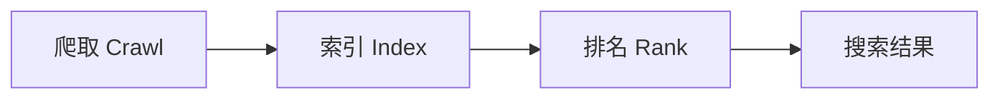
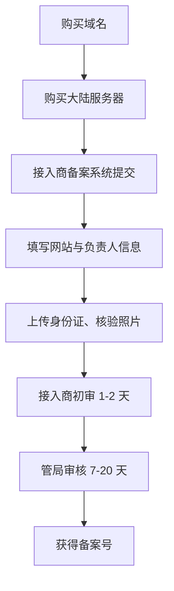

# SEO 与分析：让网站被找到、被理解

https://raw.githubusercontent.com/swpucwf/MyBolgImage/main/img/vibe_mll0919q-682d8eae8561ed41.jpg

<p>图 1：SEO、分享与数据统计</p>

## 1. 酒香也怕巷子深

项目做好了，朋友惊叹于创造力，纷纷转发，点击率上涨。但小明在百度和谷歌翻了十页都找不到自己的应用——**酒香也怕巷子深**：需要让搜索引擎和社交媒体都能更好地发现网站。

这一章四件事：**Open Graph 分享**（点开前的第一印象）、**SEO**（长期免费流量）、**Umami 统计**（理解用户）、**法律合规**（长期运营的基石）。

## 2. Open Graph：分享卡片

把链接发到群里，如果只显示一串蓝色 URL，没有标题、图片、描述，在信息流里就像一滴水掉进大海。缺的是 **Open Graph（OG）**。

OG 是 Facebook 在 2010 年推出的元数据标准：在网页 `<head>` 放几个 `<meta>` 标签，社交平台抓取链接时读取这些标签，生成预览卡片。X、LinkedIn、Telegram、Discord、Facebook、QQ 都支持。

| 有 OG | 无 OG |
|---|---|
| 精美卡片预览 | 只有蓝色链接 |
| 标题 + 描述 + 图片 | 只有 URL |
| 高点击率 | 低点击率 |

有数据显示，带图片预览的链接点击率通常是纯文本链接的 2-5 倍——人是视觉动物。

**核心 OG 标签**：

| 标签 | 说明 |
|---|---|
| `og:title` | 卡片标题 |
| `og:description` | 一句话说明价值 |
| `og:image` | 封面图 URL |
| `og:url` | 页面规范 URL |
| `og:type` | `website` 或 `article` |

形式是 `<meta property="og:xxx" content="xxx" />`。Next.js 在 `layout.tsx` 的 `metadata.openGraph` 里配置即可。

https://raw.githubusercontent.com/swpucwf/MyBolgImage/main/img/vibe_image-20260303152540838.png

<p>图 2：分享卡片的实际效果</p>

### 2.1 OG 图片是视觉核心

人的视线先被图片吸引，再看标题。**万能尺寸 1200 × 630**（约 16:9），主流平台都能正常显示。

| 原则 | 说明 |
|---|---|
| 简洁明了 | 标题短，突出核心信息（信息流里只会扫一眼） |
| 品牌一致 | 用品牌色与字体，让人一眼认出 |
| 文字安全区 | 重要内容避开边缘 20%，不同平台裁剪方式不同 |
| 高对比度 | 手机上小屏幕也清晰可读 |

图片来源：Canva 模板（最快）、AI 生成（看 prompt 质量）、`next/og` 的 `ImageResponse` 动态生成（博客类站点每篇文章自动生成封面）。

### 2.2 平台差异与调试

- **X**：有自己的 `twitter:card`，但会回退读 OG；`summary_large_image` 大图卡片效果最好；
- **微信**：**不支持 OG**，需要微信 JS-SDK（需已认证公众号）自定义分享内容——个人项目接入成本偏高，先把 OG 覆盖其他平台；
- **LinkedIn**：对 OG 支持最严格，图片 1200×627、URL 可公开访问即可。

**不要直接发群里测试**——平台会缓存第一次抓取结果。用调试工具：

| 工具 | 功能 |
|---|---|
| Facebook Sharing Debugger | 验证 OG、强制刷新缓存 |
| X Card Validator | 预览 X 卡片 |
| LinkedIn Post Inspector | 预览 LinkedIn 效果 |

图片不显示的常见原因：URL 不可公开访问（localhost、需登录）、格式不对（只支持 JPG/PNG/WebP，不支持 SVG）、图片太大（建议 5MB 内）、URL 写错。

## 3. SEO：让搜索引擎找到你

在搜索引擎搜网站名翻十页找不到——爬虫不会自动发现你，互联网每天几百万新页面，得主动告诉它你在哪、有什么。

**SEO 对独立开发者的价值**：

| 价值 | 说明 |
|---|---|
| 免费流量 | 不用付费广告 |
| 持续收益 | 排名上去后，睡觉时也有人通过搜索找到你 |
| 精准用户 | 搜索用户有明确需求 |
| 品牌曝光 | 排名靠前本身就是信任背书 |

社交分享像放烟花，发一次热闹一阵；SEO 像种树，前几个月看不到效果，一旦排名上去就有稳定流量。

### 3.1 搜索引擎三步：爬取 → 索引 → 排名



1. **爬取**：爬虫从已知页面沿链接跳转。没有链接指向你的网站，就发现不了你；
2. **索引**：抓取内容、分析信息，存入巨大数据库（像图书馆编目入库）；
3. **排名**：用户搜索时，从索引找相关页面，按几百个因素排序。

SEO 逻辑随之清晰：**让爬虫找到你（技术配置）→ 让爬虫理解你（内容优化）→ 让搜索引擎觉得你更好（质量与权威）**。

### 3.2 基础三件套

| 配置 | 作用 |
|---|---|
| **Metadata** | 每个页面独特的 `title` 与 `description`，告诉搜索引擎这页讲什么 |
| **Sitemap** | XML 站点地图，列出所有页面与更新时间，给爬虫一张导览图 |
| **Robots.txt** | 告诉爬虫哪些能爬、哪些不能（如 `/api/`、`/admin/`），并声明 Sitemap 位置 |

Next.js 有标准文件约定：`metadata` 对象、`app/sitemap.ts`、`app/robots.ts`，加载 `next-best-practices` Skill 的 AI 会处理。

配置后去站长工具提交 Sitemap：Google Search Console、Bing Webmaster Tools（都免费）。百度对个人、未备案网站收录意愿低——服务器在香港时先把 Google/Bing 做好。

### 3.3 内容才是核心

技术配置只是入场券，决定排名的是内容质量。

**标题优化**：关键词前置（用户视线从左到右）、50-60 字符、每页独特。结构：`主关键词 | 副关键词 | 品牌名`。

**E-E-A-T**：Experience（有实际经验？）、Expertise（有专业深度？）、Authoritativeness（领域权威？）、Trustworthiness（可信、有引用？）。核心一句话：**写你真正懂的东西，提供真正有价值的内容**。堆砌关键词的时代已经过去。

**URL 结构**：短的、描述性的、连字符分隔、全小写。`/blog/how-to-learn-nextjs` 好于 `/post?id=123`。

### 3.4 页面速度与结构化数据

Google 2021 年把页面体验纳入排名，**Core Web Vitals**：

| 指标 | 良好值 | 含义 |
|---|---|---|
| LCP | < 2.5s | 最大内容绘制——主要内容多快显示 |
| INP | < 200ms | 交互到下一次绘制——点击后多快响应 |
| CLS | < 0.1 | 累积布局偏移——内容是否突然跳动 |

框架已内置很多优化（代码分割、图片优化、预加载）；可关注 WebP、按需加载、浏览器与 CDN 缓存、Gzip/Brotli 压缩。用 PageSpeed Insights 测试并按建议调整。

**结构化数据**：JSON-LD 告诉搜索引擎页面结构（文章、作者、发布时间、评分），可能换来富文本摘要（发布日期、星级、FAQ），更醒目、点击率更高。常见类型：Article、Product、FAQPage、BreadcrumbList。

### 3.5 加速索引与平台差异

| 方法 | 说明 |
|---|---|
| 提交 Sitemap | 最直接 |
| 主动推送 | 部分站长平台支持 API 推送新 URL |
| 外部链接 | 被权威网站链接最有价值（像论文引用） |
| 社交媒体 | 呼应 OG 配置，爬虫也会从社交平台发现你 |

| 维度 | Google / Bing | 百度 |
|---|---|---|
| 收录门槛 | 提交 Sitemap 即可，不限服务器位置 | 偏好国内服务器，未备案几乎不收录 |
| 内容评估 | E-E-A-T，重视深度 | 重视原创，对抄袭惩罚严格 |
| 技术要求 | Core Web Vitals 是排名因素 | 更重视国内主机速度 |
| 合规 | HTTPS 是排名因素 | ICP 备案几乎是前提 |

**百度 SEO = 国内服务器 + ICP 备案 + 内容优化**，不是技术配置能绕过的。

### 3.6 SEO 检查清单

- [ ] 向 Google Search Console 与 Bing Webmaster Tools 提交 Sitemap；
- [ ] 内容原创、能解决实际问题；
- [ ] 语义化 HTML（h1 → h2 → h3 层级清晰）；
- [ ] 图片有 alt；
- [ ] URL 简洁、描述性强；
- [ ] PageSpeed Insights 测试通过；
- [ ] 移动端友好、HTTPS 启用。

SEO 通常 3-6 个月见效；关键词密度没有标准值，自然写作即可——刻意堆砌反而会被判定「关键词填充」。

## 4. Umami：用数据理解用户

上线不是结束，而是理解的开始。数据告诉你「发生了什么」，用户反馈告诉你「为什么发生」。

**为什么选 Umami**：

| 对比 | Umami | Google Analytics |
|---|---|---|
| 部署 | 自托管，数据在自己服务器 | 云服务，数据在 Google |
| 隐私 | 不用 Cookie，不追踪个人身份 | 详细追踪，需要 Cookie 同意弹窗 |
| 脚本 | < 1KB | ~45KB |
| 界面 | 简洁直观 | 强大但复杂 |
| 费用 | 自部署免费 | 免费版有限制 |

Umami 的哲学是「够用就好」：不告诉你年龄性别兴趣，但告诉你多少人来了、从哪来、看了什么、用什么设备。因为不用 Cookie，不需要烦人的同意弹窗。

**接入**：1Panel 应用商店安装 → 默认账号 `admin`/`umami`（登录后第一件事改密码）→ Settings → Websites 添加网站 → 生成追踪脚本加到全局布局：

```html
<script defer src="https://你的umami地址/script.js" data-website-id="你的网站ID"></script>
```

> 这里的脚本来自**自己服务器上自托管的 Umami**，属于第一方资源。不要随意粘贴来路不明的第三方统计脚本——若确实要接外部服务，优先固定版本并核对脚本来源，避免供应链风险。

https://raw.githubusercontent.com/swpucwf/MyBolgImage/main/img/vibe_image-20260226235803668.png

<p>图 3：Umami 数据面板</p>

### 4.1 指标解读

| 指标 | 说明 |
|---|---|
| Pageviews（PV） | 页面被浏览总次数，看 3 个页面就是 3 次 |
| Unique Visitors（UV） | 多少不同的人，同一人刷新 10 次仍算 1 |
| Visits | 会话数，上午一次下午一次算 2 次 |
| Bounce Rate | 只看一个页面就离开的比例 |

组合起来能读出很多信息：PV 高 UV 低说明少数忠实用户反复访问；UV 高但 PV/UV 低说明很多人只看一页就走；跳出率高不一定是坏事——单页应用或博客看完就走很正常，电商就要关注。

**流量来源**：Search（SEO 成果）、Social（OG 分享成果）、Direct（记住地址/收藏）、Referral（其他网站链接）。小明发现大部分来自 Social，说明 OG 卡片有效；Search 还少，SEO 需要时间。

**设备信息**：Browser / OS / Device 直接决定开发优先级——70% 用户用手机，就该优先优化移动端。

### 4.2 主要指标 vs 虚荣指标

| 主要指标（可行动） | 虚荣指标（好看但没用） |
|---|---|
| 留存率——用户会不会回来 | 总浏览量——大不代表好 |
| 转化率——会不会注册/购买 | 访客总数——来了不代表留下 |
| 活跃用户——真正在用的有多少 | 页面停留时长——可能只是忘了关标签页 |

**判断标准：看到一个数据后，你知道下一步该做什么吗？**「总浏览量涨了 20%」→ 所以呢？不知道该做什么；「注册转化率从 5% 降到 2%」→ 检查注册流程、最近改了什么，这就是可行动指标。

**事件追踪**：给元素加 `data-umami-event="事件名"`，或用 `window.umami.track('事件名', {属性})`。只追踪能帮做决策的事件（核心转化路径），追踪太多会淹没在数据里。

### 4.3 数据驱动决策

小明积累一个月数据后发现：移动端用户占 65%（此前一直在桌面端开发测试）、「关于」页跳出率 90%、周三周四流量明显更高。行动随之而来：优先修移动端交互、在关于页底部加其他页面链接、把发帖时间调到周三周四。

数据不是用来看的，而是用来**发现问题、验证假设、指导行动**。建议每周一花 10 分钟带着问题看数据：上周改动有没有影响行为？有没有异常波动？来源分布变了吗？

## 5. 法律合规

「个人项目也需要隐私政策？」——只要你收集用户数据，哪怕只是 Umami 的匿名统计，严格来说就需要。GDPR 违规罚款最高全球年营业额 4% 或 2000 万欧元取高者；虽然个人项目大概率不会被盯上，但**合规意识要从一开始就有**。

| 风险 | 后果 |
|---|---|
| 违反数据保护法 | 巨额罚款、应用下架、服务被封 |
| 缺少用户协议 | 纠纷时没有法律保护 |
| 未备案网站 | 在中国大陆被封禁 |
| 侵犯隐私 | 声誉损失、用户流失 |

### 5.1 隐私政策

只要收集以下任一类数据就需要：账户信息（邮箱、用户名、密码哈希）、行为数据（浏览、点击，Umami 也算）、个人身份信息、位置信息、Cookie 及类似技术。纯静态、无统计无表单无登录的网站可以不需要。

应回答：收集哪些数据、为什么收集、如何使用、存在哪里保留多久、是否共享给第三方、用户有哪些权利（查看/修改/删除）、Cookie 政策、联系方式。

**不要复制别人的隐私政策**——可能包含你没有的功能，也漏掉你实际收集的数据。正确做法是让 AI 扫描代码库，根据注册信息、统计工具、第三方服务（Umami、Stripe、Supabase）生成，放到 `/privacy`，网站底部加链接。

### 5.2 用户协议

隐私政策是「我怎么对待你的数据」，用户协议是「我们之间的游戏规则」。没有它，纠纷时没有依据：用户发布违法内容谁负责？服务导致损失要赔吗？能否关停账号？

核心内容：服务描述、用户责任、内容责任、知识产权、服务变更、免责声明、争议解决。让 AI 根据产品功能生成，放到 `/terms`；有注册功能时，注册流程要勾选「已阅读并同意」。

### 5.3 ICP 备案

| 服务器位置 | 是否需要 |
|---|---|
| 中国大陆 | 必须 |
| 香港、澳门 | 不需要 |
| 其他国家/地区 | 不需要 |

类型：ICP 备案（基础）、公安备案（部分省市，ICP 后 30 天内）、经营性 ICP 许可证（有偿服务，通常需企业资质）。个人项目大多只需 ICP 备案。



注意：备案期间网站可能无法访问；信息必须真实；备案号放网站底部并链接工信部；换服务器/域名/负责人要及时更新。总计约 2-4 周。

### 5.4 合规检查清单

**隐私与数据**：隐私政策由 AI 扫描代码生成并部署到 `/privacy`、底部有链接、内容准确、提供数据访问与删除机制（至少邮箱）、服务欧盟用户时符合 GDPR 基本要求。

**用户协议**：部署到 `/terms`、注册流程要求同意、内容准确反映服务范围与责任划分。

**中国大陆特定**：服务器在大陆已完成 ICP 备案、备案号在底部并链接工信部、内容合法。

**其他**：底部有联系方式、使用 Cookie 时有说明、有投诉举报渠道。

## 6. 本篇验收

- [ ] 能说清 OG 五个核心标签与 1200×630 图片规范；
- [ ] 知道微信不支持 OG，需要 JS-SDK；
- [ ] 会用调试工具验证并刷新分享缓存；
- [ ] 理解搜索引擎「爬取 → 索引 → 排名」三步；
- [ ] 能配好 Metadata + Sitemap + Robots.txt 并提交站长工具；
- [ ] 掌握标题、E-E-A-T、URL、Core Web Vitals、结构化数据要点；
- [ ] 能解读 Umami 的四类访问指标与流量来源；
- [ ] 能区分主要指标与虚荣指标，并用数据指导行动；
- [ ] 知道什么时候需要隐私政策、用户协议与 ICP 备案。

> **补记**：这一章把「被发现」拆成两层：**分享靠 OG**（点开前的第一印象），**搜索靠 SEO**（长期免费流量）；把「被理解」交给 **Umami**（可行动指标而非虚荣数字）；把「被信任」交给**合规**（隐私政策、用户协议、备案）。四个动作的共同点是：都不是一次性配置，而是持续维护——OG 要测缓存、SEO 要等 3-6 个月、数据要每周看、合规要随功能更新。

## 写在最后

下一篇[用户反馈与迭代](16-用户反馈与迭代)把「数据」接到「人」：面对真实用户的反馈、优先级排序、理解用户与持续迭代。
