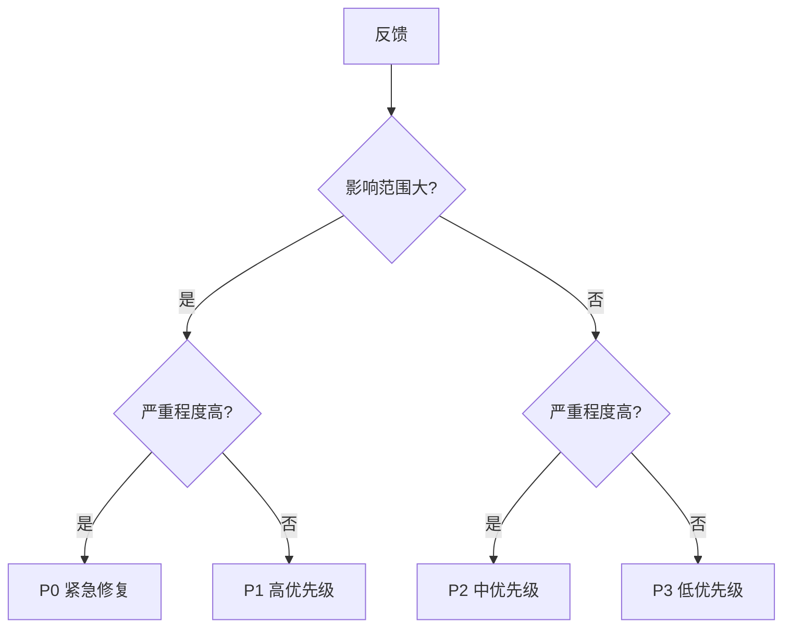

# 用户反馈与产品迭代：上线只是开始

https://raw.githubusercontent.com/swpucwf/MyBolgImage/main/img/vibe_mll09knu-500214b5388c0f63.jpg

<p>图 1：用户反馈与产品迭代</p>

## 1. 数据沉默，反馈会说话

产品上线，Umami 显示每天都有人来。但有个问题很困惑：**不知道他们为什么来，更不知道他们为什么走**。

> 数据告诉你发生了什么，用户反馈才能告诉你为什么发生。

「我就是用户，我了解用户」——这种想法很危险。你只是千千万万用户中的一个，使用习惯、需求、痛点可能和别人完全不同。有个团队花几个月做了「自动同步云端」，上线后才发现用户最想要的是「离线查看笔记」——大部分人在坐地铁、坐飞机，根本没有网络。早一点收集反馈，就不会浪费几个月。

## 2. 面对真实用户

上线前幻想用户蜂拥而至；现实是一天几个访问，有人嫌难用、嫌不好看，还有没想到的 Bug 不断冒出来。这种落差正常，根源是**你太熟悉自己的产品**：你知道「设置在侧边栏第三项」，用户看到的是「我找不到设置」；你觉得「很快就能做好」，用户觉得「为什么要这么麻烦」。

> 用户的感受是真实的。不是每条需求都对，但「找不到」就是找不到——不管你觉得入口多明显。

### 2.1 早期用户的五种反应

| 类型 | 特点 | 怎么对待 |
|---|---|---|
| 沉默的大多数 | 用了但不说话 | 主动找他们聊 |
| 问题报告者 | 发现 Bug 就告诉你 | 宝贝，感谢并认真记录 |
| 功能许愿者 | 「能不能加个 XX」 | 区分优先级，不能来一个做一个 |
| 直接批评者 | 不留情面指出问题 | 最有价值，因为说的是真话 |
| 热情支持者 | 真心喜欢产品 | 珍惜，深挖他们为什么喜欢 |

### 2.2 心理调适

第一条负面反馈往往让人难受：花了几个月做的东西，一句「不好用」就否定了。但**批评不是针对个人**——用户不知道你熬了多少夜，他们只关心好不好用；这说明他们在乎，真正可怕的是没人理。

调适心态四个字：**降低期望**。早期产品肯定不完美，这是起点不是终点；把批评当成免费的产品咨询，把每个问题当成改进机会。角色也要从「开发者」转向「运营者」：从关注代码质量到关注用户体验，从追求完美功能到追求用户留存。

### 2.3 早期该关注什么

**不要盯用户数**，那是虚荣指标。真正该看：

- **留存**——用户会不会回来（来了 100 个、第二天一个没回，100 毫无意义）；
- **核心功能使用率**——用户在不在用主要功能；
- **问题反馈**——遇到什么困难；
- **使用场景**——在什么情况下使用。

绝对用户数、收入、竞争者，早期都不重要：用户少是正常的，验证需求前谈收入没意义，盯竞争者只会分散注意力。

### 2.4 建立反馈渠道

反馈不会自己跑过来，要主动建渠道：

| 渠道 | 优势 | 局限 |
|---|---|---|
| 应用内反馈按钮 | 当场提交、上下文完整 | 需要用户主动操作 |
| 邮箱 | 适合深度建议、方便来回沟通 | 响应慢 |
| 社交媒体 | 传播性强 | 零散不系统 |
| 用户群组 | 社区氛围、持续讨论 | 需要花时间维护 |
| 用户访谈 | 最深入的洞察 | 最耗时 |

**应用内按钮**：页面固定按钮方便随时反馈；设置页不干扰主流程；操作后弹窗适合针对特定功能；错误发生时自动弹出能收集最有价值的报错上下文。表单要简洁，只问必要信息：选择类型（Bug/功能建议/其他）、自动收集页面与浏览器信息、提交后给确认提示。

**社交媒体**：用户会在你不曾注册的地方讨论产品——X、Reddit、微博、小红书、GitHub Issues。回应策略：正面感谢转发，问题引导到正式渠道，负面理解原因并承诺改进，功能请求记录并说明优先级。**不要和用户争论**。

**用户群组**：微信群对中国用户最友好，Discord 适合技术产品，Telegram 适合国际用户。早期 20-30 人就够，关键是你要在群里积极参与，而不是建了就不管。

### 2.5 数据 + 反馈 = 行动

Umami 显示注册页流失率高，群里有人说「注册表单太长了」——数据告诉你哪里有问题，反馈告诉你为什么。另一个例子：某功能使用率低，本以为是用户不需要，群里有人说「找不到这个功能」——不是不需要，是入口设计有问题。

单看数据只知道「跳出率高」；单听反馈不确定是个别还是普遍。**两者对照，才能确信该改什么。**

## 3. 反馈分类与优先级

一周收到 20 多条反馈：「登录偶尔崩溃」「能不能加深色模式」「导出功能什么时候有」「首页颜色太丑」「手机上按钮太小」「加载好慢」……每条都有道理，但不可能同时做 20 件。

### 3.1 分类

| 类型 | 例子 |
|---|---|
| Bug 报告 | 登录按钮没反应 |
| 功能请求 | 加入导出功能 |
| 体验问题 | 找不到设置在哪里 |
| 性能问题 | 页面加载太慢 |
| 内容问题 | 某个词用错了 |

分类不是为了好看，而是为了判断优先级：Bug 与性能通常比功能请求更紧急——它们影响「能不能用」，而不是「好不好用」。

### 3.2 影响范围 × 严重程度



| 级别 | 定义 | 处理时限 |
|---|---|---|
| P0 | 影响大量用户、系统不可用（登录失效） | 立即 |
| P1 | 影响大量用户、核心功能受影响（支付失败） | 24 小时内 |
| P2 | 影响部分用户但有替代方案（某浏览器显示异常） | 本周 |
| P3 | 影响小、不影响使用（颜色不好看） | 有空再说 |

「登录崩溃」影响大且严重 → P0；「颜色太丑」影响小且不严重 → P3。一步就把 20 条分成四个层级。

### 3.3 RICE：更精确的排序

好几个 P1 怎么办？用 **RICE**：

```text
RICE = (Reach × Impact × Confidence) / Effort
```

- Reach（触达）：多少用户受影响（每月用户数）；
- Impact（影响）：对用户影响程度（1-3 分）；
- Confidence（信心）：评估把握（百分比）；
- Effort（工作量）：需要多少时间资源（人月）。

| 功能 | Reach | Impact | Confidence | Effort | RICE |
|---|---|---|---|---|---|
| 导出功能 | 100 | 3 | 80% | 2 | 120 |
| 深色模式 | 500 | 1 | 100% | 3 | 167 |
| 修复登录 Bug | 1000 | 3 | 100% | 1 | 3000 |

修复登录 Bug 的分数是深色模式的 18 倍。直觉可能觉得「500 人想要深色模式，应该先做」，RICE 告诉你：修复影响 1000 人的严重 Bug 远比满足 500 人的「想要」更重要。

> RICE 不是为了精确计算，而是把假设和数据摆到台面上。纠结「先做哪个」时，把数字列出来，答案往往就清楚了。

觉得 RICE 太重，可以用 **ICE**：Impact、Confidence、Ease 各 1-10 分取平均，适合快速决策。

### 3.4 管理流程与「说不」

流程：**收集 → 分类 → 排序 → 处理 → 通知用户**。GitHub Issues 或 Notion 都能管理，关键不是工具而是习惯。最后一步「通知用户」尤其重要——修复了用户报告的问题就告诉他，他会觉得被重视，下次还愿意反馈。

最难学的是拒绝。「能不能加聊天」「能不能支持 Markdown」「能不能做个 App」——每个听起来都不错，但时间精力有限。优先级原则：核心功能优先于边缘功能、修 Bug 优先于新功能、小投入大回报优先、与产品方向一致优先。

拒绝的话术：不是目标用户 → 「不在当前计划内，但感谢建议」；与方向不符 → 「重点是 X，暂时不会做 Y」；资源有限 → 「建议很好，已记录，后续考虑」。**说「不」不是忽视用户，而是对产品方向负责**——好产品不是功能最多，而是最专注。

## 4. 理解用户

「你这个产品不好用」——盯着这五个字完全不知道该改什么：界面不好看？操作太复杂？功能不够？加载太慢？去问用户，不是发问卷，而是真的聊。

### 4.1 The Mom Test：怎么问才能得到真话

第一次访谈问「你觉得我的产品怎么样？」→「还行吧」，15 分钟什么有用信息都没得到。**The Mom Test** 的核心：问对问题，连你妈都没法对你撒谎。

三条原则：

1. **谈论过去而非未来**：过去的行为真实，「你上次怎么做的」比「你以后会不会用」可靠一万倍；
2. **谈论具体而非笼统**：「你上次遇到什么困难」比「你觉得怎么样」有价值；
3. **少问多听**：让用户多说，从细节发现真实需求。

| 坏问题 | 好问题 |
|---|---|
| 你会用这个功能吗？ | 你上次怎么解决类似问题的？ |
| 这个功能重要吗？ | 你什么时候需要用到这个？ |
| 你觉得这个设计怎么样？ | 这个设计让你哪里困惑？ |
| 你想要什么功能？ | 你最近遇到什么困难？ |

### 4.2 第二次访谈：观察比询问更真实

「你上次用笔记应用是什么时候？」「上周，想记个会议纪要。」「顺利吗？」「找了半天新建按钮，后来发现要先选分类才能新建——我当时就想随便记一下，不想选分类。」

小明恍然大悟：他设计的「先选分类再新建」在他看来合理，但用户只想快速记点东西。让用户演示操作时，他观察到用户在好几个地方犹豫、甚至点错按钮——这些用户自己都没意识到。

**用户嘴上说「还行」，但操作时的犹豫、停顿、皱眉才是真实反馈**：犹豫说明不确定怎么做，反复尝试说明功能不直观，跳过某步骤可能根本没看到那个功能。

### 4.3 访谈实操

**怎么问**：开放式问题打开话题——背景类（「能说说你的使用场景吗」）、行为类（「你上次怎么完成的」）、困难类（「哪里让你困惑」）、感受类（「那个时刻你感觉怎么样」）。追问把模糊变具体：「能具体说说吗」「能举个例子吗」「和之前的方案相比呢」。最强技巧是**沉默**——不说话，让用户继续，后面的话往往最有价值。

**完整访谈**：事前明确要验证的假设、准备核心问题；开场说明目的、强调没有「正确答案」；访谈中让用户演示、不打断；记录记原话（总结会过滤关键信息）；24 小时内整理笔记。

**做多少次**：1-3 次开始发现模式，5-10 次大部分问题重复，超过 10 次新发现递减；连续两次没听到新东西就可以停。

**从反馈到行动四层提炼**：

| 层级 | 例子 |
|---|---|
| 原始反馈 | 找不到设置在哪里 |
| 问题 | 设置入口不明显 |
| 洞察 | 用户期望在右上角找到设置（大多数应用都这么放） |
| 行动 | 把设置按钮移到右上角 |

从反馈直接跳到行动很危险——「找不到设置」不一定意味着移动按钮，也可能需要加引导。中间两层帮你理解真正原因。

**四个常见误区**：推销产品（忍不住解释「功能在这里」，用户就不说真话了）、引导答案（「你是不是觉得按钮太小」只会得到附和）、只听好的（负面反馈才是金矿）、过早解决（用户没说完就想着改代码，先理解再解决）。

### 4.4 定性 + 定量

访谈是小样本，别只听几个人就下结论。**数据（定量）告诉你 What**——客观、可测量、大规模、看趋势；**反馈（定性）告诉你 Why**——主观但深入、小样本但有背景。

小明把访谈与 Umami 对照，得到两个清晰方向：某页面跳出率 70% + 用户说「找不到核心功能入口」→ 改导航；注册转化率 30% + 用户说「表单太长」→ 简化注册。

### 4.5 北极星指标

「你的产品最核心的一个指标是什么？」「用户数？」「不对，用户数只会涨，不会告诉你产品好不好。」**北极星指标**要能反映产品核心价值：

| 产品类型 | 可能的北极星指标 |
|---|---|
| SaaS 工具 | 月活跃用户 |
| 电商 | 订单转化率 |
| 内容平台 | 内容消费时长 |
| 工具产品 | 核心功能使用率 |

对笔记应用，「每周创建笔记数」可能才是北极星——它直接反映用户是否持续使用核心功能。这个数字在涨说明产品在变好；在跌，不管用户数怎么涨都说明有问题。

### 4.6 假设验证循环

不要「我觉得应该改 X」，而是「我假设改 X 会带来 Y，因为 Z」。格式：**如果 [改变 X]，那么 [预期结果 Y]，因为 [理由 Z]**。例如：「如果简化注册表单，注册转化率会提高 20%，因为用户更愿意完成简短流程。」

验证最直接的方法是 **A/B 测试**：随机分组，一组旧版一组新版，**只改变一个因素**——同时改三个东西就不知道哪个起作用。

真实案例：注册页流失率 70%，假设表单太长，实验只保留邮箱字段：

| 版本 | 转化率 |
|---|---|
| 原版本（7 字段） | 30% |
| 新版本（1 字段） | 55% |

转化率提升 83%。假设驱动的威力：不是拍脑袋改，而是有依据地改，改完有数据验证。

### 4.7 数据驱动的五个陷阱

- **相关即因果**：冰淇淋销量与溺水事故正相关，但买冰淇淋不会导致溺水，它们都是夏天的结果；
- **选择性偏差**：只看支持自己观点的数据；
- **短期主义**：短期提升转化，长期可能伤害留存；
- **数据崇拜**：完全依赖数据，忽略直觉与反馈；
- **过度分析**：花太多时间分析，迟迟不行动——够用就行，先做再说。

数据量小时，定性反馈更重要；用户说的和做的不一致时，**相信行为**；数据与反馈矛盾时，优先相信数据，但用访谈理解原因。

## 5. 迭代节奏与成长

### 5.1 一次性全改完的教训

小明列了改进清单：优化导航、简化注册、修三个 Bug、加搜索。两周后一次性上线——搜索引入新 Bug，导致部分用户笔记列表异常；因为改得太多，他花很久才定位问题。如果一次只改一个，立刻就能知道是哪个改动出问题。

### 5.2 三层更新策略

| 层级 | 内容 | 节奏 | 风险 |
|---|---|---|---|
| 热修复 | 紧急 Bug，只改一个问题 | 随时 | 最低 |
| 小更新 | 小功能、优化、非紧急 Bug | 每周 | 中 |
| 大版本 | 新功能、重构、架构调整 | 每月 | 高 |

热修复：改完立刻测试、发布、监控，不夹带其他改动；小更新：一周积累打包发布，比每天零散更新好；大版本：更充分测试、更完整文档、更清晰沟通。

### 5.3 灰度发布与变更管理

新功能不要直接全量：**白名单**（指定友好用户先用）、**百分比**（随机 10% 用户看到）、**随机分桶**（A/B）、**条件触发**（满足特定条件才显示）。常用实现是**功能开关（Feature Flag）**。

更新要让用户知道：新增功能强调价值并教怎么用；功能移除提前通知并解释原因（突然删掉在用功能是大忌）；界面变化做对比说明；Bug 修复简单告知已解决。**更新日志（Changelog）** 是最简单有效的方式——几句话说清改了什么、为什么。

### 5.4 节奏与精力分配

| 阶段 | 节奏 | 重点 |
|---|---|---|
| 早期 | 一周一个小版本 | 找方向，速度比完美重要 |
| 成长期 | 两周一个小版本、每月一个大版本 | 质量与速度并重 |
| 成熟期 | 放慢 | 从「加功能」转向「优体验」 |

**80/20 原则**：80% 精力在稳定性与 Bug 修复，20% 在新功能。用户宁愿用稳定的简单产品，也不愿用功能丰富但经常崩溃的产品——稳定是一切的基础。

### 5.5 永远在 Beta

「什么时候算做完了？」「永远不会。」传统观念里 Beta 是临时测试版，现代产品思维里 **Beta 是一种永久心态**：持续改进、永不停止。好处是降低完美主义压力、鼓励快速尝试、保持谦逊、从反馈中不断进步。

### 5.6 加强受欢迎的，放弃没人用的

**识别受欢迎功能**的四个信号：使用率高、正面反馈多、留存贡献大、付费意愿强。加强方式：深化功能、相关扩展、优化体验、宣传推广。

小明花一周做的「标签系统」使用率不到 2%，纠结要不要删。「沉没成本不是继续投入的理由」——没人用的功能留着只会增加维护负担与产品复杂度：每多一个功能，就多一个出 Bug 的地方、多一个要测试的东西、多一个让新用户困惑的选项。

移除前准备：分析数据确认低使用率 → 提前通知受影响用户 → 提供替代方案或迁移指南 → 监控移除后的反馈。**不要偷偷删**，即使只有 2% 的用户在用，他们也值得被提前告知。

### 5.7 小步快跑与长期主义

每次改动越小，效果越好：降低风险（出问题容易定位）、快速反馈（更快知道方向对不对）、心理轻松（不用「憋大招」）、积少成多（一周一个改进，一年 52 个）。

产品进化：MVP（验证需求）→ 早期（发现方向）→ 成长期（扩大用户）→ 成熟期（深耕价值）。短期思维追求爆款，长期思维追求持续改进；短期想取悦所有人，长期专注服务核心用户。**那些成功产品不是一夜变成那样的，都经历了无数次迭代、失败与调整。**

## 6. 本篇验收

- [ ] 能说出数据与反馈的分工（What vs Why）；
- [ ] 能识别早期用户的五种反应并区别对待；
- [ ] 会建至少两种反馈渠道，并知道表单该收什么；
- [ ] 能用「影响范围 × 严重程度」排出 P0-P3；
- [ ] 会用 RICE/ICE 给同级需求排序；
- [ ] 掌握 The Mom Test 的三条原则与好/坏问题对照；
- [ ] 能从访谈做四层提炼（反馈→问题→洞察→行动）；
- [ ] 能定义自己产品的北极星指标；
- [ ] 会用「如果…那么…因为…」写假设并设计单变量 A/B；
- [ ] 能按热修复/小更新/大版本分层发布，并做好变更通知；
- [ ] 理解 80/20 精力分配与「永远在 Beta」的心态。

> **补记**：这一章把「上线」从终点改成起点。最实用的四个动作：**数据 + 反馈对照**（知道改什么）、**影响范围 × 严重程度**（先改哪个）、**The Mom Test**（问出真话）、**小步快跑**（一次只改一点）。还有一条反直觉的底线：**80% 精力保稳定，20% 做新功能**——用户宁愿用稳定的简单产品，也不愿用功能丰富但经常崩溃的产品。

## 写在最后

进阶篇到这里收束。下一篇进入[实践篇](/source/vibecoding/vibe-practice/README)：四个完整项目——AI 画布、AI 绘本生成器、AI 简历 SaaS、全栈 21 天习惯游戏，把前面所有能力串成完整交付链路。
