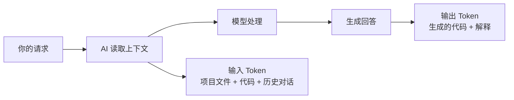
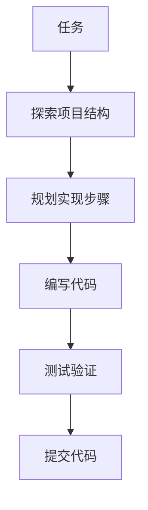

# AI 调优指南：经济性、工作流与扩展能力

https://raw.githubusercontent.com/swpucwf/MyBolgImage/main/img/vibe_02-dev-tools-ai-tuning_index.png

<p>图 1：AI 使用说明书</p>

## 1. 这一章解决什么

环境搭好之后，真正决定效率的往往不是「用哪个模型」，而是三件事：**成本意识、工作流、给 AI 的规则与扩展能力**。AI 编程有个常被忽视的现实——**Token 就是钱**，每次让 AI 读项目文件、搜索代码、生成回答，都在消耗真实费用。而多数返工也不是因为模型不行，而是因为没有流程：想到哪做到哪，写到一半才发现文件已经写过。

这一章把调优拆成六块：Token 经济学、Vibe Coding 工作流、Agent 与多 Agent、Hooks 自动化、插件/MCP/Skills 扩展、项目规则配置，最后收束到一套调试心法。

## 2. Token 经济学：上下文决定花费和质量

**Token** 是模型的计价单位，也是处理文本的基本单元：1 个汉字 ≈ 1 Token，1 个英文单词 ≈ 0.75 Token，1 行代码 ≈ 5-15 Token。模型按输入（Prompt）和输出（Completion）计费，输出通常比输入贵一些。**Context Window** 是上下文长度上限（GLM 支持 200K），接近上限时会自动压缩早期对话，可能丢失历史细节。



关键认知：**提示词本身通常很少，真正消耗 Token 的是 AI 读取的上下文**。单次调用很便宜，但累积起来也是钱；读取整个项目 vs 只读一个文件，差异是数量级的；频繁调试时循环修改会不断累积 Token。

所以「优化提示词」不是打磨话术，而是**减少 AI 需要读取的上下文范围**，同时控制输出长度。上下文范围既影响成本，也影响质量：精准上下文让 AI 聚焦问题，无关上下文会分散注意力。

| 原则 | 说明 |
|---|---|
| 指定路径 | 指定文件/文件夹路径，缩小 AI 搜索范围 |
| 明确范围 | 「登录功能有问题」比「项目有问题」更聚焦 |
| 删除客套 | 无需「请」「谢谢」「如果可能的话」 |
| 直接说事 | 直接描述任务，无需客套和铺垫 |

```
❌ 模糊提示（AI 读取更多上下文）：
"帮我看看项目里有没有什么问题，然后修复它"

✅ 精准提示（AI 聚焦相关区域）：
"修复 src/auth/login.ts 第 42 行的类型错误：user 可能为 null"
```

**成本意识检查清单**：指定文件/文件夹路径、指明功能范围、删除客套话、定期清理对话历史。AI 工具通常显示每次调用的 Token 与花费，额度用完充值即可——不必焦虑，但要有意识避免浪费。

Token 超限时说明项目规模已经需要工程化：考虑拆分项目、清理对话历史开新会话、用 `.gitignore` 排除不需要 AI 读取的文件。模型偶尔「瞎编」是幻觉问题，解决方法同样是给明确上下文，并允许它在不确定时明确说出来。

## 3. Vibe Coding 工作流

### 3.1 你是导演，AI 是演员

Vibe Coding 的核心不是「让 AI 替你写代码」，而是「你驾驭 AI 写代码」。把 AI 当替代品，会逐渐失去对产品的控制权，最终做出的东西可能技术上完美、产品上平庸。真正强大的用法是「一放一收」：放，让 AI 在海量技术方案中自由探索、生成多种实现路径；收，在关键节点选定方向、拍板决策、承担责任。**AI 可以帮你写一万行代码，但只有你能决定这一万行代码应该解决什么问题**——这也是 PRD 重要的原因，它就是对 AI 的控制权。

在分工上，AI 负责**预测**（基于训练数据生成方案、架构建议、选型），人负责**判断**（结合业务理解选择方案、决定产品方向）。权限模式本质上就是在调节「预测与判断的脱钩程度」。

**Agent Native 三大原则**：

1. **意图驱动**：告诉 AI「做什么」，不管「怎么做」——「过滤数组中大于 10 的元素，返回新数组」，而不是指定 for 循环细节；
2. **异步协作**：设定目标后 AI 可自主执行，「实现用户评论功能，包括数据库 schema、CRUD API、前端表单、列表展示，完成后告诉我，我先去忙别的」；
3. **信任但验证**：不逐行检查代码，而是跑功能测试、跑 `tsc` 类型检查、只看关键逻辑。

角色也随之从「工匠」变成「指挥官」：从手写代码到描述需求，从逐个修复到反馈问题，从关注语法到关注产品。

### 3.2 提示词原则

```
Vibecoding = Prompt（提示词） + Workflow（工具流）
```

Prompt 告诉 AI 做什么，Workflow 决定怎么做。沟通的关键是**直接、具体、有上下文**；AI 不需要角色扮演，它知道自己能做什么。

| 类型 | 欠佳 | 推荐 |
|---|---|---|
| 角色扮演 | 「你是一位 20 年经验的全栈工程师，精通 React、Vue、Angular…」 | 直接说任务：「实现用户登录功能」 |
| 模糊指令 | 「帮我优化一下代码」 | 「优化登录页加载性能：图片懒加载、延迟加载非关键资源」 |
| 无边界 | 「写一个完整的电商系统」 | 「实现用户评论功能：表单、列表展示、数据持久化」 |
| 强行要求 | 「你必须给出正确答案，不能说不知道」 | 「如果不确定，请明确说『我不确定』，而不是编造」 |
| 缺上下文 | 「修复这个 Bug」 | 「修复 app/login/page.tsx：登录后没有跳转到首页，预期跳转 /dashboard」 |

核心原则：不要让 AI 猜（提供明确上下文）、不要含糊其辞（给出具体要求）、不要强行编造（给 AI 一个「不确定」的出口）。还可以让它反复提问直到理解需求：

```text
我要开发一个任务管理应用。
请反复问我问题，直到你完全理解我的需求。
不要猜测，直接问。
```

**代码生成模板**：

```text
实现 [功能名称]

技术栈：
- Next.js [版本]
- TypeScript
- Drizzle ORM

需求：
1. [具体需求1]
2. [具体需求2]

注意事项：
- 遵循项目现有代码风格
- 不要引入新依赖，除非必要
- 包含错误处理
```

**Bug 修复模板**：

```text
修复 Bug
文件路径: [完整路径]
错误信息: [完整报错日志]
当前代码: [相关代码片段]
期望行为: [描述]
实际行为: [描述]
请分析原因并提供修复方案
```

### 3.3 标准五步工作流



**① 探索**：先了解项目现状，才能在 prompt 里给更精准的上下文——「项目已有 Comment 表，请复用」「代码风格参考 src/modules/posts」：

```text
探索这个项目的结构，告诉我：
1. 使用的技术栈
2. 文件组织方式
3. 现有的功能模块
4. 配置文件的作用
```

**② 规划**：先想清楚再动手，减少返工：

```text
我要添加用户评论功能。
请规划实现步骤，包括：
1. 需要创建哪些文件
2. 需要修改哪些现有文件
3. 数据库 schema 变更
4. 实现顺序
```

**③ 编码**：复杂任务会被自动拆解（更新 schema → 运行迁移 → 创建 API → 前端组件 → 集成 → 测试），也可以按步骤分步执行。

**④ 验证**：

```text
测试评论功能：
1. 验证 API 能正常创建评论
2. 验证评论能正确显示
3. 验证错误处理
```

**⑤ 提交**：在 CLAUDE.md 中写入——「每当你完成一个独立功能的开发，或修复完一个 Bug 并验证通过后，请自动运行 git commit 提交代码，并生成一句简洁的中文 commit message。」这样 AI 写完登录自动提交、写完首页自动提交；搞崩了可以用 `git log` 找到上一个版本回退。

**检查点 vs Git**：

| 方式 | 能回滚什么 | 不能回滚什么 | 适用场景 |
|---|---|---|---|
| 检查点 | AI 写入的文件 | 终端命令产生的变更 | 快速试错 |
| Git 提交 | 所有已跟踪文件 | 未跟踪文件 | 重要里程碑 |

检查点（`Esc+Esc` 或 `/rewind`）只回滚 AI 写入的文件，`npm install`、`mkdir`、数据库变更都回不来。正确姿势：小改动用检查点，大改动先 `git commit` 再让 AI 动手。

### 3.4 权限模式与常用命令

| 模式 | 特点 | 何时使用 |
|---|---|---|
| Default | 读自动，写询问 | 日常开发（推荐） |
| Plan | 只读不写 | 代码审查、探索、架构决策 |
| Accept Edits | 写需确认，其他自动 | 频繁跑测试/命令 |

`Shift+Tab` 循环切换。Plan 模式不只是「只读」，它会先深度探索代码库、输出结构化方案（改哪些文件、改什么、顺序），由人审批后再执行——新功能涉及 3+ 文件、大规模重构、不熟悉代码库时特别推荐。

**常用斜杠命令**：`/clear` 清空上下文、`/model` 切换模型、`/status` 查看额度、`/config` 配置、`/resume` 恢复会话、`/rewind` 回到检查点、`/agents` 管理 Agent、`/init` 生成 CLAUDE.md、`/compact` 压缩上下文、`/export` 导出对话。

**输入前缀**：`#` 写入 CLAUDE.md、`/` 斜杠命令、`!` 直接运行 Bash、`@` 引用文件路径。快捷键：`Ctrl+C` 中断、`Esc+Esc` 回退、`Tab` 扩展思考、`Shift+Tab` 切权限模式。

## 4. Agent 与多 Agent 协作

**Agent = AI 本身**：理解意图、做决策（用什么工具、先做什么）、协调工具完成任务，是一个任务执行器。自定义 Agent 是主 Agent 可以调用的「专门助手」：有特定用途、独立上下文窗口（不污染主对话）、自定义系统提示、可限制工具权限。

| 优势 | 说明 |
|---|---|
| 上下文保留 | 主对话简洁，复杂任务独立处理 |
| 专业分工 | 针对代码审查、调试等任务优化 |
| 并行处理 | 多个 Agent 同时工作 |
| 灵活权限 | 只开放特定工具，提高安全性 |

用 `/agents` 创建：选择生成方式（推荐 Generate with Claude，90% 情况够用）→ 选择模型（Sonnet 平衡、Opus 最强、Haiku 最快、继承父级）→ 选择工具权限（All / Read-only / Edit / Execution / MCP）→ 选择存储位置（项目级 `.claude/agents/` 或用户级 `~/.claude/agents/`）→ 选背景色 → 保存。创建后可以直接用 `@agent名字` 修改或使用。

**多 Agent 并行**：Claude Code 会根据任务描述主动委派，使用 Task 工具创建通用 Agent 并行处理独立任务；自定义 Agent 则用于专门的领域任务。

## 5. Hooks 自动化

**Hooks = 在特定事件时自动执行的 Shell 命令**。当触发工具调用、提交提示等事件时，自动执行注册的脚本。常见用途：写完代码自动格式化、删除重要文件前拦截、提交前自动跑测试。

用 `/hooks` 打开交互式配置：选择事件（`PreToolUse` 工具调用前、`PostToolUse` 调用后、`PostToolUseFailure` 失败后、`Notification`、`UserPromptSubmit` 用户提交提示时）→ 配置触发条件与 Shell 命令（默认超时 60 秒）→ 保存。

| 场景 | 事件 | 执行命令 |
|---|---|---|
| 自动格式化 | PostToolUse（Write/Edit 后） | `prettier --write $FILE` |
| 保护敏感文件 | PreToolUse（改 .env 时） | 拦截并警告 |
| 运行测试 | UserPromptSubmit（含「测试」） | `npm test` |
| 添加上下文 | UserPromptSubmit | 自动加载项目信息 |

敏感文件保护可以用一个简单脚本：读取 stdin 的 JSON，检查 `tool_input.file_path`，命中 `.env`、`.key`、`.pem` 就退出码 2 阻止操作。

> Hooks 会以当前用户权限执行 Shell 命令，**配置前先理解它在做什么**；新手从自动格式化这类简单场景开始，只使用可信来源的 Hooks。

## 6. 插件、MCP 与 Skills

### 6.1 先分清三者的角色

- **MCP** = 外部工具连接（Model Context Protocol），让 AI 连接数据库、API、文件系统等外部服务；
- **插件** = 扩展容器（分发单位），可以包含 Skills、Commands、Agents、Hooks、MCP Servers，通过插件商店一键安装；
- **Skills** = AI 的可复用技能包，用 `SKILL.md` 定义特定能力，AI 根据请求自动判断是否使用。

| 需求 | 推荐方式 |
|---|---|
| 代码智能（LSP） | 安装插件 |
| 连接外部服务 | 配置 MCP 或安装含 MCP 的插件 |
| 自动化工作流 | 创建或安装 Skills |
| 一键安装多个功能 | 安装插件 |

**核心原则：能用插件的就不手动配 MCP，能用内置的就不扩展。**

### 6.2 先看内置能力，再决定扩展

AI 裸跑已经能做很多：读项目内任何文件、运行允许的命令、理解代码结构、连接已配置的外部服务、自动选择工具。它不能做的是：访问电脑任意路径、执行图形界面操作、记住上次对话、绕过系统安全限制、猜测心里想什么。

| 不需要扩展 | 需要扩展 |
|---|---|
| 「读取文件并分析」→ Read | 「查询 PostgreSQL 数据库」→ MCP/插件 |
| 「运行命令并处理结果」→ Bash | 「读取 Google Drive 文档」→ MCP/插件 |
| 「实现某个功能」→ 直接描述 | 「调用 Slack API 发消息」→ MCP/插件 |

LSP（语言服务器）能力不是内置的，需要装插件：`/plugin` 搜索 `typescript-lsp` 或 `pyright-lsp`。

### 6.3 插件：最省事的扩展

```bash
/plugin                    # 打开插件管理界面
# 搜索、空格选中、按 i 安装
/plugin install frontend-design@anthropics
```

插件和 MCP 功能可以完全一样，但插件省去「找文档 → 编辑 .mcp.json → 检查格式 → 重启」的流程。

推荐插件：`typescript-lsp`、`pyright-lsp`（语言智能）、`frontend-design`（前端界面）、`feature-dev`（7 阶段功能开发工作流）、`pr-review-toolkit`（PR 审查）、`commit-commands`（Git 提交）、`code-review`（多代理并行审查）、`context7`（库文档查询）、`playwright`（浏览器自动化）。

插件本质是一个包含 `.claude-plugin/plugin.json`、`commands/`、`agents/`、`skills/`、`hooks/`、`.mcp.json` 的包；团队可以把市场与插件写进 `.claude/settings.json`，成员拉取后自动安装。

### 6.4 MCP：连接外部服务

可以把 MCP 想成一根数据线：一头插着 AI，一头插着数据库、GitHub、Figma。注意三点：MCP 在不同 CLI 工具间**不通用**；IDE 内通常有市场可直接装，CLI 工具要手动配置；部分 MCP 需要 API Key。

GLM 一键配置工具默认装好的 MCP：Vision（图片分析）、Web Search（网络搜索）、Web Reader（读取网页）、ZRead（读取 GitHub 仓库）。

热门 MCP（按分类）：GitHub、Chrome DevTools、ShadCN、Semgrep（开发调试）；PostgreSQL、Neon、Supabase（数据库）；Vercel、Cloudflare（部署托管）；Figma、Replicate（设计媒体）；Context7、Ref（文档上下文）；Stripe（支付）。

安装方式：远程 HTTP（推荐）`claude mcp add --transport http <name> <url>`；本地 stdio `claude mcp add --transport stdio <name> -- <command>`（`--` 前是工具参数，后是服务器命令）。Windows 本机用 npx 启动的 MCP 需要 `cmd /c` 包装，否则会报「连接已关闭」。管理用 `/mcp`。

### 6.5 Skills：把经验变成可复用资产

以前在对话里教 AI 怎么做，说完这轮它就忘了；Skills 把工作流程固化成 `SKILL.md`，**经验不再是一次性对话，而是可以反复使用的知识资产**。它和脚本最大的区别是柔性：脚本遇到意外会卡住，Skills 更像指导原则，AI 会根据实际情况调整（比如项目还没有测试框架，它会建议先配置，然后继续其他检查）。

获取方式：装插件（自带 Skills）或自己创建。创建不需要写代码——口述就行，而且不必一次完美：

1. 「帮我创建一个代码审查的 Skill，检查类型安全和测试覆盖率」；
2. 「加上安全检查，特别是 XSS 和 SQL 注入」；
3. 「审查结果输出成 Markdown 表格，每个问题标注严重等级」。

结构：

```yaml
---
name: your-skill-name
description: Brief description of what this Skill does and when to use it
allowed-tools: Read, Grep, Glob   # 可选，限制工具
---

# Your Skill Name

## Instructions
Provide clear, step-by-step guidance for the AI.

## Examples
Show concrete examples of using this Skill.
```

`name` 只能用小写字母、数字和连字符（≤64 字符）；`description` 用第三人称说明功能与时机（≤1024 字符）。创作要点：简洁（假设 AI 已经聪明，只补充它没有的上下文）、动名词命名（`testing-code`）、描述具体、按需选择自由度（文本说明 → 伪代码 → 精确脚本）。

### 6.6 扩展的安全底线

- **数据库 MCP**：用只读权限账号，生产环境不要直接给写权限；
- **文件系统 MCP**：限制访问路径，只开放必要目录，不要允许访问根目录；
- **GitHub MCP**：用有期限的 token，最小权限范围；
- **插件**：只从可信来源安装，查看源码与权限要求；
- **Skills**：用 `allowed-tools` 限制工具，只读技能只给只读工具。

## 7. 项目规则配置

### 7.1 什么时候真的需要配置

个人开发通常不需要：AI 有记忆，对话中说的偏好它会记住；README 加项目文档通常足够。只有当「第 5 次提醒不要用 npm，它还是用了」时才需要写成规则。

| 情况 | 需要配置？ | 为什么 |
|---|---|---|
| 个人项目，AI 记得住 | 不需要 | 对话最省事 |
| 个人项目，AI 总忘 | 建议 | 写进 CLAUDE.md，一劳永逸 |
| 多台电脑开发 | 需要 | 配置同步，不用重复设置 |
| 团队协作 | 必须 | 统一规范，避免行为不一致 |

配置文件的本质都是「写给 AI 看的项目说明书」，核心内容是**技术栈 + 编码规范 + 禁止行为**，只是不同工具文件名不同：Claude Code 用 `CLAUDE.md`、Cursor 用 `.cursorrules`、Qoder/Trae 用 `.iderules`。

更省事的方法：让 AI 自己写。给足项目信息（技术栈、团队规模、特殊需求），30 秒就能生成一份可用配置。

### 7.2 CLAUDE.md 模板

```markdown
# 项目：[项目名称]

## 技术栈
Next.js 16 + TypeScript + Tailwind + shadcn/ui

## 规范
- 禁止 any，严格模式
- PascalCase 命名组件
- 用 pnpm

## 禁止
- 不装新依赖
- 不改 .env
```

完整版还会包含项目概述、目录结构、常用命令：

```markdown
## 常用命令
- 安装依赖：`pnpm install`
- 开发服务器：`pnpm dev`
- 构建：`pnpm build`
- 测试：`pnpm test`
- Lint：`pnpm lint`
- 类型检查：`pnpm typecheck`
```

**这一节很关键**：不声明构建命令，AI 可能用 `npm run build` 或 `yarn test`，在 pnpm 项目里会导致依赖解析错误。

**进阶用法**：

- **记忆命令**：对话里用 `#` 前缀（如「# 本项目使用 pnpm，不要使用 npm」），Claude Code 自动追加到 CLAUDE.md；
- **模块化规则**：规则变长后拆到 `.claude/rules/`（`coding-style.md`、`git-workflow.md`、`testing.md`、`security.md`），会自动加载并与 CLAUDE.md 合并。小项目用单个文件，团队项目或规则超过 100 行用目录。

### 7.3 团队协作配置

```bash
# 应该提交
.claude/settings.json   # 项目级配置（不含敏感信息）
.mcp.json               # MCP 配置（不含敏感信息）
CLAUDE.md / .cursorrules / .iderules
.claude/skills/         # 团队 Skills

# 不应该提交
.env                    # 环境变量（含密钥）
node_modules/
~/.claude/settings.json # 用户级配置（个人密钥）
```

**分层配置**：项目级提交到 Git、不含密钥；用户级不提交、存个人密钥。`settings.json` 与 `CLAUDE.md` 的区别是——前者控制工具行为（权限模式、Hooks、env），后者写给 AI 看。优先级：`.claude/settings.local.json`（本地）> `.claude/settings.json`（项目）> `~/.claude/settings.json`（用户）。

## 8. 调试心法

**调试沟通公式**：

```text
完整错误日志
+ 操作步骤（你做了什么）
+ 预期结果（你想要什么）
= 快速解决方案
```

只说「报错了」要多花 2 轮追问；只给最后一行要多 1 轮猜测；给完整日志可以直接定位问题。

```text
我运行 pnpm dev 启动项目，终端报错：
[完整错误日志]
我预期的结果是：开发服务器正常启动，能在 localhost:3000 访问
帮我分析并修复这个问题
```

**循环修复模式**：第一轮没解决是正常的，继续给新日志——「按你的方法改了，现在出现新的错误：[新日志]，请继续分析」，通常 2-3 轮解决。

**终极大招：让 AI 自己 build**：

```text
请帮我运行 pnpm install && pnpm build，如果遇到错误请自行修复，直到构建成功
```

AI 直接看到真实错误、不用转述，小问题（版本冲突、缺依赖）自己解决。适合接手新项目、报错太多、CI/CD 挂了。前提是先 `git commit` 保存现场；如果 AI 来回改同一处陷入死循环，及时打断。

**常见错误速查**：

| 错误类型 | 典型信息 | 解决方向 |
|---|---|---|
| 类型错误 | `Type 'X' is not assignable to type 'Y'` | 检查类型定义，断言或改类型 |
| 空值错误 | `Cannot read property 'X' of undefined` | 空值检查、可选链、默认值 |
| 导入错误 | `Module not found: Can't resolve 'X'` | 安装依赖、修正路径、检查导出 |
| 网络错误 | `ECONNREFUSED / ENOTFOUND` | 检查服务状态、URL、网络 |
| 端口占用 | `Address already in use :3000` | 关进程或换端口 |
| 权限错误 | `EACCES / Permission denied` | 检查文件权限 |
| 语法错误 | `Unexpected token / SyntaxError` | 检查括号引号匹配 |

## 9. 推荐配置

https://raw.githubusercontent.com/swpucwf/MyBolgImage/main/img/vibe_image-20260203183832193.png

<p>图 2：输入 /plugin 打开插件商店</p>

https://raw.githubusercontent.com/swpucwf/MyBolgImage/main/img/vibe_image-20260203184020360.png

<p>图 3：选择并安装插件</p>

推荐插件：code-review、code-simplifier、commit-commands、context7、feature-dev、frontend-design、github、playwright、pr-review-toolkit、pyright-lsp、supabase、TypeScript-lsp。

**用 CC-SWITCH 管理供应商、MCP 与 Skills**：Windows 下载安装包，macOS `brew tap farion1231/ccswitch && brew install --cask cc-switch`。主界面选供应商点「启用」，或系统托盘直接点击供应商名称；切换后重启终端或客户端生效。

https://raw.githubusercontent.com/swpucwf/MyBolgImage/main/img/vibe_add-zh.png

<p>图 4：CC-SWITCH 添加供应商</p>

MCP 管理界面可以导入已有配置，也可以添加 context7 服务器——装好后在对话里输入 `usecontext7`，AI 就会去查官方文档，提高代码准确性。

https://raw.githubusercontent.com/swpucwf/MyBolgImage/main/img/vibe_image-20260203185306838.png

<p>图 5：CC-SWITCH 的 MCP 管理</p>

https://raw.githubusercontent.com/swpucwf/MyBolgImage/main/img/vibe_image-20260203184852968.png

<p>图 6：添加 context7 MCP 服务器</p>

Skills 管理支持自动扫描预配置仓库（Anthropic 官方、ComposioHQ、社区）、添加自定义仓库、一键安装到 `~/.claude/skills/`、卸载与仓库管理。

## 10. 本篇验收

- [ ] 能用「Token 就是钱」解释为什么要指定路径与范围；
- [ ] 能说出 Vibe Coding 五步工作流，并知道哪一步可以省略；
- [ ] 知道 Default / Plan / Accept Edits 三种权限模式的区别；
- [ ] 能创建自定义 Agent，并理解多 Agent 并行的价值；
- [ ] 知道 Hooks 能做什么，也清楚它的权限风险；
- [ ] 能区分插件、MCP、Skills 的适用场景；
- [ ] 能为团队写好 CLAUDE.md 与分层配置；
- [ ] 掌握「完整日志 + 操作步骤 + 预期结果」的调试公式。

> **补记**：这一章信息量很大，但主线只有一句——**Vibe Coding 的核心是 Workflow 而不是 Prompt**。成本控制靠缩小上下文，质量稳定靠「探索 → 规划 → 执行 → 验证 → 提交」，能力边界靠插件/MCP/Skills 按需扩展，而规则配置只在「AI 反复忘记」时才值得写。真正拉开差距的，是把这些固化成默认动作，而不是每次都临时想起来。

## 写在最后

下一篇[PRD 文档驱动开发](3-PRD文档驱动开发)从「想清楚要做什么」开始：产品验证、与 AI 讨论需求、写 PRD、用文档驱动编码 Agent，把这一章的工作流接到真实项目上。
