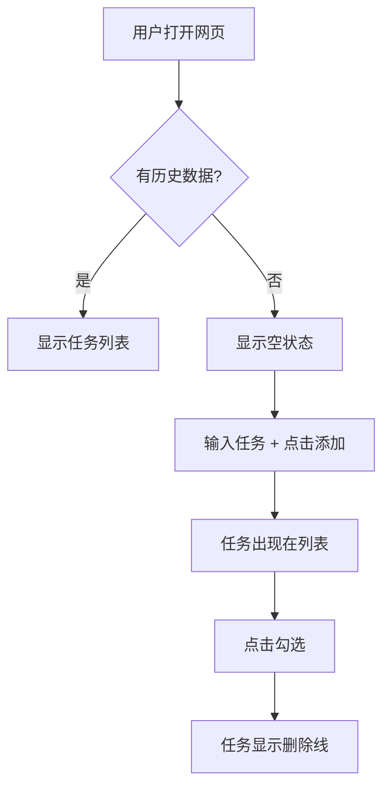

# PRD 文档驱动开发：从想法到可执行规格

https://raw.githubusercontent.com/swpucwf/MyBolgImage/main/img/vibe_mlkzvdt7-83b23488ee2e4fad.jpg

<p>图 1：产品思维与文档驱动</p>

## 1. 为什么先写文档再写代码

在让 AI 写代码之前，先写文档。没有蓝图，AI 很容易像脱缰的野马，生成的代码缺乏结构，写出一堆谁也看不懂、改不动的功能。这一章的逻辑链是：**先判断值不值得做（产品验证）→ 再让 AI 复述确认理解 → 用标准模板写 PRD → 理解 AI 如何执行 PRD**。

不过，如果已经有明确想法、只是想验证技术方案或做个小工具，可以跳过完整的产品验证流程，直接从「与 AI 确认需求」和「PRD 编写」开始。

## 2. 产品验证：避免做没人要的东西

创业公司失败的第一大原因是「没有市场需求」，占比约 42%。过早开发的成本远超想象：投入三个月做一个没人要的功能，不仅浪费了时间，还错失了验证其他假设的机会。**失败得越早，成本越低**——想法阶段发现问题只损失几张纸和一些对话，上线后才发现可能损失整个团队士气和融资窗口。验证的目的不是证明想法正确，而是尽早发现致命缺陷。

### 2.1 灵魂三问

**① 用户是谁？** 模糊的回答等于没有回答。「所有人」不是用户，「年轻人」不是用户。具体的回答指向可触达的人群：每天处理 5-10 个任务的职场人士、每周五花 2 小时汇总周报的销售团队、只会用微信的父母。不同群体的痛点、场景、支付意愿完全不同，为「所有人」设计的产品最终谁也服务不好。

**② 痛点在哪？** 「我觉得需要」不是真痛点，"没有这样的工具"也不是真痛点。真痛点是：用户现在有解决方案，但那个方案很痛苦——便签纸容易丢、手机备忘录打开太麻烦，用户每天都在经历。判断真实程度看用户是否已经尝试解决：没主动搜索过方案、没花钱或时间尝试过替代方案，这个「痛点」可能只是想象。

**需求的三个层次**：

| 层次 | 含义 | 部署系统例子 | 什么时候做 |
|---|---|---|---|
| 痛点（Must-have） | 不得不解决 | 每次部署要手动执行 10 个命令，容易漏步骤 | MVP 先解决 |
| 痒点（Nice-to-have） | 理想状态 | 自动检测代码变更并触发部署 | 迭代逐步加入 |
| 爽点（Wow-factor） | 超出预期 | 失败自动回滚并在 Slack 通知原因与修复建议 | 打造差异化 |

**③ 为何用你？** 「技术最好」「界面好看」「因为 AI 做的」都不是用户在乎的。真实优势来自三方面：更好解决痛点（更快、更便宜、更简单）、独特获客渠道、独特数据或资源。很多时候答案不是「为何用你」，而是「根本不需要你」——能接受这个答案，就节省了后续所有投入。竞争对手可能不是另一家公司，而是 Excel、纸质笔记本，或者「什么都不做」。

### 2.2 真实访谈法三原则

**原则一：谈论他们的生活，而非你的想法。** 当你开始描述自己的想法，对方会进入社交礼仪模式，点头、微笑、说「听起来不错」——不是因为感兴趣，而是不想打击热情。正确方式是谈对方的生活：最近在忙什么、遇到什么问题、怎么解决的。

**原则二：询问过去的具体行为，而非未来的假设。** 「你会用吗」会得到虚假肯定，「多少钱愿意买」会得到不真实的数字——人们对自己未来行为的预测极不准确。正确方式是问过去：上一次遇到这个问题是什么时候、当时怎么处理、试过哪些方法、花了多少时间和金钱。过去的行为是已发生的事实，不会被理想化的自我形象扭曲。

**原则三：多听少说。** 对话中说得越多，获得的真实数据越少。每次你开口解释，都是一次学习机会的丧失。你的任务是创造空间让对方自由表达，而不是引导他们走向你预设的答案。

**好问题 vs 坏问题**：

| 类型 | 坏问题 | 好问题 |
|---|---|---|
| 观点类 | 你觉得这是个好主意吗？你会买吗？ | — |
| 假设类 | 你愿意付多少钱？如果有 X 功能你会用吗？ | — |
| 诱导类 | 你不觉得这个问题很烦人吗？ | — |
| 行为追溯 | — | 上次遇到这个问题是什么时候？当时怎么处理的？ |
| 现状挖掘 | — | 你现在怎么解决？花了多少钱和时间？ |
| 动机探究 | — | 为什么费心做这件事？带来了什么影响？ |

**虚假信号的陷阱**：赞美不是数据——对话结束时说「想法很棒、保持联系」，听起来积极但毫无价值；识别方法是看对方是否做出实质性付出（愿不愿深入讨论、引荐相关人士、预付或承诺）。「我会用」有三层含义（真会、客套、拖延），看对方是否已经为这个问题付出过代价。访谈中对方提出的功能建议也不要直接实现，先深挖动机：为什么需要、没有它时怎么处理、带来什么价值。

### 2.3 MVP 思维

MVP 不是「残缺版产品」，而是**能验证假设的最简版本**。很多人把它理解成「先做个简陋版上线，以后再完善」，这会导致两个问题：简陋意味着体验糟糕，用户可能过早放弃；「以后再完善」往往永远不会到来。MVP 是实验工具，目的是以最小成本验证最核心的假设。

| 验证方式 | 适用场景 | 成本 |
|---|---|---|
| 手工服务 | 验证需求是否存在（如外卖先建微信群接单） | 时间 |
| 落地页 | 验证用户兴趣（收集邮箱/预订单） | 几乎为零 |
| 原型演示 | 验证方案可行性 | 中等 |
| 简化版本 | 验证核心功能 | 开发成本 |

**验证假设的层次**（不要跳层）：

| 假设层次 | 验证方法 | 通过标准 |
|---|---|---|
| 用户存在 | 与目标用户交谈 | 能找到 5-10 个符合画像的人 |
| 痛点真实 | 了解现状和代价 | 对方已经尝试解决 |
| 方案可行 | 原型或手工服务 | 对方愿意使用或付费 |
| 可持续 | 付费验证 | 有人真的付钱 |

访谈目标是 5-10 次有效对话，不是几百次；3 次连续访谈没有新信息时基本可以停止。找不到目标用户本身就是风险信号——可能群体不存在或无法触达。访谈得到的都是正面反馈时，检查是否提到了自己的想法、是否问了未来行为而非过去行为。

## 3. 与 AI 确认需求

AI 不一定会追问所有关键细节。当需求描述模糊时，它可能按常见模式做出假设就开始工作。如果假设恰好符合预期是好事，但假设错了，后续就要付出更多沟通成本纠正。更麻烦的是，AI 的假设往往「合理」——技术上可行、逻辑自洽，只是不符合特定需求，而这种偏差在代码生成前很难被发现。

| 偏差来源 | 导致的问题 |
|---|---|
| 用户模糊 | AI 猜测目标用户，可能猜错 |
| 功能边界不明确 | 可能加功能，也可能漏功能 |
| 技术约束未说明 | 选用了不兼容的技术 |
| 边缘情况未考虑 | 生成的代码缺少错误处理 |

**确认理解模板**：每次讨论完需求后，让 AI 按固定格式复述：

```text
请确认你理解了我的需求。请按以下格式回复：

1. **目标用户**：[你理解的目标用户]
2. **核心功能**：[你理解的 3-5 个核心功能]
3. **不做的事情**：[你理解的不做的功能]
4. **可能的问题**：[你认为我可能没考虑到的地方]

如果有任何不确定，请列出问题清单。
```

模板的价值在于强迫 AI 把隐含假设显性化。当它写下「目标用户是职场人士」时，可以立即发现理解是否准确——也许指的是大学生，也许是自由职业者。

**让 AI 主动追问**：描述完需求后直接说「基于现有方案，列出多个你不确定的问题向我确认」。AI 会输出 3-5 个问题，逐一回答后继续追问，直到双方对齐：

```text
你：我想做一个待办清单应用。
你：基于现有方案，列出多个你不确定的问题向我确认

AI：1. 目标用户是谁？个人还是团队？2. 核心功能有哪些？3. 数据存哪里？
    4. 需要登录吗？5. 有移动端需求吗？

你：个人使用；添加/完成/删除，不做标签；本地存储；不需要登录；只做桌面端。

AI：明白了。还有几个问题：本地存储如果用户清理浏览器数据，任务会丢失吗？
    "完成"的任务是删除还是保留标记？任务有截止日期吗？
```

AI 会根据回答不断挖掘新的隐藏假设，直到关键细节都明确。追问的终点有四个信号：理解与预期完全一致、所有关键细节明确、边缘情况讨论清楚、自己也感到清晰了。

**三个常见误区**：嫌 AI 问题太基础不愿回答（跳过关键确认，偏差被隐藏）；回答模糊让 AI「看着办」（它会按默认方式处理）；怕麻烦一轮问答就喊停（深层假设没被挖掘，返工成本更高）。

**必须确认的细节清单**：

| 类别 | 确认项 |
|---|---|
| 用户与场景 | 目标用户是谁（决定 UI 复杂度）、使用场景（决定技术选型）、解决什么问题 |
| 核心功能 | 最核心的 3-5 个功能、用户完成任务的流程、有哪些状态变化 |
| 不做的事情 | 哪些功能这次不做、哪些永远不做（AI 倾向「多做」，必须明确边界） |
| 数据与状态 | 存储哪些数据、数据从哪里来、边缘情况怎么处理 |
| 技术约束 | 技术栈限制、兼容设备、性能要求 |

**发现盲点的提示词**：

```text
基于我们刚才的讨论，请列出：
1. 我可能没考虑到的边缘情况
2. 你认为常见但我可能不需要的功能
3. 需要明确的技术细节

请逐条列出，我会逐一确认。
```

AI 可能会指出：数据删除后能恢复吗？列表有数量上限吗？输入超长内容怎么显示？需要在手机上用吗？——这些就是被忽略的细节。AI 指出的问题不一定都要解决，但知道它们存在，能做出知情的权衡。

**方案先行原则**：在生成完整代码之前，先让 AI 输出方案或架构——发现偏差更快、修改方案比修改代码便宜、确保整体架构合理后再进入细节。

```text
请先不要写代码，先给出实现方案：
1. 数据结构设计
2. 主要页面/组件及其职责
3. 核心流程的实现思路
4. 可能遇到的技术难点
```

**讨论结束检查清单**：

- [ ] AI 明确说了目标用户是谁；
- [ ] AI 列出了 3-5 个核心功能；
- [ ] AI 明确了不做哪些功能；
- [ ] AI 理解了完整的使用流程；
- [ ] 数据怎么存、存什么已明确；
- [ ] 边缘情况已讨论；
- [ ] 技术约束已说明；
- [ ] 让 AI 总结确认，它的理解准确。

## 4. PRD 的五部分结构与迭代

传统开发中 PRD 主要给团队看；在 AI 开发中，PRD 更重要的是给 AI 提供完整上下文，让它不需要反复猜测意图。PRD 是「单一事实来源」：想法被清晰描述后，AI 的输出会稳定很多，也不会出现需求爆炸。

| 部分 | 对应阶段 | 核心内容 |
|---|---|---|
| 第 0 部分：文档信息 | 始终记录 | 版本、阶段、更新记录、名词解释 |
| 第一部分：需求背景与目标 | 初稿 | 为什么做、为谁做、解决什么问题 |
| 第二部分：方案概述 | 中稿 | 业务流程、功能流程、信息架构 |
| 第三部分：细节方案 | 定稿 | 交互说明、边缘情况、非功能需求 |
| 第四部分：上线计划 | 定稿 | 排期、灰度发布 |

**迭代原则**：初稿想清楚「为什么」，中稿想清楚「是什么」，定稿想清楚「怎么做」。每一步都有评审和修改，避免到最后才发现大问题。版本号也可以用语义化版本：主版本号对应不兼容的重大变更、次版本号对应新增功能、修订号对应小改动。

### 4.1 第一部分：需求背景与目标

- **项目概述**：用一两句话概括。「一个给自己用的极简待办清单网页」比「一个待办清单应用」好得多——前者包含「个人工具而非团队协作」「功能有限界面简洁」「网页形态」三层边界；
- **核心问题**：目标用户画像（具体特征）、用户场景（时间/地点/情境）、核心痛点（现有方案有什么问题）；
- **用户故事**：「作为一名<角色>，我想要<完成任务>，以便于<实现价值>」——强制从用户角度而非功能角度思考；
- **需求范围**：In-Scope（明确要做）与 Out-of-Scope（明确不做）。不写 Out-of-Scope，AI 可能自动加上「常见功能」，范围不断蔓延；
- **需求列表与优先级**：需求 ID、模块、描述、优先级、状态，让 AI 知道哪些是核心、哪些可以延后。

### 4.2 第二部分：方案概述

用 Mermaid 描述核心业务流程：



只有文字时 AI 可能理解错步骤顺序，流程图则一目了然。流程图还会暴露思维盲点：试图画图时，「用户没登录怎么办」「数据加载失败显示什么」这些「显然」的步骤会变得具体可见。

信息架构图列出页面结构与层级：首页（导航栏、任务列表）、设置页（主题、数据管理）。

### 4.3 第三部分：细节方案

**页面原型与交互说明**要覆盖五种状态：初始状态、触发操作、成功状态、失败状态、空状态。只写「用户可以添加任务」，AI 不知道加在哪、怎么显示；写完整交互逻辑，它才知道输入框位置、按钮样式、列表如何更新。

**边缘情况处理**是新手最容易漏掉的部分。遗漏往往不是因为粗心，而是「正常路径偏差」——大脑自动填充最理想的流程，而真实体验充满网络波动、手滑误触、突然来电：

| 边缘情况 | 不写的后果 |
|---|---|
| 用户快速点击两次 | 可能重复提交 |
| 网络出错 | 用户不知道发生了什么 |
| 数据为空 | 显示空白或报错 |
| 用户中途退出 | 可能数据丢失 |

常见处理：快速点击做 0.5 秒防抖；请求失败显示「网络错误，请重试」；列表为空显示「暂无任务，添加一个吧」。

**非功能性需求**：性能（不写可能做得很重）、兼容性（不写可能只支持 Chrome）、数据埋点（不写上线后无法追踪使用）。

### 4.4 第四部分：上线计划

排期（需求评审 → UI/UX 设计 → 研发 → 测试 → 预计上线）、A/B 测试方案（目标、分组、流量分配、核心指标、上线标准）、灰度发布（内部员工 → 种子用户 → 10% → 50% → 全量）。

### 4.5 让 AI 生成 PRD

确认理解后，让 AI 基于模板生成：

```text
请基于我们的讨论，用 PRD 模板生成文档。
如果某个字段我们没讨论过，请标注 TBD（待确定）。
```

生成之后要做三件事：**检查每个字段是否基于讨论**（不是 AI 猜的）、**补充 TBD 字段**（补细节或明确「不需要」）、**纠正误解**（发现不一致立即改）。

## 5. 从 PRD 到代码：理解 AI 的执行方式

### 5.1 人与 AI 的阅读差异

| 人的阅读方式 | AI 的阅读方式 |
|---|---|
| 从头到尾读一遍 | 把 PRD 分解成「信息块」 |
| 跳过重复内容 | 每个字段都处理 |
| 会「脑补」模糊的地方 | 严格按字面意思理解 |
| 会主动问不清楚的地方 | 可能按默认理解处理，也可能追问 |

核心差异是 **AI 不会脑补**。「登录功能」对人类意味着用户名、密码、登录按钮；对 AI 可能意味着简单本地验证，也可能意味着完整 OAuth 流程——不明确指定，它会按训练数据里的常见模式选一种。

AI 的执行流程：接收 PRD → 提取关键信息 → 构建数据模型 → 设计 API 接口 → 生成前端代码 → 生成后端代码 → 整合测试。每一步都是潜在失败点，也是可以通过改进 PRD 优化的点。

### 5.2 PRD 细节如何影响代码

| PRD 描述 | AI 的理解 |
|---|---|
| 「任务有标题、完成状态」 | `{ title: string, completed: boolean }` |
| 「用户可以添加多个任务」 | `tasks: Array<Task>` |
| 「数据需要保存」 | localStorage 或数据库 |
| 「点击添加按钮，任务出现在列表」 | `handleAddTask()` |
| 「快速点击防抖」 | `debounce()` 或 disabled 状态 |

没写 Out-of-Scope，AI 可能补上登录、云同步、分类标签；没写边缘情况，AI 可能不做防抖、不做错误处理：

```javascript
// 没有边缘情况描述时
function addTask() {
  tasks.push(newTask);
}

// PRD 写明「快速点击防抖，0.5 秒内只响应一次」后
function addTask() {
  if (isAdding) return;
  isAdding = true;
  tasks.push(newTask);
  setTimeout(() => isAdding = false, 500);
}
```

### 5.3 AI 理解 PRD 的三个盲区

| 盲区 | 例子 | 解决方案 |
|---|---|---|
| 默认值 | 「显示任务列表」——最多显示多少条？AI 可能猜 10/50/100 | 明确写出期望的默认值 |
| 状态变化 | 「任务可以勾选完成」——删除线？移到底部？消失？ | 用「初始 → 触发 → 加载中 → 成功/失败」描述状态 |
| 优先级 | 列了一堆功能，AI 按顺序全部实现 | 用 P0/P1/P2 标注优先级 |

### 5.4 三个写作技巧

1. **结构化格式**：Markdown 列表与标题比纯文字段落清晰；
2. **具体而非抽象**：不说「界面要好看」，说「白色背景，蓝色按钮，无边框圆角」；不说「要流畅」，说「点击后 0.5 秒内响应」；
3. **用 Mermaid 流程图**：比文字描述更准确，AI 能「看懂」。

### 5.5 方案先行，实现为后

```text
请先给出这个功能的技术实现方案，包括数据结构、接口定义、主要步骤。
我确认后你再写代码。
```

| 直接写代码 | 先输出方案 |
|---|---|
| 方向性错误发现得晚 | 方案阶段就能纠偏 |
| 有误解返工量大 | 方案阶段发现问题 |
| 是否符合预期不可控 | 方案确认后预期更明确 |

## 6. 好 PRD vs 坏 PRD

```markdown
# 待办清单
做一个待办清单功能，用户可以添加任务、勾选完成。
```

问题：没说用户是谁（可能做成团队版）、没说核心功能（可能加一堆不需要的）、没说 Out-of-Scope（可能加登录、云同步）、没说边缘情况（快速点击会重复提交）、没有流程图（可能理解错业务逻辑）。

```markdown
# 极简待办清单

## 1.1 项目概述
一个给自己用的极简待办清单网页，只有添加和勾选功能。

## 1.2 核心问题
- **目标用户**：我自己（职场人士，每天处理 5-10 个任务）
- **用户场景**：早上打开电脑，快速看今天要做什么
- **核心痛点**：便签纸容易丢，手机备忘录打开麻烦

## 1.5 需求范围
**In-Scope**：添加任务、查看列表、勾选完成、删除任务
**Out-of-Scope**：登录注册、云同步、分类标签

## 2.1 核心业务流程
[Mermaid 流程图]

## 3.1 边缘情况处理
- 快速点击「添加」→ 0.5 秒防抖
- 列表为空 → 显示「暂无任务」
- 刷新页面 → 数据不丢失（localStorage）
```

**PRD 要写多详细**？原则是：AI 读了之后，不需要再问「这个按钮放哪」「失败时怎么处理」。初稿可以简略、中稿要有流程图、定稿要包含边缘情况。不推荐边开发边写 PRD——「写着写着发现不对」的返工成本更高；PRD 也不是写完就不能改，每次重大变更更新版本号和记录即可。小项目也需要 PRD，可以只写几百字，但五部分结构应当完整。

> **补记**：这一章真正训练的是**问题定义能力**，而不是文档格式。三个最容易被低估的动作：① 用「灵魂三问」尽早否掉伪需求；② 让 AI 复述并主动追问，把隐含假设逼出来；③ 明确写出 Out-of-Scope 与边缘情况——这两处恰恰是 AI 「自由发挥」和「缺失错误处理」的高发区。

## 写在最后

下一篇[开发基础](4-开发基础)补齐技术底层：构建流程、技术选型、API 与 HTTP、前后端分离、配置格式、README 结构与找库方法——让 PRD 里的技术描述落得下去。
