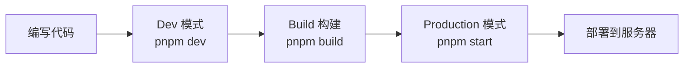
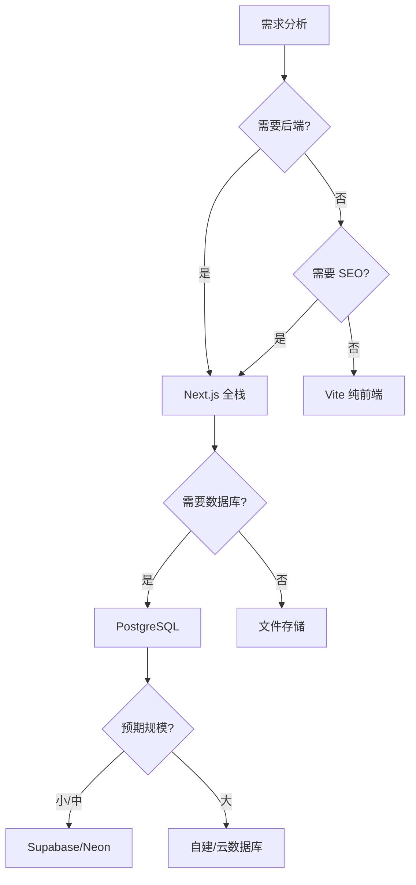
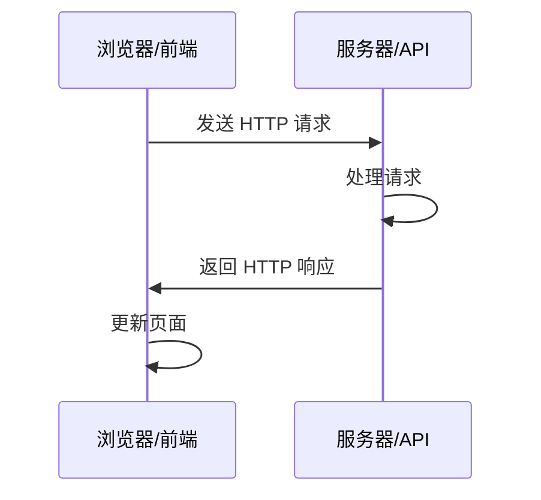

# 开发基础：从代码运行到 API 与文档

https://raw.githubusercontent.com/swpucwf/MyBolgImage/main/img/vibe_mlkzwcw8-aa8ae9e1ebb5251a.jpg

<p>图 1：你必须知道的开发基础</p>

## 1. 代码的三种状态

代码有三种「生命状态」：**Dev（开发）、Build（构建）、Production（生产）**。理解它们的区别，是避免「改了代码没效果」这类困惑的关键。

| 模式 | 命令 | 像什么 | 特点 | 适用场景 |
|---|---|---|---|---|
| Dev | `pnpm dev` | 打草稿 | 保存后浏览器自动更新、热重载、报错详细、运行较慢 | 日常开发调试 |
| Build | `pnpm build` | 把草稿排版印刷成书 | 压缩体积、优化速度、生成 `.next` 或 `dist`、去除调试信息 | 准备上线前 |
| Production | `pnpm start` | 模拟正式上线环境 | 运行构建后代码、性能最优、无热重载 | 上线前最后检查 |



**热重载**只在 Dev 模式存在：开发工具后台监听文件变化，检测到修改就自动刷新或只更新改动部分。Build 或 Production 模式下代码已打包，没有监听机制，修改后需要重新构建。

**为什么 `pnpm dev` 能启动项目**？打开根目录的 `package.json`：

```json
{
  "scripts": {
    "dev": "next dev",
    "build": "next build",
    "start": "next start"
  },
  "dependencies": {
    "next": "^16.0.0",
    "react": "^19.0.0"
  }
}
```

`scripts` 定义运行命令，包管理器查表执行；`dependencies` 记录第三方库及版本，保证 `pnpm install` 后还原同样的环境。也可以自定义端口，比如 `"dev": "next dev -p 4000"`。

**构建产物不能双击打开**。Next.js 本质上是运行在 Node.js 上的程序，需要服务器环境（连接数据库、处理 API、服务端渲染）；即使是 Vite 打包的纯静态项目，现代应用用绝对路径引用资源，双击打开走 `file://` 协议会找不到资源。

https://raw.githubusercontent.com/swpucwf/MyBolgImage/main/img/vibe_image-20260226235036212.png

<p>图 2：直接双击构建产物导致资源加载失败</p>

正确访问方式：Next.js 用 `pnpm start`，Vite 用 `pnpm preview`，永远通过 Web 服务器访问应用。

**缓存问题**也是常见困惑来源。浏览器缓存的解决方式：`Ctrl + Shift + R` 强制刷新、无痕模式、开发者工具 Network 勾选 Disable cache。

https://raw.githubusercontent.com/swpucwf/MyBolgImage/main/img/vibe_image-20260226235149160.png

<p>图 3：在 Network 面板禁用缓存</p>

如果强制刷新还不行，可能是构建缓存，删除 `.next` 目录后重新 `pnpm build`。**环境变量缓存**则是另一回事：修改 `.env` 后必须重启服务（`Ctrl+C` 再 `pnpm dev`），因为环境变量在进程启动时加载，运行中改文件不会自动生效。

## 2. 技术栈决策框架

技术栈决策是产品开发的关键节点。很多人容易陷入「技术崇拜」——追求最新最酷的技术，忽略实际需求。这在 AI 时代尤其危险：AI 对主流成熟技术支持最好，冷门技术可能导致它理解不准、生成错误的实现。

**核心原则：明确需求 → 评估复杂度 → 选择最小可行方案。**

### 2.1 编程语言全景

| 语言 | 主战场 | 代价 |
|---|---|---|
| C / C++ | 操作系统、游戏引擎、嵌入式 | 手动内存管理，开发效率低 |
| Java | 企业级后端、银行核心系统 | 代码冗长，开发周期慢 |
| Python | 数据科学、AI 训练 | 前端能力弱，全栈需另一套技术 |
| Go | 云原生、Docker/K8s、高性能网络服务 | 生态相对年轻 |
| Rust | 系统编程、高性能 + 内存安全 | 学习曲线陡，不适合快速原型 |
| JavaScript / TypeScript | Web 前后端通吃 | 需构建工具链 |

### 2.2 为什么选 TypeScript + Next.js

从独立开发者或小团队的实际需求出发：需要一套技术栈同时处理前端界面和后端逻辑，学习曲线不能太陡，社区支持要丰富。

C/C++/Rust 太底层，内存管理、编译优化对快速做产品是巨大时间成本；Java/Go 需要单独学前端，两套工具链、两套思维方式、两套部署流程；Python 浏览器跑不了，还是要学 JavaScript；PHP/Ruby 生态在萎缩，且 AI 训练数据不如 JavaScript 丰富。

TypeScript 的独特之处是**统一了前后端**：同一种语言写界面和 API，类型定义两端共享，AI 不需要在语言范式之间切换。Next.js 进一步把 React 前端、API 路由、数据库连接、部署流程整合在一起——不用配复杂构建工具、不用处理跨域、甚至不用管服务器。

**AI 时代的选型新维度是「AI 友好度」**：主流技术训练数据庞大，AI 知道最佳实践与常见陷阱；统一技术栈让上下文更连贯——前端 React、后端 Python、数据库 MongoDB 混用时，上下文切换多、生成风格容易不统一；统一 TypeScript 生态时，类型共享、AI 能一次理解整个项目。

### 2.3 三个决策问题

1. **这个项目本质上需要做什么？** 展示内容为主 → 静态站点/纯前端；需要登录 → 后端能力；需要持久化 → 数据库；需要 AI → 集成 AI API；
2. **用户规模和并发量预期？** 个人/小规模 → 简单方案；中等 → 考虑扩展性；大规模 → 架构设计；
3. **团队（或个人）的技术背景？** 熟悉 JS/TS → Next.js；熟悉 Python → FastAPI/Flask；全新学习 → 选 AI 支持最好的技术栈。

### 2.4 方案速查

| 类别 | 方案 | 适用 | 不适用 |
|---|---|---|---|
| 前端 | Next.js | 需要后端、SEO、全栈 | 纯静态展示 |
| 前端 | Vite + React | 纯前端 SPA | 需要 SSR/SEO |
| 前端 | 纯 HTML/CSS | 极简静态页 | 交互复杂应用 |
| 数据库 | PostgreSQL | 关系型、需要事务 | 极简键值存储 |
| 数据库 | Supabase | 快速开发、需认证/存储 | 需完全自定义后端 |
| 数据库 | Neon | 无服务器、轻量 | 需完整后端功能 |
| 数据库 | SQLite | 本地开发、极简 | 多用户并发写入 |
| 部署 | Vercel | Next.js、全球分发 | 主要用户在国内 |
| 部署 | EdgeOne Pages | 国内节点、边缘计算 | 需要深度 Next.js 特性 |
| 部署 | 云服务器/Docker | 完全控制、环境一致性 | 小项目运维成本高 |

**Supabase vs Neon**：Supabase 提供完整后端功能（认证、存储、实时订阅），适合快速开发；Neon 专注数据库本身，轻量且支持 Serverless，适合对后端有自定义需求的场景。PostgreSQL 还能通过扩展支持 `JSONB`（半结构化数据）和 `pgvector`（向量搜索），对 AI 应用友好。

**不同规模的选择**：初创（0-50 人）用 Next.js + PostgreSQL + Vercel；中型（50-500 人）用 Java/Go 后端 + React 前端 + 云数据库；大型（500+）多语言并存，按业务线选最合适的技术。

**决策流程**：



PRD 阶段不需要定死所有技术细节，确定大方向即可（框架、数据库、部署平台），具体库和组件设计可以在开发中调整。不确定功能能否实现时，先问 AI 可行性与技术路线；不需要先学会 TypeScript 再开始，边做边学效率更高。

## 3. PRD 与技术文档的分工

PRD 迭代到方案基本确定后，除了业务逻辑，还需要记录技术实现方案。两者分工明确：

| 文档 | 回答的问题 | 内容 |
|---|---|---|
| PRD | 做什么 | 目标用户、核心功能、用户交互、边缘场景 |
| 技术文档 | 怎么做 | 技术栈、数据库表结构、API 定义、第三方集成、部署方案 |

技术文档通常包含五部分：数据模型（用户表、文章表、评论表）、API 设计、第三方服务集成、部署方案、非功能性约束。对个人项目不必拘泥形式，可以把两者合并成「项目文档」，但要清楚区分哪些是产品思考、哪些是技术决策。

## 4. 读懂 AI 生成的代码：四个基本构件

所有编程语言都基于四个核心概念，理解它们就像学会阅读代码的「字母表」：

| 构件 | 作用 | 阅读时问自己 |
|---|---|---|
| 变量 | 存储数据的容器 | 数据存在哪里？ |
| 函数 | 可复用的指令块（输入 → 处理 → 输出） | 操作被封装在哪里？ |
| 条件 | 分叉的路口（`if/else`） | 什么情况下执行什么？ |
| 循环 | 重复执行 | 什么在重复执行？ |

这四个概念是**图灵完备**的基础——任何可计算的问题都能用它们的组合解决。手机上的每个 App，底层都是这四种构件的不同组合。

**伪代码是人与 AI 之间的桥梁**：它用编程的逻辑结构（条件、循环）描述需求，但不要求具体语法。例如登录功能：

```text
当用户点击登录按钮时：
    获取输入框中的邮箱和密码
    检查邮箱格式是否正确
    如果格式正确：
        发送请求到服务器验证
        如果验证成功：
            跳转到首页
        否则：
            显示"密码错误"
    否则：
       显示"邮箱格式不正确"
```

这种描述比纯自然语言清晰，AI 能很好地理解并转成正式代码。

**同样的功能可以有不同实现**。在 1000 个用户中查邮箱：逐个检查最坏要 1000 次；若按邮箱排序后二分查找，最多约 10 次。涉及大数据量时，可以提醒 AI「数据量很大，请使用高效的查找方法」。

## 5. API 与 HTTP 基础

**API（应用程序接口）** 是软件之间通信的约定。在 Web 开发中通常指 HTTP API——可以把 API 理解成**远程的函数**：函数定义在代码里，API 定义在服务器上；函数调用传参数返回结果，API 调用发请求返回响应。

用餐厅类比：前端是顾客、后端是厨房、API 是菜单、HTTP 请求是服务员。



**HTTP 请求的四个部分**：

| 部分 | 作用 | 示例 |
|---|---|---|
| 方法 | 想做什么 | GET 读取、POST 创建、PUT/PATCH 修改、DELETE 删除 |
| URL | 资源地址 | `https://api.example.com/users/123` |
| Headers | 元数据 | `Authorization` 令牌、`Content-Type` 数据格式、`Accept` 期望格式 |
| Body | 发送的数据 | 通常是 JSON：`{"title": "...", "content": "..."}` |

**响应**由状态码、响应头、响应体组成。状态码的规律：第一位表示类别，**2xx 成功、4xx 客户端问题、5xx 服务器问题**。

| 状态码 | 含义 | 常见场景 |
|---|---|---|
| 200 / 201 / 204 | 成功 / 已创建 / 无内容 | GET / POST / DELETE 成功 |
| 400 | 请求错误 | 参数格式错误 |
| 401 | 未认证 | 缺少或无效令牌 |
| 403 | 禁止访问 | 有令牌但权限不足 |
| 404 | 未找到 | 资源不存在 |
| 429 | 请求过多 | 触发限流 |
| 500 | 服务器错误 | 后端内部出错 |

完整示例（修改昵称）：

```http
PATCH /api/users/123 HTTP/1.1
Host: api.example.com
Authorization: Bearer your_token_here
Content-Type: application/json

{ "nickname": "新昵称" }
```

```http
HTTP/1.1 200 OK
Content-Type: application/json

{ "id": "123", "nickname": "新昵称", "updatedAt": "2025-01-28T10:00:00Z" }
```

**排查速查**：401 → 检查 Authorization；404 → 检查路径；数据显示错误 → 检查字段名/类型/结构是否匹配；429 → 降低频率加重试；网络错误 → 检查服务器状态。即使 200 OK，也可能因字段名不一致（`userName` vs `username`）、类型不一致（`"123"` vs `123`）、结构不一致（数组 vs 对象）而出错——告诉 AI「数据格式对不上」即可。

https://raw.githubusercontent.com/swpucwf/MyBolgImage/main/img/vibe_image-20260227000559422.png

<p>图 4：在开发者工具 Network 面板查看 API 请求</p>

**JSON 是 Web API 的标准格式**：大括号表示对象、方括号表示数组、键必须双引号、键值对逗号分隔。它是不同语言之间的「普通话」——Python、JavaScript、Java、Go 都能轻松解析与生成。

## 6. 前后端分离与模块化

前端运行在浏览器，负责页面渲染、用户交互、数据展示与收集；后端运行在服务器，负责业务逻辑、数据存储、身份认证、调用外部服务。

**传统模式（服务端渲染）**：服务器查数据库、生成完整 HTML、浏览器直接显示；页面切换要重新加载，前后端代码耦合。

**前后端分离**：浏览器加载页面框架 → 请求数据 → 后端处理并返回 JSON → 浏览器渲染。优势是职责清晰、可并行开发、技术解耦、API 可复用给 Web/App、切换页面无需重载。

**全栈框架**（如 Next.js）把前后端放进同一个项目、用同一种语言写，但职责不变：`app/page.tsx` 在浏览器渲染，`app/api/*.ts` 在服务器执行。好处是统一语言、类型共享、部署简单、减少上下文切换。

**模块化思维**：不要把代码塞进一个文件，按功能拆分模块：

```
src/
├── app/              # Next.js App Router
│   ├── page.tsx      # 前端页面
│   └── api/          # API 路由
│       ├── auth/     # 认证
│       ├── posts/    # 文章
│       └── users/    # 用户
├── components/       # 可复用组件
├── lib/              # 工具函数
└── db/               # 数据库相关
```

模块化让代码易维护、易理解、易测试、便于协作，也让 AI 能更快定位相关代码。

## 7. 配置文件格式：JSON 与 YAML

结构化数据格式用严格规则组织数据：格式统一无歧义、易于程序解析生成、跨语言跨平台通用，**AI 也能准确理解**——比散漫的自然语言更易读。

**JSON**：

```json
{
  "name": "张三",
  "age": 25,
  "address": { "city": "北京", "district": "朝阳" },
  "hobbies": ["阅读", "游泳", "编程"]
}
```

规则：对象用 `{}`、数组用 `[]`、键必须双引号、键值对逗号分隔。数据类型包括字符串、数字、布尔值、数组、对象、`null`。

**YAML** 更人性化，用缩进表示层级、不需要括号：

```yaml
name: 张三
age: 25

address:
  city: 北京
  district: 朝阳

hobbies:
  - 阅读
  - 游泳
  - 编程
```

JSON 通用性强，是 HTTP API 的标准格式；YAML 更简洁，常用于 CI/CD、Docker Compose 等配置。两者都是「数字时代的普通话」。

## 8. API 集成六步法

接入 AI、地图等外部服务，可以按六步走：

1. **获取凭证**：注册平台、创建 API Key（通行证）；
2. **选择技术路线**：官方 SDK 或直接 HTTP 请求；
3. **配置环境变量**：Key 存到 `.env`，不要写死在代码里——环境变量是代码与密钥之间的防火墙；
4. **编写最小测试**：先用一个最小请求验证能否调通；
5. **归档参考文档**：把官方文档保存下来，下次让 AI 写功能时直接把文档喂给它，生成更准确；
6. **业务功能开发**：在调通的基础上封装业务逻辑。

https://raw.githubusercontent.com/swpucwf/MyBolgImage/main/img/vibe_image-20260226235253923.png

<p>图 5：在平台创建 API Key</p>

https://raw.githubusercontent.com/swpucwf/MyBolgImage/main/img/vibe_image-20260226235337240.png

<p>图 6：配置环境变量</p>

对 AI 应用推荐 **Vercel AI SDK**：`@ai-sdk/openai-compatible` 包可以对接任何兼容 OpenAI API 格式的服务商，只学一套规范，改 `baseURL`、API Key 和模型名就能调用主流大模型。常见错误里最典型的是**限流（429）**：需要降低请求频率、加入重试与退避策略。

## 9. README：项目的说明书

代码不仅给机器运行，也给人和 AI 阅读。README 是项目的第一印象：

| 角色 | 获得什么 |
|---|---|
| 自己 | 长期不忘细节，快速恢复上下文 |
| 协作者 | 快速理解项目，上手开发 |
| AI | 完整项目上下文，生成更准确的代码 |
| 用户 | 了解功能，正确使用 |

完整结构：项目简介（一两句话）→ 快速开始（安装依赖、启动命令、访问地址）→ 环境变量（复制 `.env.example` 并填写）→ 核心功能 → 技术栈 → 项目结构 → 开发指南（可选）→ 贡献指南（可选）→ 许可证。

```markdown
# 极简待办清单
一个给自己用的极简待办清单网页，支持添加、完成和删除任务。

## 快速开始
pnpm install
pnpm dev
访问 http://localhost:3000 查看效果。

## 环境变量
复制 `.env.example` 为 `.env.local`，填写 DATABASE_URL、OPENAI_API_KEY 等。

## 技术栈
Next.js 14 (App Router) + TypeScript + Tailwind CSS + PostgreSQL + Drizzle ORM
```

写 README 的过程也是「知识外化」：原本以为「显而易见」的设计决策，动笔才发现需要解释；原本以为「简单」的启动流程，实际有多个依赖步骤。这些发现往往会反过来推动项目改进。

## 10. 找库与评估：不重复造轮子

真实项目里会不断遇到「这个功能是不是已经有现成的库」。答案通常是：有，而且不止一个。**不重复造轮子**的前提是：主流需求几乎都有成熟方案（表单验证 `zod`、请求 `axios/ofetch`、时间 `dayjs/date-fns`、图标 `lucide-react`），AI 也会优先组合这些积木。

**怎么找到合适的库**：先描述需求让 AI 推荐候选，再到 npm 页面看周下载量、最近更新时间、issue 活跃度；同时对比同类库的体积与维护状态。**如何评估**：维护频率（半年无更新要警惕）、下载量（反映真实使用）、文档质量、TypeScript 类型支持、bundle 体积、许可证。

**什么时候可以自己写**：需求极简（几十行能解决）、库的抽象反而增加复杂度、有特殊约束（体积、安全、离线）、或学习目的。判断标准不是「能不能写」，而是「维护成本是否高于收益」。

> **补记**：这一章把「开发常识」压缩成了一条链：**代码在三种状态下运行 → 技术栈按需求选 → 文档分产品与技术两层 → 代码由四个构件组成 → 前后端通过 HTTP/JSON 通信 → 外部能力按六步集成 → 项目用 README 与库生态维持可维护性**。这些不是要背下来的知识，而是排查问题时的坐标系——例如「改了没效果」先想状态与缓存，「接口拿不到数据」先看状态码与字段名。

## 写在最后

下一篇[UI 与 UX 设计](5-UI与UX设计)进入「好看又好用」的一层：AI 设计工具、组件库、动画库、灵感来源、进阶效果与组件 Skills。
