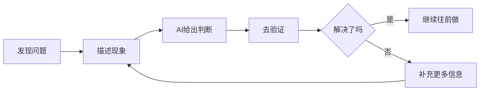

# 开始前：学习地图与求助流程

## 1. 这不是一门「编程课」

很多人看到「AI 编程」「Web 应用」「从零到上线」，脑海里会自动浮现一幅画面：先学语言、再学语法、再学框架、再做练习，最后也许才轮到项目。这套教程不是这条路子——它更像学开车，而不是学发动机制造：一开始不必背出方向盘、刹车、后视镜的结构图，而是先把车开上路。代码、提示词、Git、API、部署这些词当然会遇到，但不需要先把它们系统学完才有资格开始，而是在做作品的过程中按需弄明白。

**不教什么**（以及为什么现在不这么教）：

| 不教 | 原因 |
|---|---|
| 先学完 Python / JavaScript 再开始 | 会把很多人永远挡在门外 |
| 先背完整语法与框架知识 | 先累死在抽象知识里，作品还没出现 |
| 训练成专业工程师 | 这不是基础篇的目标，系统工程内容留给进阶篇 |

**真正要建立的三件事**：

1. **把想法说清楚**：AI 能不能帮上忙，很大程度取决于有没有把目标、边界、想要的效果表达清楚。这不是「花哨地写 prompt」，而是把脑中模糊的念头说成 AI 能执行的明确任务；
2. **学会和 AI 协作**：角色不是 AI 的观众，也不是它的下属，而像项目的发起人——定义目标、补充上下文、检查结果、决定下一步怎么改。代码仍然重要，但不必从第一天就手打一切；
3. **先做出作品，再逐步理解**：对零基础读者，最大的门槛通常不是某个技术词，而是始终没有亲手做出一个东西。作品一旦出现，很多抽象概念会突然有了上下文。

一个更准确的类比：传统编程学习是先学外语的语法、词汇、句法、修辞，再试着写文章；这里更像是先用最熟悉的母语把想表达的内容说清楚，AI 负责翻译成更接近代码和实现的形式，人负责判断翻译对不对。**在 AI 编程时代，先拥有表达能力和判断能力，往往比先掌握大量语法更重要。**

代码当然不是不重要——它决定作品能不能运行、修改、上线；只是不必再是「进入创作世界之前必须先跨过的门槛」。基础版先建立三种能力：把需求说清楚的表达、看懂结果对不对的判断、遇到问题还能继续往前走的推进。

## 2. 最终会做出什么：个人主页 + 数字分身

先看终点：**一个个人主页 + 数字分身**。它不是做完就扔的 demo，而是能继续修改、分享、成长的作品。

| 部分 | 具体内容 |
|---|---|
| 主页首屏 | 头像、名字、一句话介绍、清晰的第一印象 |
| 内容区 | 作品展示、经历、联系方式等真正想让人看到的内容 |
| 数字分身 | 一个能替你回答常见问题的聊天入口 |
| 正式发布版本 | 稳定可访问的公网链接，能发给朋友、HR、潜在合作伙伴 |

选这个案例，是因为它对零基础更友好：天然与自己有关（不是替陌生需求造产品）、结果直观（页面好不好看、聊天自然不自然一眼可见）、天然适合引入 AI（数字分身是自然场景），而且不是一步到位，而是沿清晰路径持续迭代：

| 版本 | 会变成什么样 |
|---|---|
| `v1` | 能预览、能展示、能简单聊天 |
| `v2` | 带回本地，能继续修改 |
| `v3` | 首页更像一个认真做过的作品 |
| `v4` | 内容更完整，访客知道看什么、问什么 |
| `v5` | 数字分身更像本人 |
| `v6` | 正式上线，别人可以访问和反馈 |

## 3. 适合谁、不适合谁

**适合**：

| 是谁 | 会得到什么 |
|---|---|
| 零基础学生 | 第一次知道「我也能把想法做成东西」 |
| 产品 / 运营 / 设计背景 | 把只能写在文档里的想法变成可演示作品 |
| 想做个人主页 / 作品集 | 做出一个真的可以分享出去的个人项目 |
| 想低成本试项目 | 用最小闭环完成第一次验证，而不是停在想象里 |

尤其适合「不是来考技术理论、想先做出作品再决定要不要深入、愿意边做边学」的人。

**不太适合**（不是不能学，而是不是最优入口）：想系统学前/后端/全栈原理；一上来就做复杂 SaaS 或多协作后台；想深入 Git 协作、部署架构、域名、DNS、CI/CD（这些在进阶篇系统讲）。

学完基础篇会到什么程度：能做出一个真正可展示的 AI 作品，知道怎么用 AI 继续修改、卡住时怎么推进，并对 Git、API、部署、安全建立「够用理解」；但不会自动变成专业全栈工程师，也不会获得大型架构设计能力——更现实的目标是从「完全没有作品」到「有第一个完整作品，且知道怎么继续走」。

## 4. 怎么学最有效

更合适的打开方式不是从头到尾连续阅读，而是**一边做一边读，遇到问题再回到对应位置查**。三种路径：

- **体验路径**：看完第 0 章直接做第 1 章，先拿到能预览、能聊天的 `v1` 原型；
- **完整路径**：按顺序完成第 0 章到第 6 章，走一遍从想法到上线的闭环；
- **边做边跳读**：第 0 章看完先做第 1 章，卡到哪里再回头查对应章节或附录。

**附录是工具箱，不是预习任务**：报错了去查「常见错误与问 AI 流程」，需要界面词汇去查「UI 速查卡」，忘了 Git 最小动作翻「Git 最小操作卡」——不先通读，而是在需要时马上推一把。

**每一章最重要的不是看完，而是交付**：先看这一章要做成什么，再动手，用验收清单确认结果，然后进入下一章。只阅读不动手很容易产生「我好像懂了」的错觉，真正开始做才发现没有建立起推进能力。

节奏上不必一口气做完：一次只完成一个小节，或一章里最重要的动作，但保证每次结束时作品都比开始时更往前一点——比「今天看了很多」更重要的，是「今天作品真的往前走了一步」。

## 5. 卡住时怎么办：统一求助流程

新手遇到问题的第一反应往往是：乱改代码、逐条搜报错、怀疑「是不是我不适合学这个」，然后在一个问题上卡很久。在 AI 编程时代更有效的第一反应是：**先把问题描述清楚，再让 AI 帮忙继续推进**——这不是偷懒，而是更省力也更高效的工作方式。

**统一求助公式**：按顺序告诉 AI——我刚刚做了什么、现在看到了什么问题、我本来想要什么结果；能配截图或完整报错更好。

```text
我刚刚在做：[刚刚做了什么]

现在出现的问题是：[现在看到的现象]

我原本希望得到的结果是：[想达到什么效果]

请先帮我判断最可能的原因，再告诉我下一步该怎么做。
```

三个常见例子：

```text
我刚刚让 AI 帮我修改了主页的布局。现在页面打开后是空白的。
我本来想看到修改后的主页，请先帮我判断最可能的原因，再告诉我下一步该怎么做。

我刚刚加了一个发送按钮。现在点击之后没有任何反应。
我本来希望点击后能发送消息，请帮我先定位最可能的问题。

我刚刚更新了数字分身的说明信息。现在它回答得还是很机械，而且没有按我的设定来。
我希望它更像我本人，请帮我判断是说明写得不够清楚，还是哪里没有生效。
```

**一次没解决不代表失败**，很多问题本来就是小迭代过程：



更好的做法是把新现象告诉 AI，说明刚按建议做了什么，继续下一轮判断。最值得补充的信息通常是：截图、完整报错原文、刚改了哪部分、看到的结果与预期差在哪里。「它不对」「它坏了」「还是不行」这类信息太少，AI 也很难判断。

还有一条更稳的协作视角：**不要把所有问题都第一时间归咎于 AI**。更常见的真实情况是——目标没说清楚、改动范围没限制、环境或配置没准备好、某一步没按预期生效。问题出现时，先看上下文、目标、边界、环境，而不是先把责任扔给 AI。

## 6. 学习地图

整条路线一目了然：


每章把作品推进到哪：

| 章节 | 作品的变化 |
|---|---|
| 第 1 章 | 做出能预览、能展示、能简单聊天的 `v1` |
| 第 2 章 | 从平台搬到自己的电脑，变成可持续修改的项目 |
| 第 3 章 | 首页从默认模板变成更像认真做过的作品 |
| 第 4 章 | 内容不再单薄，访客更懂你是谁、该问什么 |
| 第 5 章 | 数字分身不再只是「会回话」，开始像本人 |
| 第 6 章 | 从「只在自己电脑里」变成别人也能访问的正式链接 |

什么时候停、什么时候继续：只想体验一次「我也能做出来」，做到第 1 章就很值；想完成第一次完整闭环，就一路做到第 6 章。两者都不是失败——区别只是第 1 章结束拿到第一次正反馈，第 6 章结束拿到第一次完整作品闭环。

**出发前确认清单**：

- [ ] 我知道这套基础篇不是传统语法课
- [ ] 我知道自己最终会做出什么作品
- [ ] 我知道这条路线是否适合自己
- [ ] 我知道卡住时该如何向 AI 求助
- [ ] 我知道第 1 章到第 6 章分别在推进什么

> **补记**：这一章最值得记住的其实是两条「反直觉」——① 先做出来再理解，比先学完再动手更适合零基础（作品会给抽象概念提供上下文）；② 卡住时的正确动作是「结构化描述问题交给 AI」，而不是硬扛或乱改。把这两条当成整条学习路线的行为准则，后面每一章都会顺很多。

## 写在最后

路线清楚了，下一步就别停在准备阶段——下一篇[第一个版本：两小时做出个人主页与数字分身](2-第一个版本)从准备素材、填需求模板开始，用 AI 原型工具把 `v1` 真正生成出来并完成三轮微调。
