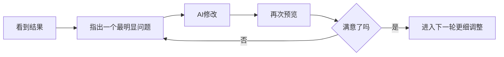

# 第一个版本：两小时做出个人主页与数字分身

## 1. 为什么先做这一版

很多人一上手就陷入「是不是应该先学会更多概念」的焦虑。但对零基础读者，最有效的起点往往不是再多读一篇解释，而是先完成第一次正反馈：**原来不用先学完整套语法，也真的能把一个页面做出来**。所以这一章的任务不是学会完整提示词理论，也不是一次把作品做到完美，而是先做出一个能预览、能展示、能简单聊天的版本。

**先别急着打开工具**。新手常见的动作是直接对 AI 说「帮我做一个个人主页，再加一个聊天机器人」——结果也能生成页面，但往往很空、很泛、很像模板站。不是 AI「不会做」，而是还没给它足够真实的材料；数字分身尤其如此：如果自己都没整理出「我是谁、想让别人看到什么、别人最可能问什么」，它也很难回答得自然。

## 2. 先收集事实，再考虑怎么说

正式生成之前，只需要准备一批**够用的第一版素材**——是「够用」，不是「完美」。很多人一上来就试图把自己写成一段很像宣传文案的话，结果越写越空；更稳的做法是先记事实，再记表达，不追求句子漂亮，把这几类信息记出来就够用：

| 类型 | 记到什么程度 |
|---|---|
| 基本信息 | 名字、头像、一句话介绍 |
| 当前状态 | 最近主要在做什么、最想让别人记住什么 |
| 兴趣与特点 | 2-4 个兴趣点、一个比较有记忆点的特点 |
| 访客视角 | 可能来访问主页的人是谁 |
| 常见问题 | 别人最可能问的 3 个问题 |

这些内容先写成很散的草稿即可，不需要已经像一段完整 prompt。核心判断标准是：**具体比抽象更有用，真实比好听更有用**。

| 太空的写法 | 更有用的写法 |
|---|---|
| 我是一个有热情的人 | 我最近在整理自己的作品，也在尝试用 AI 做个人项目 |
| 我喜欢很多东西 | 我比较关注 AI 应用、写作和旅行 |
| 我想做一个很棒的主页 | 我想做一个能展示我是谁、也能回答常见问题的个人主页 |
| 希望聊天机器人聪明一点 | 希望数字分身能回答「你最近在做什么」「你有哪些作品」「怎么联系你」 |

有用的素材不是「文采更好」，而是信息更落地。它会直接决定两个结果：

1. **页面是不是「你自己的页面」**：信息太空，AI 很容易生成一个没问题、但谁都能套用的默认页面；
2. **数字分身是不是「在替你说话」**：它不是百科全书，最重要的工作是根据提供的事实回答问题、用接近你的方式介绍你，并在不知道时诚实收住，而不是乱编。

现在**不需要**完美简历、全部作品素材、复杂人设文档或完整的个人品牌故事——第 4、5 章还会继续补内容和风格。

## 3. 用填空式模板写出第一版需求

零基础读者最常见的障碍不是「没有想法」，而是「脑子里有画面，但不知道怎么把它说成一段像样的话」。所以不必从零写 prompt，先用一个**填空式模板**起步：它的作用不是写出「最专业的 prompt」，而是把最重要的信息放到对的位置上。

模板本质上只回答五个问题：想做什么，页面里最基本要出现什么，谁会来看，数字分身要知道什么，整体希望是什么感觉。把下面这份模板复制到笔记工具里填空：

```text
我想做一个个人主页，上面有一个数字分身聊天区。

【关于我】
- 名字：______
- 一句话介绍：______
- 我现在主要在做：______
- 我的兴趣：______
- 我一个比较有记忆点的特点：______

【这个主页给谁看】
- 主要访客：______

【页面里至少要有】
- 头像
- 名字和一句话介绍
- 一个简单的个人信息展示区
- 一个可以提问的数字分身聊天区

【数字分身需要知道】
- 我的职业或身份：______
- 我最近在做的事：______
- 我擅长或关心的方向：______
- 别人最可能问我的 3 个问题：______

【风格要求】
- 我希望整体感觉是：______
- 我更偏好的颜色：______
- 是否要适配手机：是
- 其他要求：______

请先帮我生成一个第一版原型。
要求：
1. 先保证结构清楚、能用
2. 不要过度复杂
3. 先做出一个可预览的版本
```

填好的示例（本质上就是把上一节的散事实翻成平台更容易执行的需求）：

```text
我想做一个个人主页，上面有一个数字分身聊天区。

【关于我】
- 名字：林安
- 一句话介绍：一个正在学习用 AI 做产品的内容策划
- 我现在主要在做：整理自己的作品和写作方向
- 我的兴趣：AI 应用、写作、旅行
- 我一个比较有记忆点的特点：喜欢把复杂问题讲成人话

【这个主页给谁看】
- 主要访客：朋友、潜在合作伙伴、面试官

【页面里至少要有】
- 头像
- 名字和一句话介绍
- 一个简单的个人信息展示区
- 一个可以提问的数字分身聊天区

【数字分身需要知道】
- 我的职业或身份：内容策划
- 我最近在做的事：搭自己的个人主页，整理作品集
- 我擅长或关心的方向：内容表达、AI 应用、知识整理
- 别人最可能问我的 3 个问题：你现在在做什么？你有哪些作品？怎么联系你？

【风格要求】
- 我希望整体感觉是：简约、清爽、稍微有一点科技感
- 我更偏好的颜色：深蓝色和白色
- 是否要适配手机：是
- 其他要求：不要太花哨，信息层次要清楚

请先帮我生成一个第一版原型。
要求：
1. 先保证结构清楚、能用
2. 不要过度复杂
3. 先做出一个可预览的版本
```

模板之所以有效，不是因为格式标准，而是它完成了三件事：**补上下文**（让 AI 知道你是谁）、**缩小范围**（不要一次生成过多复杂功能）、**明确优先级**（第一版先求能预览、能展示、能聊天）。它最重要的价值是防止在第一步就漏掉关键信息——可以把它理解成一个过渡层：上一节是原始素材，这一节把素材整理成平台更容易吃进去的版本。填完不必继续往下看太久，先把模板真的填一版，就算觉得还不够好也先完成第一版。

## 4. 在平台里生成第一个版本

以 **秒哒** 这类中文友好的 AI 原型工具为例；其他支持自然语言生成页面的工具操作逻辑基本一致：打开平台、新建项目、粘贴需求、等待生成、进入预览。

**第一次生成的目标要非常克制**：不是「惊艳全场」，而是「先出来一个能看、能点、能聊的版本」。范围先收住——页面能展示你是谁、有数字分身聊天区、整体结构清楚、移动端至少不至于崩掉。

建议顺序：

1. 新建项目，起一个简单清楚的名字，比如 `my-homepage` 或 `个人主页-v1`；
2. 把上一节填好的模板完整贴进去，不要一边贴一边临时大改，先让第一版完整跑出来；
3. 耐心等第一轮输出结束，除非工具明显跑偏到完全不相关的方向，否则别半路频繁打断；
4. 生成完成后进入预览页，第一次预览只看三件事：页面结构是否出来了、个人信息是否基本正确、数字分身聊天区是否已经出现。

在秒哒里，粘贴需求后通常不会立刻跳出最终页面，而是先整理出一份更结构化的需求文档，确认应用名称、核心功能、页面结构和风格要求——这是正常步骤，不是工具卡住，而是在把自然语言需求再收一层。方向没有明显跑偏，就可以点击右下角的「立即生成应用」。

https://raw.githubusercontent.com/swpucwf/MyBolgImage/main/img/vibe_01_miaoda_prd.png

<p>图 1：平台根据需求先生成需求文档，并提供「立即生成应用」入口</p>

这里主要看两件事：需求文档有没有把「你是谁、页面要有什么、数字分身要做什么」说对；右侧整理出的风格要求有没有明显偏离预期。两件事大体都对，就继续往下走，不要过早抠细节。

**第一次预览时不要急着挑剔一切**。更有效的做法是先判断三件事：它是不是已经是一个页面了、是不是已经能表达「这是我」的方向、是不是已经具备继续迭代的基础。下面这两张图是真实的第一页结果：

https://raw.githubusercontent.com/swpucwf/MyBolgImage/main/img/vibe_01_page_first_result.png

<p>图 2：第一页结果示例，首屏和聊天区已经出现，但细节问题很多</p>

https://raw.githubusercontent.com/swpucwf/MyBolgImage/main/img/vibe_01_page_result2.png

<p>图 3：第一页结果示例，下半部分已有项目卡片和底部链接，但很多交互仍是初版状态</p>

第一版结果通常同时出现好消息和问题。好消息是页面骨架出来了：首屏、项目区、聊天区、底部链接已经存在。问题也很典型：名字或信息可能抽错；聊天框位置生硬、和页面右边缘贴得太近；`Q1`、`Q2`、`Q3` 这类按钮经常只是演示用的快捷问题，不一定真的接上了大模型；有些链接、卡片或按钮看起来能点，其实还没真正跳转。这正是反复强调「第一个版本的目标不是一步到位，而是先把一个能继续改的版本拉出来」的原因。

第一页不是想要的也很正常——通常意味着描述还不够具体、风格还不够清楚，或者没有限制「先做第一版，不要加太多东西」；也可能是平台先给了一版「能演示结构」的原型。这些恰好说明：**生成不是结束，迭代才是常态**。

## 5. 推荐的三轮微调法



**第 1 轮：只修明显错误**——信息写错、区块缺失、布局严重不对、聊天入口没出现。像前面截图里的「名字写错」「聊天框贴边」「底部链接看着能点其实不能跳」「Q1/Q2/Q3 只是占位按钮」，都属于这一轮。

```text
请先不要大改整个页面。

我先修几个明显问题：
1. 我的名字 / 中文名显示不对，请改成正确版本
2. 右侧聊天框离页面右边缘太近，请给它更自然的外边距和留白
3. 页面里的外部链接和联系方式请接成真实可点击跳转
4. Q1 / Q2 / Q3 如果只是演示按钮，请不要伪装成真实对话；要么把它们改成真正可触发聊天的问题，要么先移除

这一轮先只修这些明显问题，不要重做整体风格。
```

如果最在意「chatbot 到底有没有真的连上模型」，可以单独追问：

```text
请检查当前聊天区是否已经接入真实的大模型调用。
如果还只是演示或关键词匹配，请明确告诉我现在是哪种状态。
如果平台支持，请继续把它接成真实可用的 LLM 对话；如果这一步还缺配置，也请明确告诉我缺什么。
```

**第 2 轮：调风格和内容**——处理「已经能用，但还不像我」的问题：风格太花或太素、颜色不一致、信息层次不清楚。

```text
现在结构已经基本对了。
接下来我只想调整整体风格：
- 让页面更简约、清爽
- 主色调改成深蓝和白色
- 不要增加新的复杂模块
请只做风格层面的修改。
```

**第 3 轮：做小幅细化**——处理「不是大问题，但做完更顺眼」的细节：按钮文案、聊天区提示语、头像与简介的排版。

```text
页面整体已经接近我想要的效果了。
现在请只做小幅细化：
- 把聊天框的引导语改得更自然一点
- 让头像和简介区的间距更舒服
- 不要新增模块，也不要重做布局
```

**两个很重要的微调原则**：① 一次只改一类问题——不要说「配色要改、布局要改、聊天逻辑要改，再顺手加个作品区」，很容易让修改范围失控；② 尽量把改动边界说清——直接说「只改这一部分」「先不要新增模块」「保留现在的整体结构」，能明显降低「修一处、动很多地方」的概率。

**现在修什么、后面几章再修什么**：

| 现在就修 | 后面几章继续处理 |
|---|---|
| 名字写错、信息抽错 | 更完整的界面与风格统一（第 3 章） |
| 明显的布局问题、区块缺失 | 内容模块怎么补更合理（第 4 章） |
| 链接按钮不能跳转 | 数字分身怎么更像你、更稳（第 5 章） |
| 聊天区只是占位、没有真实调用 | 上线与真实环境验证（第 6 章） |

三轮之后仍不满意，不要继续死磕细节，先回头检查两件事：初始需求是不是太模糊、是不是把太多目标混在同一轮里。这时往往不是「更努力地调」，而是**重写一版更清楚的需求描述**。

## 6. 第一轮验收与优化清单

到这里要把完成标准定下来，避免「既然做出来了，再多改一点、再加一点」把这一章拖成没有结束点的过程。

**过关线**：别人点开预览页，至少看到一个能正常打开的完整页面，而不是空白或明显报错；页面能清楚表达「你是谁」，至少包括名字、一句话介绍、一眼能看出的定位；数字分身入口已经出现，哪怕不够聪明，也得让人知道这里可以提问，并完成一轮基础对话；手机端不追求精致，但文字能看、区块不严重重叠、主要按钮还能点。

**验收清单**：

- [ ] 页面能正常打开
- [ ] 名字和一句话介绍清楚显示
- [ ] 页面看起来已经像「我的个人主页」而不是空白模板
- [ ] 聊天入口存在，并且能完成基础提问
- [ ] 手机端至少可以正常浏览

**一个很实用的检查动作**：不要只用「作者视角」看页面，假装是第一次访问的朋友，问自己三个问题——能不能一眼知道这是谁；知不知道应该点哪里、问什么；这个页面现在值不值得继续迭代。三个问题大体都能回答「可以」，这个版本就过关了。

**记录下一轮优化清单**：第 2 到第 5 章不是凭空多讲几章，而是在继续解决现在已经看见的问题。推荐按四类来记：

| 类别 | 可以怎么记 |
|---|---|
| 界面问题 | 颜色不喜欢、排版不顺、聊天框贴边、移动端不舒服 |
| 内容问题 | 自我介绍太空、名字信息有误、作品区还没有、联系信息不完整 |
| 数字分身问题 | 回答太机械、Q1/Q2/Q3 还是占位、还没接真实模型、不够像我 |
| 体验问题 | 访客不知道聊什么、按钮文案不清楚、链接不能跳、入口不明显 |

```text
我的下一轮优化清单

【界面】
- ______
- ______

【内容】
- ______
- ______

【数字分身】
- ______
- ______

【体验】
- ______
- ______
```

对照前面的截图，可以这样记：

```text
我的下一轮优化清单

【界面】
- 聊天框离右边缘太近，视觉上有点挤
- 首屏和聊天区还不够协调

【内容】
- 名字 / 中文名显示不对，要改正
- 某些介绍文案还不够像我

【数字分身】
- Q1 / Q2 / Q3 还是演示按钮，不是真实问答
- 聊天区要确认有没有接上真实模型

【体验】
- 底部链接还不能跳转
- 页面里有些按钮看起来能点，但实际上没动作
```

顺带加一个「优先级」会更清楚：

| 问题 | 优先级 | 可能在哪一章解决 |
|---|---|---|
| 首页还像默认模板 | 高 | 第 3 章 |
| 页面内容太少 | 高 | 第 4 章 |
| 访客不知道聊什么 | 高 | 第 4 章 |
| 数字分身不像我 | 高 | 第 5 章 |
| 想让别人稳定访问 | 中 | 第 6 章 |

这一章结束，手里应该有三样东西：一个能预览的个人主页 + 数字分身 `v1`、一份知道哪里还不够好的判断、一份后续可继续推进的优化清单。

> **补记**：这一章的方法论可以浓缩成一句话——**先把「事实素材」结构化，再让 AI 生成，然后按「明显错误 → 风格内容 → 细节」三轮收敛**。三轮仍不满意时，问题通常不在「调得不够努力」，而在需求描述本身；重写需求比继续微调更有效。

## 写在最后

作品还停留在平台里。下一篇[带回自己的工作台：从平台到本地](3-带回自己的工作台)会把它导出到自己的电脑，用 AI IDE 打开、跑起来，并完成第一次真实的本地修改——从那一刻起，才算真正拥有这个项目。
