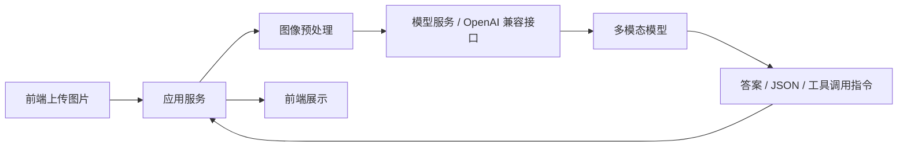

# 推理部署与 Serving

## 1. 从「能跑起来」到「能稳定服务」

调用一次多模态模型很简单，做成服务则要回答一组新问题：模型在哪跑、图片怎么传、接口怎么暴露、延迟与吞吐能否接受、故障时怎么回退。

离线评测是快照，线上指标是心电图。两者能对上的前提是链路一致——同一张图、同一套预处理、同一份 prompt 模板。上线或灰度前，至少核对四件事：

1. **同一批样例**：离线评测的 `id` 或图片摘要，能否在请求日志里找到对应记录？
2. **同一条预处理链**：缩放、切块、色彩空间是否与离线评测时一致？不一致时优先怀疑「线上独有问题」。
3. **最小日志字段**：时间、模型名、请求标识、耗时、HTTP/业务错误码、截断后的 prompt 摘要是否齐全？
4. **抽样对拍**：每月或每版挑几条固定样本，离线问一次、线上问一次；差异变大通常说明链路漂移，而不是模型突然变笨。

## 2. 三种推理方式

### 2.1 Transformers 本地推理

优点是最直观，能看清模型输入输出的数据结构，适合单机实验与最小 Demo；局限是并发能力一般，服务化能力要自己补，大模型场景下资源利用不一定最优。

### 2.2 OpenAI 兼容接口

上层应用接入简单，能直接和现有聊天框架、Agent 框架整合，替换底层服务时业务代码基本不动；前提是服务端正确支持多模态 content schema，不同实现的细节略有差异。

### 2.3 专用推理服务框架

面向高吞吐或生产环境。多模态方向的主流选择：

| 引擎 | 核心特点 | 多模态支持 | 启动示例 |
|---|---|---|---|
| vLLM 0.6+ | PagedAttention + V1 引擎，吞吐极高 | Qwen2.5-VL、LLaVA、InternVL | `vllm serve Qwen/Qwen2.5-VL-3B-Instruct --dtype bfloat16` |
| SGLang | RadixAttention，多轮缓存复用强 | Qwen2.5-VL、LLaVA | `python -m sglang.launch_server --model Qwen/Qwen2.5-VL-3B-Instruct` |
| LMDeploy | PyTorch 引擎，国产模型适配好 | Qwen-VL、InternVL 原生支持 | `lmdeploy serve api_server Qwen/Qwen2.5-VL-3B-Instruct` |

选型上没有绝对答案：追求极致吞吐选 vLLM，多轮对话密集选 SGLang（缓存复用收益大），国产模型为主选 LMDeploy（中文文档与适配更完整）。

实践顺序值得强调一次：先跑通单机脚本，确认模型本身正常；再用上述命令之一启动服务；最后接 Demo。这样出问题时容易判断是「模型侧」还是「服务侧」。

## 3. 典型服务链路



中间两层最值得盯：`图像预处理` 与 `模型服务`。大量「模型不准」的问题实际发生在这些位置。

一个典型翻车场景：线上反馈「模型变慢、答案还变差」，日志显示应用层把长截图压成极小缩略图再送模型——延迟未必最高，细节却先丢光。用同一条评测 `id` 对照，离线用原图正常、线上用缩略图崩，问题就不在权重，而在预处理与协议是否与离线评测一致。

## 4. 部署前的资源账

| 资源项 | 影响 | 常见误区 |
|---|---|---|
| 显存 | 视觉分支额外占显存，同级别模型比纯文本更吃卡 | 按纯文本模型的经验值估容量 |
| 分辨率 | 分辨率越高，视觉 token 越多，推理成本越高 | 截图、文档、长图仍按自然图像的比例缩放 |
| 延迟 | 包含图片读取、编码、预处理、序列构造与生成 | 只统计模型生成时间，忽略前后处理 |

长图场景尤其容易踩坑：整图缩小等于主动放弃细节，正确做法是切块、分页或多图输入。

## 5. 输入 schema 是一等公民

很多部署问题不是模型本身，而是协议层：

- `messages` 结构不正确；
- 图片用 URL 还是 base64 传法不对；
- chat template 没套对；
- 文本与图像的顺序不对。

视觉问答请求通常要明确表达三件事：这是图像输入、这是文本问题、生成是否需要 JSON 或固定格式。把输入 schema 当成接口契约维护，比在 prompt 里反复补救更可靠。

## 6. 常见的服务化设计

1. **统一入口**：应用层统一调用 `/v1/chat/completions` 或同类接口，底层可切换不同模型。
2. **模型路由**：按任务类型分流——截图/OCR 走文档能力更强的模型，自然图像问答走通用 VLM，高成本任务只在必要时启用大模型。
3. **结果后处理**：业务需要结构化字段时，不要完全依赖自由文本，配合 JSON 模板、字段校验与规则回退。

## 7. 多模态服务的高频问题

| 问题 | 根因 | 对策 |
|---|---|---|
| 图片被错误压缩或缩放 | 传输或预处理后小字已糊 | 固定预处理参数，与离线评测保持一致 |
| 长图直接缩成小图 | 细节整体丢失 | 切块、分页或多图输入 |
| 兼容接口与 SDK 不完全匹配 | 各服务对图像消息字段支持程度不同 | 先发一组最小请求验证 schema |
| 没有日志与采样 | 无法定位问题 | 记录 prompt、图片标识、返回、错误 |

## 8. 上线前至少要观测的字段

- 请求时间与请求标识；
- 图像加载时间；
- 模型推理时间；
- 输出 token 数；
- 错误率与错误码；
- 典型失败样例。

一个最小日志结构可以是这样：

```python
import logging, time, uuid

logger = logging.getLogger("vlm")

def log_request(model: str, image_id: str, question: str, latency_ms: int, status: str):
    logger.info(
        "vlm_request",
        extra={
            "request_id": str(uuid.uuid4()),
            "model": model,
            "image_id": image_id,
            "question": question[:80],
            "latency_ms": latency_ms,
            "status": status,
            "ts": round(time.time(), 3),
        },
    )
```

字段里保留 `image_id` 的意义在于可回溯：离线评测用过的图，线上再出问题时能直接对照，快速判断是模型退化还是预处理/接口换了。

## 9. 推荐的部署顺序

对个人仓库与学习项目，顺序比工具更重要：

1. 本地脚本；
2. 简单 Web Demo；
3. OpenAI 兼容封装；
4. 路由与监控；
5. 最后才做高并发优化。

一开始就上复杂框架，问题会被框架的抽象层掩盖；先把主链路跑稳，再逐层加能力。

## 10. 给 Demo 打三层工程补丁

在写 Demo 之前补上三层，可维护性会高很多。

**输入校验**：图片非空、文件类型合理、问题文本非空。

**请求日志**：请求时间、模型名、图片文件名、用户问题、响应耗时。

**模型路由**：即使只接一个模型，也把调用写成独立函数，后续扩展自然图像模型、OCR 模型、高精度慢模型时不用改调用方。

```python
def route_model(image_kind: str) -> str:
    if image_kind in ("screenshot", "receipt", "table"):
        return "doc-strong-vlm"
    return "general-vlm"

def ask_vlm(image_bytes, question: str, image_kind: str = "photo") -> str:
    model = route_model(image_kind)
    # 统一在这里做校验、日志与请求组装
    return call_openai_compatible(model, image_bytes, question)
```

## 写在最后

部署的关键不是「模型能跑」，而是「输入链路正确、延迟可接受、问题可定位」。下一篇[动手跑通第一个 VLM](4-动手跑通第一个VLM)把这条链路落到两种最小可运行方式上：本地 Transformers 与服务端 OpenAI 兼容接口。
