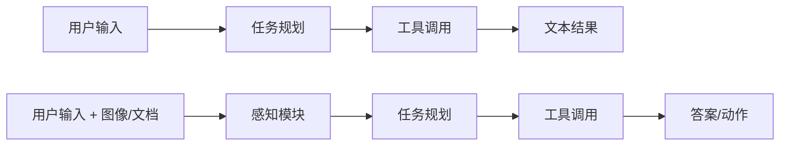

# 从单模态 Agent 到多模态 Agent

## 1. 多模态如何改变 Agent 的边界

只能处理文本的 Agent，世界是描述性的；能看图、看截图、看文档、看网页之后，它才有感知现实任务的入口。这一变化带来三种升级：

- 从「回答问题」到「看见问题」；
- 从「读说明书」到「读界面、读票据、读文档」；
- 从「纯文本推理」到「基于视觉证据的决策」。

多模态在这里不是锦上添花，而是很多真实任务里必须补上的那块能力。落地顺序也值得固定下来：先做到单轮图文问答稳定；再给图像加一步「感知摘要」，避免规划模块直接啃原图；然后引入工具分支与简单规则；最后把感知失败时的降级路径写清，并与评测集里记录的失败 `id` 对齐。跳过中间步骤的常见后果是「Agent 框架很漂亮，一上真实截图就不可观测」。

## 2. 单模态与多模态 Agent 的结构差异



多出来的那一层感知模块，带来三个新问题：

- 感知结果怎么进入规划模块（直接塞原文，还是先压成结构化摘要）；
- 感知错误如何被发现（置信度、字段缺失、交叉校验）；
- 多模态上下文怎样存入记忆（存原图、存摘要，还是存关键字段）。

<div align="center">
  
  <p>图 1：多模态 Agent 工作流</p>
</div>

## 3. 四个关键模块

| 模块 | 职责 | 常见实现 |
|---|---|---|
| 感知 | 理解图片、截图、文档、表格 | VLM 摘要、OCR、版面分析 |
| 规划 | 根据目标与感知结果决定下一步 | 直接回答 / 调 OCR / 调检索 / 结构化解析 |
| 工具 | 补齐模型不擅长的环节 | OCR、图像裁剪、网页解析、文件读取、检索 |
| 记忆 | 维持多轮与跨任务上下文 | 图像摘要、关键字段、用户偏好、历史结论 |

四者边界清楚，系统才好排错：感知错、规划错、工具错、记忆丢，对应的修复手段完全不同。

## 4. 案例：截图助手 Agent

用户发来一张报错截图，问「这个错误是什么意思，下一步该怎么处理」。一个合格的处理流程：

1. 视觉模型读取截图内容；
2. 提取关键错误码、报错位置、按钮与上下文；
3. 判断是否需要查文档或本地知识库；
4. 生成解释与下一步操作建议。

这条流程里，多模态模型负责感知，Agent 负责组织与行动。若截图是长图（顶部导航 + 中间报错 + 底部日志），整图处理容易漏细节，需要配合切块策略，详见[长图处理与切块策略](9-长图处理与切块)。

## 5. 别把所有事压给一个 VLM

模型能直接看图回答，不代表系统里每件事都该交给它。更稳的分工：

- VLM 负责理解与摘要；
- OCR 专用工具负责提字；
- 检索模块负责补知识；
- 规则层负责结构校验。

原因很现实：VLM 很强，但不是每个环节都最稳、最省成本。字符级准确率上，专用 OCR 仍普遍优于通用 VLM；成本上，一次大模型调用远高于一次规则匹配。

## 6. 设计前先想清三件事

**图像在流程中扮演什么角色**：主要证据、辅助上下文、触发器，还是待抽取对象？不同角色决定是否需要高精度 OCR、细粒度定位、多图比较。

**输出最终落成什么形式**：自然语言说明、结构化 JSON，还是自动化动作？形式决定了后处理与校验的强度。

**出错时如何回退**：看不清时让用户重传、OCR 失败时切换工具、字段缺失时转人工确认。没有回退路径的 Agent，在真实输入上等同于不可用。

## 7. 一个可复用的工作流模板

1. 接收文本 + 图片；
2. 用 VLM 生成图像摘要与关键字段；
3. 把摘要写入 Agent 上下文；
4. Planner 判断是否需要调用额外工具；
5. 执行工具并拿回结果；
6. 汇总为最终答案。

这个模板适用于截图助手、文档助手、电商商品图助手、质检助手、教学批改助手——差异只在第 2 步的摘要字段与第 5 步的工具集。

## 8. 最小骨架：可跑通的 v1

一个能跑的最小 Agent，把上面的模板压成三个方法：感知、路由、执行。

```python
import json, os
from openai import OpenAI

# to_data_url 与前一篇的实现一致：读文件 -> base64 -> data URL 字符串

class MultimodalAgent:
    def __init__(self):
        self.client = OpenAI(base_url=os.getenv("OPENAI_BASE_URL", "http://127.0.0.1:8000/v1"),
                             api_key=os.getenv("OPENAI_API_KEY", "EMPTY"))
        self.model_id = os.getenv("MODEL_ID", "your-vlm")

    def perceive(self, image_path: str, question: str) -> str:
        resp = self.client.chat.completions.create(
            model=self.model_id,
            messages=[{"role": "user", "content": [
                {"type": "text", "text": "请先对图片做感知摘要，提取最关键的对象、文本、界面元素或异常信息。"
                                          f"\n用户目标：{question}"},
                {"type": "image_url", "image_url": {"url": to_data_url(image_path)}},
            ]}],
            max_tokens=256,
        )
        return resp.choices[0].message.content

    def decide_tools(self, summary: str) -> list[str]:
        tools = []
        if "报错" in summary or "error" in summary.lower():
            tools.append("knowledge_lookup")
        if "表格" in summary or "金额" in summary:
            tools.append("structured_extract")
        return tools

    def run(self, image_path: str, question: str) -> dict:
        if not question.strip():
            return {"status": "error", "error": "Question is empty."}
        perception = self.perceive(image_path, question)
        tools = self.decide_tools(perception)
        return {
            "status": "ok",
            "question": question,
            "perception": perception,
            "tools": tools,
            "next_action": "把这里换成最终总结、JSON 输出或进一步工具调用。",
        }
```

这版的价值在结构清晰：感知、路由、执行三段分离，日志能打印「走了哪条分支」。它的局限也很明显——用关键字匹配做路由，`if "报错" in summary` 这种写法扩展性差、容易误判。

## 9. v2：用 tool-calling 交给模型决策

生产向的写法是把工具定义成标准 JSON schema，让模型自己决定调不调、调哪个、传什么参数：

```python
TOOLS = [{
    "type": "function",
    "function": {
        "name": "knowledge_lookup",
        "description": "当截图或描述中包含报错、异常、错误码时，调用此工具查询知识库或 FAQ",
        "parameters": {
            "type": "object",
            "properties": {
                "error_keywords": {"type": "string", "description": "提取到的关键错误信息或错误码"},
            },
            "required": ["error_keywords"],
        },
    },
}]
```

两版的分工可以这样理解：

| 维度 | v1 关键字路由 | v2 tool-calling |
|---|---|---|
| 代码量 | 少，逻辑一眼看懂 | 多，需要维护 schema |
| 扩展性 | 加一个工具要改 if 分支 | 加一个工具只改 schema 与实现 |
| 误判率 | 依赖关键词覆盖 | 由模型判断，可带参数校验 |
| 适用场景 | 教学、原型、分支极少的任务 | 生产环境、多工具组合 |

推荐的路径是先跑通 v1 理解「感知 → 路由 → 工具 → 汇总」的链路，再读 v2 理解 schema 写法。两者并存，对照着看最容易掌握。

## 10. 感知失败时的降级

多模态 Agent 与纯文本 Agent 最大的工程差异是：感知一定会错，而且错误往往不可见。降级路径必须在设计阶段写死：

- **看不清**：提示用户重传或换角度，而不是硬答；
- **部分字段缺失**：切换工具（VLM 读不出的交给 OCR），或缩小结论范围；
- **多工具结果冲突**：以规则层为准，冲突样本入库复盘；
- **置信度低**：转人工确认，同时把样本留在评测集里。

每条降级路径都应对应评测集里的一类失败模式。只有当失败模式、降级策略、观测字段三者对齐，Agent 才算真正可运维。

## 写在最后

多模态让 Agent 从「只能聊天」升级到「能感知现实输入」，但稳定的系统通常是 VLM + 工具 + 规划的组合，而不是单模型包打天下。接下来三篇转向三个高频专题，第一个是[OCR 与文档理解](7-OCR与文档理解)：票据、合同、截图这类密集版面，才是感知误差最集中的地方。
