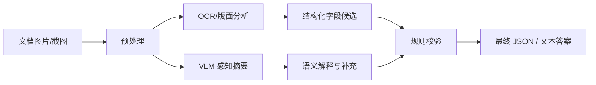

# OCR 与文档理解

## 1. 为什么值得单独讨论

很多人默认「模型既然能看图，就顺便能读文档、读截图、读表格」。现实通常不是这样。

自然图像理解与文档理解同属多模态，但对模型的要求差别明显：

- 自然图像更关注对象、场景、关系与常识；
- 文档理解更关注文字精度、版面结构、字段边界与阅读顺序。

所以一个能把风景图描述得很好的模型，面对发票、后台截图、合同页面、表格报表时，可能突然表现一般。这不是模型「退化」，而是能力的分布不同——图文预训练语料里，自然图像远多于密集版面。

## 2. OCR 不等于文档理解

| 能力 | 解决的问题 | 产出 |
|---|---|---|
| OCR | 读到了什么字 | 文本 + 坐标 |
| 文档理解 | 这些字构成什么结构 | 标题、正文、页眉页脚、单元格关系、键值对、图表印章 |

文档理解要额外判断：文字在页面中的结构关系、哪部分是标题与正文、哪些单元格属于同一行列、哪些字段是键哪些是值、哪些元素是图表印章签名复选框。

一句话概括：OCR 是「提字」，文档理解是「读懂文档」。前者是后者的必要条件，但远不是充分条件。

## 3. 四类常见场景

**票据与发票**：重点在字段抽取与格式稳定性，字段通常是商户名、时间、金额、税号。

**合同与报告**：重点在版面结构、条款定位、摘要与关键信息提取。

**网页与后台截图**：重点在界面元素识别、报错信息定位、按钮标签与表单项解释。

**表格与报表**：重点在单元格关系、行列对齐、统计口径与趋势归纳。

四类场景的失败模式也不同：票据怕金额串行，截图怕按钮文字看错，表格怕跨行跨列关系丢失，合同怕长文档里漏条款。

## 4. 通用 VLM 在 OCR 上的典型问题

常见失败有五类：

- 漏读小字；
- 数字识别错误（`1` 与 `l`、`0` 与 `O`、小数点位置）；
- 阅读顺序错乱（多栏排版尤其明显）；
- 表格跨行跨列关系丢失；
- 把「没看清」补成「猜测答案」。

根因通常落在三处：

1. **输入分辨率不够**：细节在进入模型前就已经损失；
2. **训练数据里 OCR 与文档样本不足**：模型没学过密集版面的阅读习惯；
3. **模型偏生成式回答**：擅长解释，不擅长稳定的结构化抽取。

第 1 条最容易被忽略，也最容易修。很多「模型读不出小字」的案例，把图换成原图或提高切块分辨率后就正常了。

## 5. 工程上更稳的组合工作流

真实系统里不建议把所有事情压给一个通用 VLM，更稳的做法是分工：



这个流程的价值不在「更复杂」，而在把任务拆成了更稳定的部分：

- OCR 工具负责识字；
- 版面分析工具负责结构；
- VLM 负责语义理解、归纳与自然语言解释；
- 规则层负责最后兜底。

每一段都可以单独评测、单独替换，出错时也知道该换哪一环。

## 6. 案例：票据字段抽取

最小链路可以按四步走。

**第一步，限定字段**。不要一上来就抽一切，先固定为商户名、日期、总金额、支付方式。

**第二步，先做 OCR**。把识别文本和坐标拿出来，而不是直接让模型「猜」。

**第三步，OCR 结果与原图一起喂给 VLM**。让模型做两件事：基于 OCR 文本纠错归并、基于页面结构判断哪个字段更可信。

**第四步，规则校验**。金额必须是数字格式、日期要满足时间格式、必填字段为空时返回人工确认。

## 7. 案例：截图报错分析

截图类任务偏「界面理解 + 语义解释」，拆法不同：

1. OCR 提取错误文本与按钮标签；
2. VLM 判断界面上下文（登录页、数据库页、IDE）；
3. 检索系统文档或 FAQ；
4. 生成「问题解释 + 下一步建议」。

这类场景里，VLM 最擅长理解上下文与组织解释，而不是逐字逐句精确读取。把「读字」交给 OCR、把「读懂」交给 VLM，是最省成本的组合。

## 8. Prompt 设计：用 JSON 约束输出

文档场景的 prompt 不应只写「请提取关键信息」，而要给出结构与边界：

```text
请阅读这张票据图片，输出 JSON：
{
  "merchant_name": "",
  "date": "",
  "total_amount": "",
  "payment_method": ""
}

要求：
1. 如果字段无法确认，填 null。
2. 不要编造图片中不存在的信息。
3. 保留原始单位和金额格式。
```

三个好处：限制输出格式、压缩幻觉空间、方便接规则校验。`null` 这一条尤其关键——它把「不确定」变成了可识别的信号，而不是一句看起来合理的编造。

## 9. 优先优化哪几件事

时间有限时，按这个顺序投入：

1. **输入图像质量**：原图、少压缩、少缩放；
2. **长图与高分辨率处理**：切块加分页，而不是整图缩小；
3. **输出格式约束**：JSON 模板 + null 约定；
4. **失败回退机制**：字段缺失转人工，低置信度不入库。

不要一开始就急着换模型。真正的问题常常是：图太糊、图被压缩过、页面太长被缩小、输出要求过于开放。

## 写在最后

文档场景的胜负手往往在输入而非权重：分辨率、切块、输出约束三件事做到位，效果提升经常大于换一个更大的模型。下一篇[多图输入与比较](8-多图输入与比较)处理另一种信息密度问题——单张图看不够，需要跨图对照与归纳。
