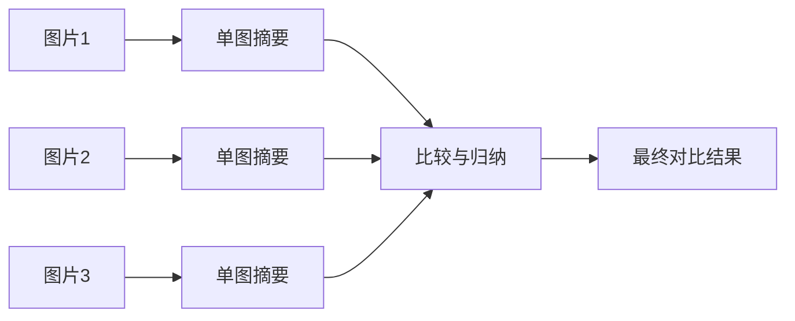

# 多图输入与比较

## 1. 多图为什么是高频需求

很多任务不是「看一张图回答问题」，而是同时看多张图、比较多张图、从多张图里归纳变化。典型场景：

- 商品多视角展示；
- 施工前后对比；
- UI 改版前后分析；
- 质检中的合格 / 不合格对照；
- 医疗或工业中的时间序列变化观察。

系统只能稳定处理单图，在很多业务里其实还不够用。

## 2. 多图与单图的核心差别

单图任务的重点是图像理解；多图任务在此基础上还要解决：

- **图像顺序**：谁先谁后，模型是否知道；
- **跨图对应关系**：两张图里哪个元素是同一个；
- **比较维度**：比布局、比颜色、比数量还是比错误信息；
- **归纳方式**：逐项罗列，还是给结论与风险；
- **长上下文成本**：图越多，视觉 token 越多。

本质上，多图任务是在做跨图推理，而不是把单图理解重复几次。

## 3. 四类常见任务

| 类型 | 典型问题 | 难点 |
|---|---|---|
| 前后对比 | 这两个版本界面有什么变化 | 差异点多且琐碎，容易漏项 |
| 多视角归纳 | 同一商品的正、侧、细节图总结卖点 | 需要跨图合并同一对象的属性 |
| 批量筛查 | 一组质检图中找出异常样本 | 数量多，上下文与成本压力大 |
| 时间序列变化 | 多天拍摄的仪表盘、工程现场、病灶 | 变化幅度小，需要精确对齐 |

## 4. 四个容易踩的坑

**模型不知道图片顺序**。只把多张图一起塞进去，不说「第一张是什么、第二张是什么」，回答很容易混乱。

**比较维度没说清**。「比较这两张图」过于宽泛，模型只能给一段泛化描述。

**多图导致上下文过长**。视觉 token 线性增长，成本与信息噪声一起上升。

**模型把多图混成一张图的整体印象**。这会丢掉局部差异，输出「两张图大致相似」这类无效结论。

## 5. 一个有效的 prompt 写法

固定三件事：编号、比较维度、输出格式。

```text
我会提供两张图片：
图 1：旧版页面截图
图 2：新版页面截图

请完成以下任务：
1. 对比两张图在布局上的主要变化
2. 对比按钮和导航结构的差异
3. 用 3 条要点总结新版相对旧版的变化
4. 如果无法确认，请明确说明「不确定」
```

这种写法的收益很直接：降低混图概率、让比较任务聚焦、输出更容易复核。第 4 条同样重要——它给模型留了「不确定」的出口，避免为了凑答案而编造差异。

## 6. 更稳的分层工作流

多图任务不一定非要一次性把所有图片送进去。更稳的策略是先单图摘要，再跨图比较：



分层处理的三个好处：更省上下文、更容易定位是哪张图的摘要出错、更容易与 Agent 工作流结合——每张图的摘要都可以作为独立的工具结果进入规划模块。

## 7. 案例：UI 版本对比助手

实现顺序：

1. 给每张图分配明确编号；
2. 先生成每张图的界面摘要；
3. 提取关键元素（导航、按钮、表格、弹窗）；
4. 再让模型输出差异总结。

输出最好固定结构，便于接产品评审或测试流程：

```json
{
  "layout_changes": [],
  "button_changes": [],
  "risk_points": [],
  "summary": ""
}
```

`risk_points` 这一栏值得单独留出：评审时最关心的往往不是「变了什么」，而是「改哪里可能出问题」。

## 8. 案例：商品多图卖点总结

商品图场景特别适合多图输入，因为单张图往往只能看到部分特征：

- 图 1：正面图；
- 图 2：细节图；
- 图 3：使用场景图。

任务侧要求模型汇总共性卖点、识别材质与结构、判断适用场景，再按运营文案的格式输出。这里多图的价值在于信息互补——正面图给轮廓，细节图给工艺，场景图给使用方式，单张图都拿不到完整结论。

## 9. 什么时候不该一次性全塞

出现下列情况时，拆批或分阶段处理更稳：

- 图片数量超过 5 到 10 张；
- 每张图都包含大量小字；
- 任务偏细节抽取而非整体总结；
- 模型上下文预算有限。

对应做法：先单图分析，再做摘要压缩，最后做多图比较。把「看」和「比」拆成两步，比让模型一次完成两件事可靠得多。

## 写在最后

多图的难点从来不是「能不能塞进去」，而是「顺序、维度、归纳方式」有没有定义清楚。下一篇[长图处理与切块策略](9-长图处理与切块)处理另一半问题：不是图太多，而是单张图太长，一次看不完。
