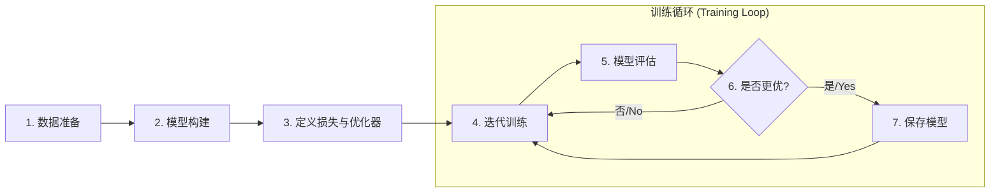

# 文本分类的三级演进

## 1. 任务与通用流程

文本分类的目标是把给定文本自动分配到一个或多个预定义类别，应用极广：情感分析（商品/影评的正负中性）、新闻分类（体育/财经/科技/娱乐频道）、意图识别（查天气还是放音乐）、垃圾邮件过滤。

无论文本分类还是更复杂的 NLP 任务，深度学习方案通常遵循同一套标准化流程：



理解并掌握这套可复用模板，比单纯实现某个模型更重要。下面按「全连接基线 → LSTM → 正则化 LSTM → BERT 微调」的路径走完三级演进，用同一份 20 Newsgroups 数据做对照。

## 2. 步骤零：模块化设计

先想清楚每个模块的输入输出，再写代码：

- **数据模块输出**：模型需要的 `token_ids` 张量与 `label_ids` 张量；
- **模型输入**：数据模块的输出；
- **模型输出**：每个类别的置信度。

> 一个反过来想的技巧：若对数据处理感到困惑，先从模型定义开始——一旦 `forward` 需要的输入（如 ID 序列）明确，数据处理的目标就清楚了，只需把原始文本处理成那个格式。

## 3. 数据准备

### 3.1 加载 20 Newsgroups

`scikit-learn` 的 20 Newsgroups 约 2 万篇新闻、近似均衡分布在 20 个新闻组；演示只取 4 类：

```python
from sklearn.datasets import fetch_20newsgroups

categories = ['alt.atheism', 'soc.religion.christian', 'comp.graphics', 'sci.med']
train_dataset_raw = fetch_20newsgroups(subset='train', categories=categories, shuffle=True, random_state=42)
test_dataset_raw  = fetch_20newsgroups(subset='test',  categories=categories, shuffle=True, random_state=42)
```

样本形如 `{'text_preview': 'From: sd345@city.ac.uk ...', 'label': 'comp.graphics'}`。

### 3.2 数据探索：先看再设计

（1）**文本长度分布**——先写个简单分词函数（转小写→正则保留字母数字与基本标点→标点两侧加空格→按空格切分），统计每篇词元数画直方图：

<div align="center">
  
  <p>图 1：训练集文本长度分布</p>
</div>

大部分文本集中在较短区间，但存在少量超长「异常值」——直接截断会丢失过多信息。

（2）**词频-排名对数图**：

<div align="center">
  
  <p>图 2：词频-排名对数图</p>
</div>

典型的**齐夫定律（Zipf's Law）**：少数高频词占据绝大多数出现次数，大量词汇构成极低频的长尾。两个发现直接决定了后面两个设计——长文本要**滑窗切块**、低频词要按 `min_freq` 过滤。

### 3.3 Tokenizer 与词典

`Tokenizer` 类封装分词、词典与 ID 转换：`_tokenize_text` 用正则实现上面的分词逻辑；词典遍历训练集统计词频并过滤低频词，预设 `<PAD>`（ID 0）与 `<UNK>`（ID 1）：

```python
def build_vocab_from_counts(word_counts, min_freq=5):
    vocab = {"<PAD>": 0, "<UNK>": 1}
    for word, count in word_counts.items():
        if count >= min_freq:
            vocab[word] = len(vocab)
    return vocab

vocab = build_vocab_from_counts(word_counts, min_freq=5)   # vocab_size ≈ 10983
```

### 3.4 长文本：滑窗切块

有的文档超过 1 万词元，直接输入会内存溢出、效率低下；简单截断又会丢末尾关键信息。更好的做法是切成**固定长度且有重叠**的文本块：`max_len=128`、`overlap=26` 时，第一块 `words[0:128]`、第二块 `words[102:230]`（`128-26=102`）依此类推。两大好处——**信息保全**（完整利用全文）+ **数据增强**（一篇长文变多条样本）。

`TextClassificationDataset` 在 ID 化后按 `stride = max_len * 0.8`（20% 重叠）切块；`collate_fn` 用 ID 0 把同批样本填充到批内最长：

```python
class TextClassificationDataset(Dataset):
    def __init__(self, texts, labels, tokenizer, max_len=128):
        ...
        for text, label in tqdm(zip(texts, labels), total=len(labels)):
            token_ids = self.tokenizer.convert_tokens_to_ids(self.tokenizer.tokenize(text))
            if len(token_ids) <= self.max_len:
                self.processed_data.append({"token_ids": token_ids, "label": label})
            else:
                stride = max(1, int(self.max_len * 0.8))
                for i in range(0, len(token_ids) - self.max_len + 1, stride):
                    self.processed_data.append({"token_ids": token_ids[i:i+self.max_len], "label": label})
```

实例化后：`train_samples=7142, valid_samples=5408, batch_size=32`。

## 4. 第一级：全连接基线（词袋式）

### 4.1 张量变形路径

```
token_ids [B, T] --Embedding--> [B, T, E] --Linear+ReLU 两层--> [B, T, H*4]
  --Masked Average Pooling--> [B, H*4] --Linear--> logits [B, num_classes]
```

### 4.2 掩码平均池化（关键操作）

简单平均会被 `<PAD>` 拉偏语义。例：批内两条样本，A 真实长 4（`[v_I, v_love, v_NLP, v_too]`），B 真实长 2（`[v_NLP, v_rocks, v_PAD, v_PAD]`）：

1. 创建掩码 `[[1,1,1,1],[1,1,0,0]]`；
2. 特征向量与掩码相乘，填充位的 `v_PAD` 变零向量；
3. 沿序列维求和：`sum_B = v_NLP + v_rocks + 0 + 0`；
4. **除以真实长度**（掩码中 1 的个数）：`pool_B = sum_B / 2`。

四步在 `forward` 里对应四行代码：

```python
padding_mask = (token_ids != self.embedding.padding_idx).float()
masked_features = token_features * padding_mask.unsqueeze(-1)   # 置零
summed_features = torch.sum(masked_features, 1)                  # 求和
real_lengths = padding_mask.sum(1, keepdim=True)
pooled_features = summed_features / torch.clamp(real_lengths, min=1e-9)  # 除真实长度
```

### 4.3 模型与训练

`TextClassifier` = `Embedding(padding_idx=0)` + `Sequential(Linear(E,H*2), ReLU, Linear(H*2,H*4), ReLU)` + 分类层。超参 `embed_dim=128, hidden_dim=256, epochs=20, lr=1e-3`。

`Trainer` 封装训练/评估/保存：`_run_epoch` 前向+反向，`_evaluate` 算验证准确率，`_save_checkpoint` 只在验证准确率刷新最佳时存 `best_model.pth`；训练结束把 `vocab.json` 与 `label_map.json` 一并落盘。

实测日志：第 14 轮达到最佳，验证集准确率 **84.69%**（未固定随机种子，每次有小幅差异）。

<div align="center">
  
  <p>图 3：全连接模型的训练损失与验证集准确率曲线</p>
</div>

训练损失稳步下降并趋平，验证准确率前几轮迅速提升后小幅波动趋于饱和——训练早期快速收敛。

### 4.4 推理：长文本聚合

推理时一篇长文档会切成多个块，得到多组预测，聚合策略有两种：

- **多数投票法**：逐块预测类别，取得票最多者；平票时选置信度总和最高的；
- **概率累乘/平均法**：算各类别在所有块上的平均置信度取最高。累乘易因小概率下溢，实践常用「取对数求和」或直接平均。

`Predictor.predict` 实现多数投票（`torch.bincount(preds).argmax()`）。推理前必须用与训练**完全一致**的词典重建 `Tokenizer`、重建同结构模型并 `load_state_dict`。示例文本同时出现看病与 GPU 字样，预测为 `sci.med`。

## 5. 第二级：LSTM 序列建模

### 5.1 动机：平均池化丢语序

基线模型的核心是掩码平均池化——本质是「词袋」模型，**忽略了词语顺序**。LSTM 通过循环结构与门控逐词处理、持续更新内部状态，理论上最终隐藏状态能编码整句更丰富的语义。这次实验要验证：**在这个任务上，序列建模是否真比词袋更有效**。

### 5.2 三处改造

（1）**`collate_fn` 补长度**：`pack_padded_sequence` 需要每个样本填充前的真实长度，故额外返回 `lengths`：

```python
return {"token_ids": ..., "labels": ..., "lengths": torch.tensor(batch_lengths, dtype=torch.long)}
```

（2）**`TextClassifierLSTM`**：`batch_first=True` 让输入输出都是 `[B, T, F]` 与 DataLoader 对齐；分类层输入维度按 `num_directions` 动态确定：

```python
class TextClassifierLSTM(nn.Module):
    def __init__(self, vocab_size, embed_dim, hidden_dim, num_classes,
                 n_layers=1, dropout=0.3, bidirectional=False):
        self.embedding = nn.Embedding(vocab_size, embed_dim, padding_idx=0)
        self.lstm = nn.LSTM(embed_dim, hidden_dim, num_layers=n_layers, dropout=dropout,
                            bidirectional=bidirectional, batch_first=True)
        self.classifier = nn.Linear(hidden_dim * (2 if bidirectional else 1), num_classes)

    def forward(self, token_ids, lengths):
        embedded = self.embedding(token_ids)
        packed = nn.utils.rnn.pack_padded_sequence(
            embedded, lengths.cpu(), batch_first=True, enforce_sorted=False)  # 长度须在 CPU
        _, (hidden, _) = self.lstm(packed)
        hidden = torch.cat((hidden[-2], hidden[-1]), dim=1) if self.lstm.bidirectional else hidden[-1]
        return self.classifier(hidden)
```

要点：`pack_padded_sequence` 把填充批次压成紧凑表示，LSTM 只对真实部分计算，既快又准；单向取 `hidden[-1]`，双向拼接前向 `hidden[-2]` 与后向 `hidden[-1]`。另外注意 `nn.LSTM` 的 `dropout` **只在 `n_layers > 1` 时生效**，单层时应设 0 以免误解。

（3）**`Trainer`/`Predictor` 传递 `lengths`**：推理端手工对块填充并同步算 `chunk_lengths`，长度张量留在 CPU。

超参：`n_layers=2, dropout=0, bidirectional=True, epochs=20, lr=1e-3, output_dir="output_lstm"`。

### 5.3 结果：反直觉的下降

- 全连接基线：**0.8469**
- 无正则化 LSTM：**0.8143**（稳定低约 2 个百分点）

<div align="center">
  
  <p>图 4：LSTM 模型的训练损失与验证集准确率曲线</p>
</div>

理论上更能建模序列的 LSTM 反而更差，两个原因：

1. **任务对语序相对不敏感**：在从零训练、数据量有限的前提下，新闻分类高度依赖**关键词**（看到 "Jesus"/"God" 大概率宗教类，看到 "Graphics"/"Monitor" 大概率图形类）。词袋模型极擅长捕捉这类强特征词，「有哪些词」远比「词的顺序」重要，LSTM 学语序的努力没有转化为优势；
2. **模型复杂性与过拟合**：参数更多的 LSTM 更容易在数据不够时过拟合——训练损失极低而验证准确率不高，正是「记住」训练集特定句式而非学到普适规律的症状。

## 6. 第三级：正则化 LSTM（组合三策略）

### 6.1 随机 Token 遮盖

数据增强：训练时以 10% 概率把词元替换为 `<UNK>`（不动 PAD），迫使模型不只依赖「明星词」。

```python
item = super().__getitem__(idx).copy()   # 关键：副本
if self.is_train:
    item['token_ids'] = [self.unk_token_id if (t != 0 and random.random() < self.mask_prob) else t
                         for t in item['token_ids']]
```

> **`.copy()` 不能省**：若直接改原数据，第二个 epoch 看到的就是上次遮盖后再遮盖的数据，如此循环会彻底丢失信息。数据增强必须每轮都在干净原始数据上独立进行。

### 6.2 提前停止（Early Stopping）

`TrainerWithEarlyStopping` 重写 `train`：记录「验证准确率连续 `patience` 轮未超历史最佳」的计数，达到阈值即停：

```python
if self.best_accuracy > current_best:
    self.epochs_no_improve = 0
else:
    self.epochs_no_improve += 1
if self.epochs_no_improve >= self.patience:
    print(f"提前停止于 Epoch {epoch+1} …"); break
```

### 6.3 组合效果

三种策略合体：遮盖数据集（`mask_prob=0.1`）+ LSTM `dropout=0.3` + 早停 `patience=3`，输出到 `output_lstm_regularized`。日志显示第 16 轮达最佳 **0.8415**、第 19 轮触发早停：

<div align="center">
  
  <p>图 5：正则化 LSTM 模型的训练损失与验证集准确率曲线</p>
</div>

对比：比无正则化 LSTM（~0.8143）**明显提升**，验证了「基础 LSTM 的主要问题就是过拟合」；但仍略逊全连接基线（~0.8469）。三个策略各自的作用：

- **随机遮盖**：逼模型识别更广泛的词组合，而非少数「明星」关键词；
- **早停**：在性能见顶将下滑时及时刹车，锁定最佳状态；
- **Dropout**：多层 LSTM 中层间随机丢弃，破坏「共适应」，增强独立特征学习。

这个系列正好印证**奥卡姆剃刀**：如无必要，勿增实体——模型选择应从基线开始逐步加复杂度，并用实验验证每一步是否真有收益。

## 7. 第四级：BERT 微调（范式转换）

### 7.1 为什么换范式

前两个模型都从随机初始化、在 20 Newsgroups 这个小数据集上从零学起。BERT 走**预训练-微调**范式：

1. **加载预训练权重**：加载在维基百科/书籍等海量语料上训好的 BERT，它已是通用「语言理解专家」；
2. **附加任务头**：在主干上加一个未训练的分类层；
3. **下游微调**：用新闻分类数据训练全模型（或只训分类层），轮次少、学习率小即可快速适配。

### 7.2 数据侧改造：换 Tokenizer + 加 attention_mask

```python
from transformers import BertTokenizer
tokenizer = BertTokenizer.from_pretrained('bert-base-uncased')
# [UNK]=100, [PAD]=0, [CLS]=101, [SEP]=102, vocab_size=30522
```

`BertTokenizer` 自动做小写/标点分割并加 `[CLS]`、`[SEP]`。`BertTextClassificationDataset` 直接用它编码（`truncation=False`），滑窗切块逻辑不变；`bert_collate_fn` 额外生成 `attention_mask`：

```python
padded_ids = input_ids + [tokenizer.pad_token_id] * padding_len
attention_mask = [1] * len(input_ids) + [0] * padding_len   # 新增
```

掩码为 1 的位置是真实 token、0 是填充；模型据此在注意力计算中忽略填充。

### 7.3 模型：主干 + 分类头

```python
class TextClassifierBERT(nn.Module):
    def __init__(self, model_name, num_classes, freeze_bert=False):
        self.bert = BertModel.from_pretrained(model_name)
        self.classifier = nn.Linear(self.bert.config.hidden_size, num_classes)  # 维度从 config 取，免硬编码
        if freeze_bert:
            for p in self.bert.parameters(): p.requires_grad = False
    def forward(self, input_ids, attention_mask):
        outputs = self.bert(input_ids=input_ids, attention_mask=attention_mask)
        return self.classifier(outputs.pooler_output)   # [CLS] 的句子级表示
```

`freeze_bert=True` 是「特征提取」模式（只训分类头，快但通常不如全量微调）；实战还可按层号冻结部分层，在速度/显存与效果间折中，示例只保留「全部冻结」这一简单形式。

### 7.4 训练与推理适配

`Trainer` 传 `attention_mask`；保存改为 `transformers` 规范：`bert.save_pretrained(output_dir)` + 分类头单独 `classifier.pth`，并把 `tokenizer.save_pretrained(output_dir)` 一并落盘。推理端 `BertTokenizer.from_pretrained(output_dir)` 一次性恢复分词器，`TextClassifierBERT(model_name=output_dir)` 加载微调后的权重，再加载 `classifier.pth`；分块时同步生成 `attention_masks`，其余投票逻辑不变。

超参差异是关键：**学习率 2e-5**（在预训练知识上做「微小」调整，太大破坏知识）、**epochs=5**（少轮即收敛）。

### 7.5 结果：三级对比

- 全连接基线：**~0.8469**
- 正则化 LSTM：**~0.8415**
- **BERT 微调：~0.9032**

<div align="center">
  
  <p>图 6：BERT 模型的训练损失与验证集准确率曲线</p>
</div>

BERT 的优势拆开看：

1. **上限更高**：90.32%，高出前两者 5 个百分点以上；
2. **收敛更快**：**第一个 epoch 的 87.38%** 就已超过前两个模型 20 轮训练的最佳水平；
3. **上下文理解**：自注意力捕捉任意两词的依赖，生成真正上下文相关的向量；
4. **知识迁移**：预训练已学到语法、语义与世界知识，微调只是「专家学新任务」，少量数据即可；
5. **范式成熟**：无需精调结构/正则，更少代码与调试达到更好效果。

这不与「奥卡姆剃刀」矛盾——剃刀提醒在**同一层级内**别乱加复杂度；而 BERT 是**更高起点**的另一条维度。结论不是「越复杂越好」，而是「**利用高质量预训练模型微调，往往是用更少精力与数据在下游达到更好性能的推荐路径**」；当然，这份便捷建立在预训练阶段巨大的算力与时间投入之上。

## 8. 总结：模型选择的实践流程

1. **从简单快速的基线开始**（全连接词袋）——先摸清任务难度、建立比较基准；
2. **审慎增加复杂度**——从零训练的 LSTM 未带来提升，印证奥卡姆剃刀；
3. **优先考虑高质量预训练模型微调**——基线不够时，别急着从零搭更复杂结构，先上「预训练-微调」。

> **补记**：这三级演进最有价值的不是三个模型，而是**同数据集、同评测口径下的受控对照**——0.8469 / 0.8143 / 0.8415 / 0.9032 四个数字讲清了三件事：词袋在这个任务足够强、序列建模在小数据上会过拟合、预训练知识能跨过 5 个百分点。工程上照这个顺序试，通常最省钱。

## 写在最后

分类任务验证了「预训练-微调」的威力，但分类只需一个句子级标签；下一篇[NER项目全流程](2-NER项目全流程)转向**词元级**标注任务，看命名实体识别如何处理数据、构建模型并完成推理优化。
