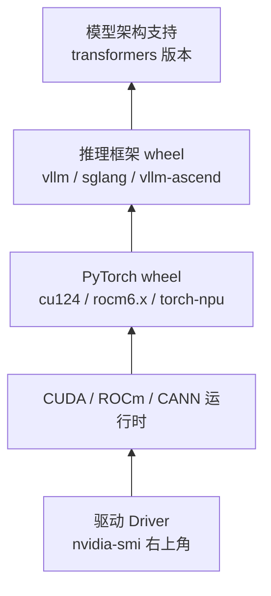

# 算力与环境基线

开源权重不缺，缺的是「这份权重在自己手上到底跑不跑得动」的判断力。在下载任何一个模型之前，先把显存、精度、依赖版本这三笔账算清楚，后面 90% 的失败都能提前避免。

## 1. 显存账本：四笔开销

推理时显存不是一个数，而是四块相加：

| 开销 | 由什么决定 | 能否调 |
|---|---|---|
| 权重 | 参数量 × 每参数字节数 | 换精度、换量化档位 |
| KV Cache | 层数、KV 头数、上下文长度、并发数 | 调 `max_model_len`、并发、KV 精度 |
| 激活与会话缓冲 | batch 大小、序列长度 | 调 batch |
| 框架与运行时 | CUDA context、算子 workspace、通信缓冲 | 换框架、限制显存占比 |

权重那一项最容易估。参数量 $P$ 的模型，按精度换算：

$$
M_{\text{weight}} \approx P \times b
$$

$b$ 是每参数字节数：FP32 为 4，FP16/BF16 为 2，INT8 为 1，INT4 为 0.5。所以 8B 模型 BF16 约 16 GB，4-bit 量化约 4–5 GB（实际略高，因为部分层保持高精度）。这张表可以直接当尺子用：

| 参数量 | BF16 | INT8 | INT4 |
|---|---|---|---|
| 0.6B | 1.2 GB | 0.6 GB | 0.3 GB |
| 1.7B | 3.4 GB | 1.7 GB | 0.9 GB |
| 8B | 16 GB | 8 GB | 4–5 GB |
| 30B（MoE，激活 3B） | 60 GB | 30 GB | 15–18 GB |
| 70B | 140 GB | 70 GB | 35–40 GB |

MoE 模型要按**总参数量**算权重显存、按**激活参数量**算算力，两个数字不是一回事——30B-A3B 权重仍需 60 GB 左右，但每 token 只走 3B 的算力。

## 2. KV Cache：长上下文的隐形账单

KV Cache 是逐 token 线性增长的，公式为：

$$
M_{\text{kv}} = 2 \times L \times n_{\text{kv}} \times d_h \times S \times B \times b
$$

其中 $2$ 代表 K 与 V 两份，$L$ 是层数，$n_{\text{kv}}$ 是 KV 头数，$d_h$ 是每头维度，$S$ 是序列长度，$B$ 是并发数，$b$ 是 KV 的字节数（BF16 为 2）。

以 Qwen3-8B（36 层、8 个 KV 头、head_dim 128、BF16）为例，单条 8K 上下文：

$$
2 \times 36 \times 8 \times 128 \times 8192 \times 1 \times 2 \approx 1.2\ \text{GB}
$$

看似不多，但 16 路并发就是 19 GB——超过权重本身。这就是「模型装得下、长上下文一压就崩」的根源，也是 GQA（`num_key_value_heads` 远小于注意力头数）存在的意义：它把 KV Cache 直接按比例缩小。

工程上的三个旋钮随之明确：

- `max_model_len` 决定单条序列上限，直接乘进 KV 账本；
- `max_num_seqs` / `--max-num-seqs` 决定并发上限，同样乘进去；
- `--gpu-memory-utilization` 控制框架能吃多少显存，剩下的才归 KV 池。

## 3. 依赖版本：一条链，不是三个独立数字

环境报错里最常见的一句是「版本不匹配」，但真正需要对齐的是一条自底向上的链：



几个高频误解：

- `nvidia-smi` 显示的 CUDA Version 是**驱动支持上限**，不是装好的运行时版本。真实运行时看 `nvcc --version` 或 `torch.version.cuda`。
- PyTorch wheel 自带的 CUDA 运行时与系统装的 CUDA Toolkit 可以不同版本，驱动只要够新就行。
- 推理框架对架构的支持是**版本相关**的：新模型（如 `qwen3_5`）在旧 vLLM 上会直接报「模型类型不识别」，此时升级框架比改代码有效。
- AMD 上如果 Python 版本对不上官方要求，pip 可能悄悄装成 CUDA 版 wheel，随后在 AMD 卡上报 `libcudart.so` 找不到。

## 4. 环境的三种起步方式

| 方式 | 适合 | 代价 |
|---|---|---|
| 本机/裸机 pip 安装 | 固定机器、长期使用 | 依赖冲突要自己解 |
| 官方或社区镜像 | 快速验证、换卡对比 | 镜像体积大，版本被锁定 |
| 云平台实例（镜像市场） | 临时算力、多卡实验 | 关机即失效，需持久化目录 |

云平台的镜像市场里通常已备好「PyTorch + CUDA + 常用库」的组合，省掉换源与编译。代价是版本由镜像决定：镜像里是 torch 2.5.1 + cu124，就别硬装要求 cu128 的框架，换镜像比改环境便宜。

## 5. 换源：先解决下载，再谈编译

国内环境第一步几乎总是换源。pip 走镜像：

```bash
python -m pip install --upgrade pip
pip config set global.index-url https://mirrors.cernet.edu.cn/pypi/web/simple
```

镜像站列表见 [MirrorZ](https://help.mirrors.cernet.edu.cn/)，各高校镜像同步内容一致，选一个延迟低的即可。临时装单个包时用 `-i` 覆盖，不必改全局配置：

```bash
pip install -i https://pypi.tuna.tsinghua.edu.cn/simple some-package
```

conda 换源改 `.condarc`。Windows 上无法直接创建以点开头的文件，先执行 `conda config --set show_channel_urls yes` 生成再编辑：

```yaml
channels:
  - defaults
show_channel_urls: true
default_channels:
  - https://mirrors.tuna.tsinghua.edu.cn/anaconda/pkgs/main
  - https://mirrors.tuna.tsinghua.edu.cn/anaconda/pkgs/r
  - https://mirrors.tuna.tsinghua.edu.cn/anaconda/pkgs/msys2
custom_channels:
  conda-forge: https://mirrors.tuna.tsinghua.edu.cn/anaconda/cloud
  pytorch: https://mirrors.tuna.tsinghua.edu.cn/anaconda/cloud
```

注意 conda 与 pip 是两套源，`conda install` 装不动的包用 pip 补，不要反过来在同一环境里反复交叉覆盖 torch。

## 6. 一份可复用的自检脚本

动手前先跑一遍，把结果留在 `env_report.md` 里。换机器、换镜像、报 bug 时这份报告比重装环境有用。

```python
import platform
import torch

def report():
    print("platform :", platform.platform())
    print("python   :", platform.python_version())
    print("torch    :", torch.__version__)
    print("cuda rt  :", torch.version.cuda)
    print("device   :", torch.cuda.get_device_name(0) if torch.cuda.is_available() else "CPU")
    if torch.cuda.is_available():
        prop = torch.cuda.get_device_properties(0)
        print("capability:", f"{prop.major}.{prop.minor}")
        print("vram     :", f"{prop.total_memory / 1024**3:.1f} GiB")

if __name__ == "__main__":
    report()
```

对照三处：`torch.cuda.is_available()` 是否为真、`vram` 与预期是否一致、`capability` 是否被当前框架支持（新卡算力过高时，旧框架可能未编译对应架构）。

AMD 平台的 ROCm 版 PyTorch 仍复用 `torch.cuda` 命名空间，需要在终端用 `rocm-smi` 交叉核对；昇腾平台则看 `torch_npu.npu.is_available()` 与 `npu-smi info`。

## 7. 可交付物与练习

本文的产出是一张「这台机器能跑什么」的判断卡：

- 显存总量与可用余量；
- 权重账本算出的最大可跑参数量（BF16 / INT8 / INT4 三档）；
- 在目标上下文长度与并发下的 KV 预算；
- 依赖链三个关键版本号：驱动、torch、推理框架。

练习：把自己的卡代入第 1、2 节公式，分别算出「8B 模型 32K 上下文、4 并发」与「30B MoE 8K 上下文、2 并发」是否可行，再决定下一篇要下哪份权重。

## 写在最后

账算清了，下一步是把权重拿到本地。[2-权重的五种拿法](/source/大模型/开源模型实战篇/2-权重的五种拿法)整理五条下载路径、目录组织与校验方式。
