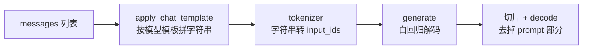

# 第一跑与ChatTemplate

服务化之前先让模型在自己的脚本里说一句人话。这一步看似最简单，实际上是整条流水线上「接口代际差异」最集中的地方：老模型自带 `chat()`，新模型只认 `apply_chat_template`，混合推理模型还多一个思考开关。

## 1. 最小加载

三行就能起一个可对话的模型：

```python
import torch
from transformers import AutoModelForCausalLM, AutoTokenizer

path = "/data/models/Qwen3-8B"

tokenizer = AutoTokenizer.from_pretrained(path, use_fast=False)
model = AutoModelForCausalLM.from_pretrained(
    path,
    device_map="auto",
    torch_dtype=torch.bfloat16,
).eval()
```

四个参数各自负责一件事，缺一个就会出问题：

| 参数 | 作用 | 不写会怎样 |
|---|---|---|
| `device_map="auto"` | 按显存自动分片到 GPU/CPU | 全部压到 0 号卡，多卡机器浪费 |
| `torch_dtype` | 指定加载精度 | 按 config 走，可能是 FP32，显存翻倍 |
| `.eval()` | 关闭 dropout | 推理结果带随机性 |
| `use_fast=False` | 用慢速分词器 | 少数模型的自定义 token 处理不一致 |

精度优先选 `bfloat16`：同样 2 字节，动态范围比 `float16` 大，长上下文里不容易溢出成 `NaN`。老卡不支持 BF16 时再退回 `float16`。

`device_map="auto"` 依赖 `accelerate`，没装会直接报错；它做的是「按层切分」，并不能让 8B 模型塞进 8 GB 显存——显存不足时仍要量化。

## 2. 两代对话接口

### 2.1 老接口：模型自带 `chat()`

早期 Qwen 系列把对话拼接、历史管理、停止符全封装在模型对象里：

```python
response, history = model.chat(tokenizer, "你好", history=None)
print(response)

response, history = model.chat(tokenizer, "给这个故事起个标题", history=history)
print(response)
```

优点是省事，缺点是**不可移植**：`chat()` 是各家自己加的，换到 Llama、GLM 上就没有这个方法。这类接口现在主要在旧模型文档里出现。

### 2.2 新接口：模板 + `generate`

现在的主流做法是让模型自带的 chat template 负责拼接，`generate` 只负责解码：

```python
messages = [{"role": "user", "content": "用三句话解释什么是 KV Cache。"}]

text = tokenizer.apply_chat_template(
    messages,
    tokenize=False,
    add_generation_prompt=True,
    enable_thinking=False,
)

inputs = tokenizer(text, return_tensors="pt").to(model.device)
outputs = model.generate(
    **inputs,
    max_new_tokens=512,
    do_sample=True,
    temperature=0.7,
    top_p=0.8,
    top_k=20,
)
print(tokenizer.decode(outputs[0][inputs["input_ids"].shape[1]:],
                       skip_special_tokens=True))
```

整条链路的职责划分很清楚：



两个细节值得单独记：

- `add_generation_prompt=True` 会在末尾补上「轮到 assistant」的标记。漏掉它，模型会以为还在写 user 的话，输出变成自问自答。
- 解码时要切掉 `inputs["input_ids"].shape[1]` 之前的 token。不切就会把 prompt 一起打印出来，看起来像模型在复读。

## 3. 模板里到底写了什么

把 `tokenize=False` 的输出打出来，模板的作用就一目了然。Qwen 系列的格式是：

```text
<|im_start|>system
You are a helpful assistant.<|im_end|>
<|im_start|>user
用三句话解释什么是 KV Cache。<|im_end|>
<|im_start|>assistant
<think>

</think>

```

三个信息都在里面：**角色边界**用 `<|im_start|>` / `<|im_end|>` 包裹，**思考位**是一对空的 `<think></think>`，**轮次归属**由最后的 `assistant` 开头声明。

换成 GLM 系列，同一段对话的模板是另一种 token：

```text
[gMASK]<sop><|system|>
You are a helpful assistant.<|user|>
你好/nothink<|assistant|>
<think></think>
```

这就是必须调 `apply_chat_template`、不能自己拼字符串的原因：分隔符与思维块的位置都因模型家族而异，硬编码只在训练它的那份模板上有效。

模板还会随 `enable_thinking` 变化。同一个模型，`enable_thinking=False` 时会在消息里插入抑制思考的标记，`True` 时保留完整思考位。标记写法由各家族模板自定义（例中 `/nothink` 即为 GLM 系的一种），**模板是开关的第一层**，改它比改模型参数更根本。

## 4. 采样参数：两套官方建议

混合推理模型的思考模式与非思考模式，推荐采样参数并不相同。以 Qwen3 为例：

| 模式 | temperature | top_p | top_k | min_p |
|---|---|---|---|---|
| thinking | 0.6 | 0.95 | 20 | 0 |
| non-thinking | 0.7 | 0.8 | 20 | 0 |

三个参数的分工：

- `temperature` 控制分布陡峭程度，越小编码越确定；
- `top_p` 是核采样，只保留累计概率前 p 的候选；
- `top_k` 直接截断到概率最高的 k 个；
- `min_p` 按最大概率的相对比例裁剪，设 0 即关闭。

思考模式下温度必须调低（0.6），因为长链条推理对早期 token 的分歧非常敏感；非思考模式可以放宽到 0.7 换一点表达多样性。`do_sample=False` 时这几个参数全部失效，退化成贪心解码——这是「改了参数没反应」的最常见原因。

## 5. 三层开关：模板、请求、服务端

思考能力在不同层都有开关，混用时会互相覆盖：

| 层 | 形式 | 生效范围 |
|---|---|---|
| 模板层 | `apply_chat_template(enable_thinking=...)` | 本地脚本 |
| 请求层 | `extra_body={"chat_template_kwargs": {"enable_thinking": false}}` | OpenAI 兼容接口 |
| 服务层 | `--reasoning-parser deepseek_r1` / `kimi_k2` | 服务端解析思维内容 |

请求层那条最容易被忽略：服务已经启动、模板也已固定，客户端仍可在每次请求里传 `chat_template_kwargs` 覆盖。若发现 API 返回里混着思考内容，先检查请求体有没有显式关掉。

## 6. 一次加载，多轮对话

`generate` 是无状态的，多轮要自己把历史补进 `messages`：

```python
history = [{"role": "system", "content": "你是一个简洁的技术助手。"}]

def chat_once(question):
    history.append({"role": "user", "content": question})
    text = tokenizer.apply_chat_template(
        history, tokenize=False, add_generation_prompt=True, enable_thinking=False)
    inputs = tokenizer(text, return_tensors="pt").to(model.device)
    out = model.generate(**inputs, max_new_tokens=256, do_sample=False)
    answer = tokenizer.decode(out[0][inputs["input_ids"].shape[1]:],
                              skip_special_tokens=True).strip()
    history.append({"role": "assistant", "content": answer})
    return answer

print(chat_once("Transformer 的注意力复杂度是多少？"))
print(chat_once("为什么长上下文会变慢？"))
```

每轮都要把**完整历史**重新送进模型，计算量随轮数线性增长。Transformers 直跑不会跨请求复用 KV Cache，这也是后面必须换 vLLM/SGLang 的直接原因。

最简单的性能观测是自己计时：

```python
import time

t0 = time.perf_counter()
first = chat_once("介绍一下你自己")
t1 = time.perf_counter()
print(f"首轮耗时 {t1 - t0:.2f}s, 输出 {len(first)} 字")
```

首轮耗时里包含加载权重之后的第一次前向（含算子预热），第二次起才接近真实解码速度。报性能数据时一定要说明是第几轮。

## 7. 常见坑对照表

| 现象 | 原因 | 处理 |
|---|---|---|
| 输出复读 prompt | 解码没切掉输入部分 | 用 `shape[1]` 切片 |
| 模型自问自答 | 漏 `add_generation_prompt` | 加上该参数 |
| 输出格式散乱、无角色边界 | 手工拼 prompt | 必须走 `apply_chat_template` |
| `chat()` 不存在 | 新模型不带自定义方法 | 改用模板 + `generate` |
| 报 `trust_remote_code` | 仓库含自定义 `modeling_*.py` | 加载时置 `trust_remote_code=True` |
| batch 推理报 pad 错误 | 分词器无 `pad_token` | 设 `pad_token = eos_token` |
| 改了 `temperature` 无效 | `do_sample=False` | 开启采样 |
| 显存比预期多一倍 | 未指定 `torch_dtype` | 显式传 `bfloat16` |
| 思考内容混进答案 | 模板开关未关 | 模板或请求层设 `enable_thinking=False` |

## 8. 可交付物与练习

产出一个 `first_run.py`，要求能打印三样东西：模型路径与精度、模板渲染后的原始字符串、首轮与次轮的耗时。这三样在换模型时最容易出差异，留着比对比重跑快得多。

练习：把同一段多轮对话分别用 `enable_thinking=True` 与 `False` 各跑一次，对比输出长度、耗时和模板文本，观察思考位对结果的影响。

## 写在最后

单脚本跑通只证明「模型可用」，不证明「模型可服务」。[4-服务化vLLM](/source/大模型/开源模型实战篇/4-服务化vLLM)把同一份权重变成带并发能力的 OpenAI 兼容接口。
