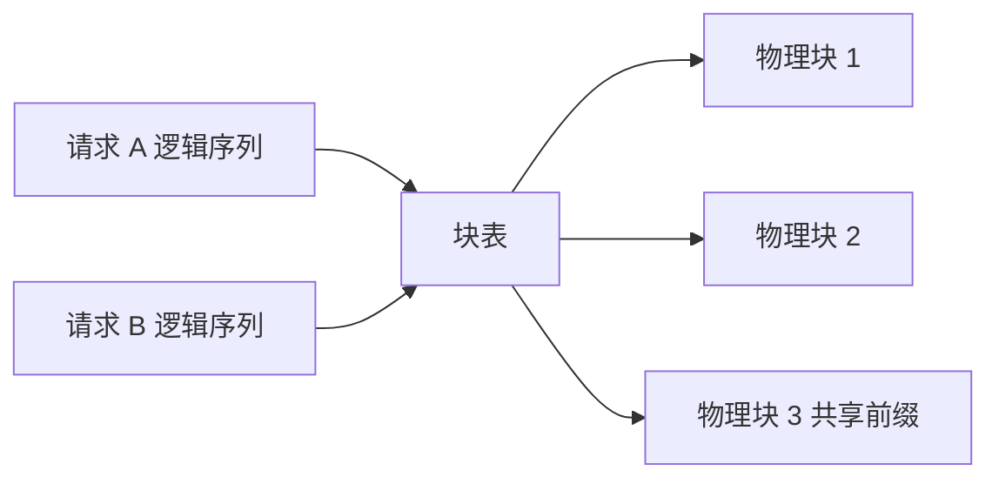

# 服务化vLLM

脚本能对话，但一次只能服务一个人。服务化要解决三件事：权重只加载一次、请求能排队并共享显存、对外提供统一协议。vLLM 是这条路上最常用的起点。

## 1. 从脚本到服务，变了什么

| 维度 | Transformers 直跑 | vLLM 服务 |
|---|---|---|
| 权重加载 | 每个进程一次 | 启动时一次，常驻 |
| 并发 | 无，串行 | 连续批处理（continuous batching） |
| KV 显存 | 随请求增长，难复用 | 分块管理，可复用、可回收 |
| 对外接口 | 自己包函数 | OpenAI 兼容 HTTP |

「连续批处理」的含义值得说清：新请求不必等当前批次全部生成完，而是每步解码时重新组批，短请求先退出、长请求继续。它把 GPU 的空转时间压掉，这也是吞吐提升的主要来源。

## 2. PagedAttention 一句话

传统实现给每个请求预分配一段连续显存，长度按最大可能值算，于是碎片与浪费同时出现。PagedAttention 把 KV Cache 切成固定大小的块（block），用块表把逻辑位置映射到物理块，按需分配、可共享、可回收。



带来的直接结果：显存利用率上升，能同时容纳更多序列；前缀相同的请求（同一 system prompt）可以共享块。副产物是**启动日志里会明确告诉你 KV 池能装多少 token**，这个数字比任何理论估算都可靠。

## 3. 两条使用路径

### 3.1 离线批量：`LLM.generate`

适合「一次性跑几千条」的批处理任务，不起 HTTP 服务：

```python
import os
os.environ["VLLM_USE_MODELSCOPE"] = "True"

from vllm import LLM, SamplingParams
from transformers import AutoTokenizer

model_path = "/data/models/Qwen3-8B"
tokenizer = AutoTokenizer.from_pretrained(model_path, use_fast=False)

llm = LLM(model=model_path, max_model_len=8192, trust_remote_code=True)

sampling = SamplingParams(
    temperature=0.6, top_p=0.95, top_k=20, min_p=0,
    max_tokens=1024, stop_token_ids=[151645, 151643],
)

prompt = tokenizer.apply_chat_template(
    [{"role": "user", "content": "用一句话说清 PagedAttention 的收益。"}],
    tokenize=False, add_generation_prompt=True,
)

outputs = llm.generate([prompt], sampling)
print(outputs[0].outputs[0].text)
```

`stop_token_ids` 里放的是模型的结束符（Qwen 系列为 `<|im_end|>` 与 `<|endoftext|>`），不设就可能一直生成到 `max_tokens`。

### 3.2 在线服务：`vllm serve`

```bash
VLLM_USE_MODELSCOPE=true vllm serve /data/models/Qwen3-8B \
  --served-model-name Qwen3-8B \
  --max_model_len 8192 \
  --gpu-memory-utilization 0.9 \
  --reasoning-parser deepseek_r1
```

参数逐条：

| 参数 | 作用 | 取值建议 |
|---|---|---|
| `--served-model-name` | 对外暴露的模型名 | 与客户端 `model=` 一致 |
| `--max-model-len` | 单请求最大长度 | 按 KV 账本定，不要照抄模型上限 |
| `--gpu-memory-utilization` | 允许占用的显存比例 | 单卡 0.85–0.9，共享卡降低 |
| `--tensor-parallel-size` | 张量并行卡数 | 显存不足时按 2/4/8 递增 |
| `--max-num-seqs` | 同时在跑的序列数 | 显存紧时下调 |
| `--reasoning-parser` | 拆分思维内容 | 按模型家族选（deepseek_r1 / kimi_k2） |
| `--trust-remote-code` | 允许加载自定义结构 | 新模型基本都要 |

`--enable-reasoning` 属于旧版本参数，新版本 vLLM 通常只给 `--reasoning-parser` 就能生效；两者并存时按报错提示取舍，不要同时硬加。

服务启动后，日志里有两行值得抄进笔记：

```text
GPU KV cache size: 123,456 tokens
Maximum concurrency for 8,192 tokens per request: 15.07x
```

第一行是 KV 池总容量，第二行是当前 `max_model_len` 下的理论并发上限。它直接回答了「这台机器能扛多少人」——比估算准，因为它是运行时实测的。

## 4. 三个端点

### 4.1 模型列表

```bash
curl http://localhost:8000/v1/models
```

返回里能看到 `id`、`root`（真实权重路径）、`max_model_len`。`id` 就是 `--served-model-name` 的值。

### 4.2 补全与对话

```bash
curl http://localhost:8000/v1/chat/completions \
  -H "Content-Type: application/json" \
  -d '{
    "model": "Qwen3-8B",
    "messages": [{"role": "user", "content": "5 的阶乘是多少？"}],
    "temperature": 0.6,
    "max_tokens": 512
  }'
```

Python 侧完全按 OpenAI 客户端写：

```python
from openai import OpenAI

client = OpenAI(base_url="http://127.0.0.1:8000/v1", api_key="EMPTY")

resp = client.chat.completions.create(
    model="Qwen3-8B",
    messages=[{"role": "user", "content": "什么是连续批处理？"}],
    temperature=0.7,
)
print(resp.choices[0].message.content)
```

`api_key` 随便填，vLLM 默认不做鉴权——真要暴露到公网，必须自己在前面加一层反代与鉴权。

### 4.3 思维内容字段

开启 reasoning parser 后，思考过程会落在独立字段里，例如 `reasoning_content`，而 `content` 只留最终答案。客户端解析时按字段取，不要用正则从 `content` 里抠 `<think>` 标签，那是解析器已经做掉的事。

## 5. 压测：先量再调

一个 20 行的小并发脚本，比任何「感觉很快」都有用：

```python
import concurrent.futures as cf
import time
from openai import OpenAI

client = OpenAI(base_url="http://127.0.0.1:8000/v1", api_key="EMPTY")

def one(i):
    t0 = time.perf_counter()
    r = client.chat.completions.create(
        model="Qwen3-8B",
        messages=[{"role": "user", "content": f"第 {i} 个请求：一句话解释连续批处理。"}],
        max_tokens=128,
        temperature=0.7,
    )
    return time.perf_counter() - t0, r.usage.completion_tokens

t_start = time.perf_counter()
with cf.ThreadPoolExecutor(max_workers=8) as ex:
    results = list(ex.map(one, range(32)))
wall = time.perf_counter() - t_start

latencies = sorted(r[0] for r in results)
tokens = sum(r[1] for r in results)
print(f"吞吐 {tokens / wall:.1f} tok/s")
print(f"P50 {latencies[len(latencies)//2]:.2f}s  P95 {latencies[int(len(latencies)*0.95)]:.2f}s")
```

三个观察点：

- 并发从 1 加到 8，吞吐应显著上升而延迟缓慢上升；延迟陡增说明显存里塞不下更多序列；
- 吞吐不再增长时，瓶颈已从 GPU 转到调度或网络；
- 混用不同 `max_tokens` 的请求才能看出连续批处理的收益，全是同长度请求时会低估。

## 6. 调优顺序与失败排查

调优有先后，顺序错了会白折腾：

1. 先用 `--max-model-len` 把 KV 预算压到显存之内；
2. 再用 `--gpu-memory-utilization` 给框架留余量；
3. 然后加 `--tensor-parallel-size` 扩显存；
4. 最后才调 `--max-num-seqs` 逼近并发上限。

| 现象 | 原因 | 处理 |
|---|---|---|
| 启动即 OOM | 权重 + KV 池超过显存 | 降 `max_model_len` 或量化 |
| 报 KV cache 不足 | 可用显存不足以放最小块 | 降 `gpu-memory-utilization` 之外的值、减并发 |
| 模型类型不识别 | 框架版本早于模型 | 升级 vLLM / transformers |
| 请求返回 404 | `model=` 与 `--served-model-name` 不一致 | 对齐名称 |
| 端口可访问但很慢 | 请求串行发送 | 客户端加并发 |
| 思考内容混在答案里 | 未配 `--reasoning-parser` | 补上解析器 |

## 7. 可交付物与练习

产出三样东西：一份可复用的启动脚本（参数注释齐全）、三条 curl 示例、一张压测结果表（并发 1/4/8/16 对应的吞吐与 P95）。这张表是后续换框架、换卡、换量化档位的对照基线。

练习：把 `--max-model-len` 从 8192 降到 4096 再压一次，观察启动日志里的并发上限与实测吞吐如何变化，验证「KV 预算决定并发」这一判断。

## 写在最后

vLLM 是默认选项，不是唯一选项。[5-SGLang与LMStudio](/source/大模型/开源模型实战篇/5-SGLang与LMStudio)给出另一条高并发栈与一个纯本地图形端，用同一份客户端代码横向对比。
