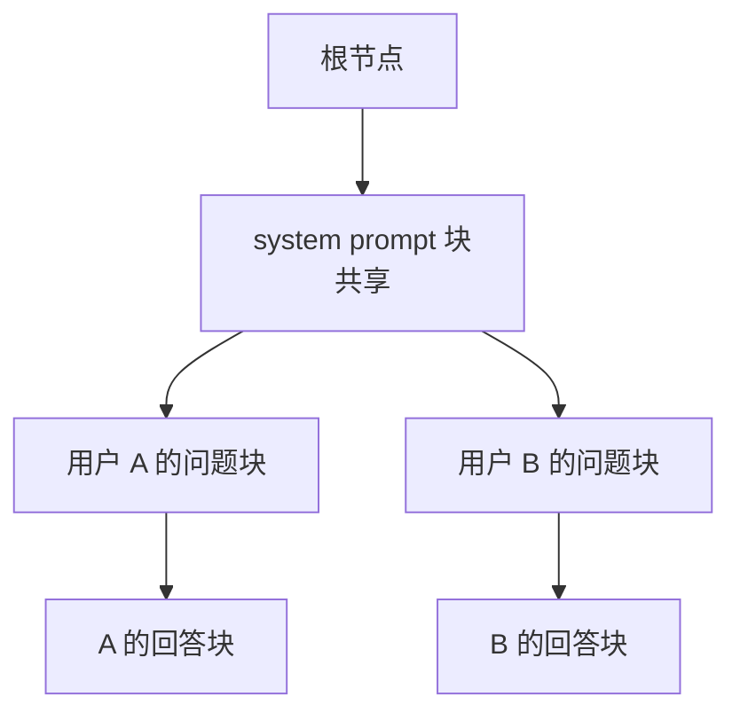

# SGLang与LMStudio

同一份权重，可以放进高并发服务端，也可以塞进笔记本的图形界面。选哪条路不取决于模型，取决于「谁在用、多少人在用、允不允许掉精度」。

## 1. 四类栈的定位

| 栈 | 量化倾向 | 并发能力 | 典型场景 |
|---|---|---|---|
| SGLang | FP16 为主 | 强，跨卡分布式 | 企业级高并发、长上下文 |
| vLLM | 8-bit 折中 | 较强 | 通用服务化、批量推理 |
| Ollama | 4-bit 为主 | 弱，单机 | 个人本地跑起来就能用 |
| LM Studio | GGUF 多档位 | 单机少量 | 图形界面试验、离线演示 |

这张表的核心不是排名，而是**精度与并发的权衡**：SGLang 倾向于保留半精度换取稳定输出，Ollama 用 4-bit 换取能在消费级显卡上跑起来，vLLM 站在中间。精度损失不是抽象的——4-bit 量化在数学推理、长链工具调用上的退化通常比闲聊明显。

## 2. RadixAttention：SGLang 的核心差异

vLLM 用分页解决「显存碎片与动态组批」，SGLang 在此基础上多做一件事：**把 KV Cache 组织成基数树（radix tree），让不同请求自动复用相同前缀**。



机制拆成四步：

1. **块级索引**：KV Cache 按固定大小切块，每块用 token 内容哈希在树中定位；
2. **最长前缀匹配**：新请求进来先找最长的公共前缀，命中的块直接复用，只算未命中的部分；
3. **引用计数 + LRU**：每个块记录被多少活跃请求引用，显存不足时驱逐最久未用的叶块；
4. **写时复制**：需要修改共享前缀后的内容时只复制必要的块，其余保持共享。

收益集中在「前缀重复」的场景：多轮对话的历史、批量任务共用的 system prompt、Agent 里反复出现的工具描述模板。这些恰是高并发服务里最耗算力的部分。

它与 PagedAttention 不是替代关系：RadixAttention 解决**复用**，PagedAttention 解决**分配**，SGLang 的底层存储同样借鉴了分页思想。

## 3. SGLang 的安装与启动

常规 `pip install sglang` 在新模型上经常不够——官方部署文档往往要求源码安装并锁定某个 cudnn 版本：

```bash
pip install "sglang @ git+https://github.com/sgl-project/sglang.git#subdirectory=python"
pip install nvidia-cudnn-cu12==9.16.0.29
```

源码安装意味着编译期依赖要齐（CUDA toolkit、ninja），镜像里预装过的环境更省事。启动命令：

```bash
sglang serve \
  --model-path /data/models/Kimi-K2.5 \
  --tp 8 \
  --trust-remote-code \
  --tool-call-parser kimi_k2 \
  --reasoning-parser kimi_k2
```

| 参数 | 作用 |
|---|---|
| `--model-path` | 含 `config.json` 与权重分片的目录 |
| `--tp` | 张量并行卡数，按显存缺口取 2/4/8 |
| `--tool-call-parser` | 把工具调用解析成结构化字段 |
| `--reasoning-parser` | 把思维内容与最终答案分离 |

默认端口是 **30000**，不是 8000。客户端 base_url 要跟着改，这是从 vLLM 迁过来最常见的第一个错误。

启动日志里会打出端口、并行度与显存分配情况，服务就绪后同样提供 OpenAI 兼容接口。

## 4. 冷启动与显存的两套账

大模型冷启动不是秒级。以 8 卡、百 GB 级权重的模型为例，实测总启动时间可达 **8714 秒（约 2 小时 25 分钟）**，其中约 1 小时 45 分钟用于从磁盘读取权重，之后是数十秒到数十分钟无日志的多卡 P2P 通信、张量切分与 MoE 专家重排。看到终端「卡住不动」先别急着重启。

显存也要分两套账看：

| 口径 | 数值示例 | 含义 |
|---|---|---|
| 框架自报 `mem_usage` | 72.33 GB/卡 | 权重 + 必要缓冲区 |
| `nvidia-smi` | 81.4 GB/卡 | 加上预分配的静态图与 KV 池 |

第二列更大是正常的——框架会提前占住一段显存做 KV 池，避免运行中反复申请。排查「显存是不是漏了」时，以框架自报值为准，`nvidia-smi` 只作旁证。

## 5. LM Studio：把权重装进图形界面

完全不想碰命令行时，LM Studio 是最短路径。它的模型来源是 **GGUF** 格式，也就是 llama.cpp 生态的量化权重。

档位选择可以直接对着显存表来：

| 档位 | 大致体积（8B） | 适合显存 |
|---|---|---|
| `Q3_K_M` | 约 4 GB | 8 GB 及以下 |
| `Q4_K_M` | 约 5 GB | 8–12 GB，通用首选 |
| `Q5_K_M` | 约 6 GB | 12 GB 以上 |
| `Q8_0` | 约 8.5 GB | 16 GB 以上，接近无损 |

K 系列（`Q4_K_M` 等）对关键层保留更高精度，同等体积下质量优于早期的 `Q4_0`。显存富余时直接上 `Q8_0`，几乎感觉不到与 BF16 的差距；显存紧张时宁可降上下文长度，也别一路降到 `Q2`。

离线使用只需两步：把量化仓库（如 `lmstudio-community/Qwen3-8B-GGUF`）整个目录放进 LM Studio 的模型目录，界面里刷新即可看到。之后打开本地服务开关，就得到一个 OpenAI 兼容端点：

```text
http://localhost:1234/v1
```

`api_key` 填任意字符串（例如 `lm-studio`）即可，服务端不校验。

## 6. 同一份客户端，三家通吃

三家的接口都兼容 OpenAI，所以客户端代码可以完全复用，只改 `base_url` 与 `api_key`：

```python
from openai import OpenAI

BACKENDS = {
    "vllm":    ("http://127.0.0.1:8000/v1",  "EMPTY"),
    "sglang":  ("http://127.0.0.1:30000/v1", "EMPTY"),
    "lmstudio": ("http://127.0.0.1:1234/v1", "lm-studio"),
}

name = "sglang"
base_url, api_key = BACKENDS[name]
client = OpenAI(base_url=base_url, api_key=api_key)

resp = client.chat.completions.create(
    model="default",
    messages=[{"role": "user", "content": "用一句话介绍你自己。"}],
    temperature=0.7,
    max_tokens=256,
)
print(resp.choices[0].message.content)
```

一个坑：`model` 字段的取值三家不同。vLLM 用 `--served-model-name` 指定的名字，SGLang 常接受 `default`，LM Studio 要用界面上显示的模型标识。报 404 时先怀疑这个字段。

流式输出也只差一个参数，适合做打字机效果：

```python
stream = client.chat.completions.create(
    model="default",
    messages=[{"role": "user", "content": "讲讲 RadixAttention 的收益。"}],
    stream=True,
)
for chunk in stream:
    piece = chunk.choices[0].delta.content
    if piece:
        print(piece, end="", flush=True)
```

## 7. 怎么选

| 约束 | 选择 |
|---|---|
| 多卡、高并发、长上下文 | SGLang |
| 通用服务、生态与资料最全 | vLLM |
| 单卡、只想跑起来 | Ollama / LM Studio |
| 必须离线、图形界面演示 | LM Studio + GGUF |
| 精度敏感（数学、工具调用） | FP16/BF16 服务端，不用 4-bit |

一个务实做法：**先用 LM Studio 或 Ollama 验证「这个模型值不值得用」，再用 vLLM/SGLang 决定「怎么把它服务好」**。反过来先上高并发栈，往往在调通环境前就耗掉了全部耐心。

## 8. 可交付物与练习

产出一个 `client.py`，把三个后端的 base_url、api_key、model 名收进字典，命令行切换即可对比同一问题在三家上的输出与延迟。这份脚本在选型讨论里比任何文字描述都有说服力。

练习：同一个 8B 模型，分别在 LM Studio（`Q4_K_M` 与 `Q8_0` 各一次）与 vLLM（BF16）上问同一道数学题，记录输出差异与耗时，亲眼确认量化档位的代价。

## 写在最后

服务跑起来只说明「能出结果」，说明不了「结果好不好」。[6-评测EvalScope](/source/大模型/开源模型实战篇/6-评测EvalScope)把评测接到自己的服务上，用同一套口径横向比较模型与量化档位。
