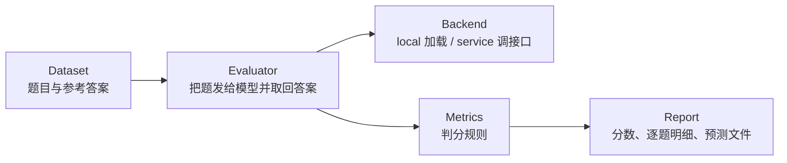

# 评测EvalScope

「跑起来了」和「跑得对」是两件事。评测要把「哪份权重、哪个后端、什么采样参数下得分多少」固化成可复现的记录，否则所有对比都只是印象。

## 1. 评测的三层结构

任何大模型评测都可以拆成三层，EvalScope 的组织方式与之一致：



对应到实际使用中的三个决策：

| 层 | 要定的事 | 影响 |
|---|---|---|
| Dataset | 用什么基准、取哪个子集 | 分数能不能和别人比 |
| Backend | 本地加载还是打服务 | 速度、显存、是否与线上一致 |
| Metrics | 精确匹配、包含、LLM 判分 | 分数的松紧程度 |

## 2. 两种评测模式

**local 模式**：评测器自己加载权重推理。适合「还没有服务、只想比较两份权重」。

**service 模式**：把评测器当客户端，打已经起好的 OpenAI 兼容接口。适合「验证线上服务」，也是唯一能测到量化、并发、解析器配置的模式。

| 模式 | 优点 | 代价 |
|---|---|---|
| local | 不依赖服务，配置简单 | 评测器与业务各加载一份，显存翻倍 |
| service | 与线上完全一致 | 需要先起服务，结果受服务参数影响 |

既然前面几篇已经把服务跑起来了，这里统一走 `service`——评测的就是「实际要用的那套东西」。

## 3. 安装

```bash
pip install evalscope
```

按需装 extras 可以省掉大量无关依赖：

| extras | 内容 |
|---|---|
| `evalscope[all]` | 全部数据集与后端 |
| `evalscope[perf]` | 吞吐与延迟压测 |
| `evalscope[vlmeval]` | 多模态评测 |
| `evalscope[rag]` | RAG 相关指标 |

只跑文本基准时装基础版即可，遇到 `ImportError` 再按提示补对应 extra。

## 4. 一条命令跑完

服务在 8000 端口时，命令行只需给出模型名、接口地址与数据集：

```bash
evalscope eval \
  --model Qwen3-8B \
  --api-url http://localhost:8000/v1 \
  --api-key EMPTY \
  --eval-type service \
  --eval-batch-size 16 \
  --datasets iquiz \
  --work-dir outputs/Qwen3-8B
```

参数表：

| 参数 | 含义 | 备注 |
|---|---|---|
| `--model` | 模型标识 | 必须与服务的 `--served-model-name` 一致 |
| `--api-url` | OpenAI 兼容地址 | 注意结尾的 `/v1` |
| `--api-key` | 鉴权 | 本地服务填 `EMPTY` |
| `--eval-type` | `service` / `local` | 打服务必须用 `service` |
| `--eval-batch-size` | 并发请求数 | 与服务端 `max-num-seqs` 匹配 |
| `--datasets` | 数据集名，多个用逗号分隔 | 先单选一个跑通 |
| `--work-dir` | 结果落盘目录 | 按模型名分目录便于对比 |

`--eval-batch-size` 与服务端并发要匹配：服务只允许 4 路并发时，评测端开 64 只会让请求排队，总耗时反而更长。

## 5. Python 接口

需要循环多组参数时，用 Python 更顺手：

```python
from evalscope import TaskConfig, run_task

task_cfg = TaskConfig(
    model="Qwen3-8B",
    api_url="http://localhost:8000/v1",
    api_key="EMPTY",
    eval_type="service",
    datasets=["iquiz"],
    eval_batch_size=16,
    generation_config={
        "temperature": 0.0,
        "max_tokens": 1024,
    },
    work_dir="outputs/Qwen3-8B",
)

run_task(task_cfg=task_cfg)
```

关键点：`generation_config` 是**评测变量**的一部分。同一个模型，温度 0 与 1.0 的得分可能差好几个点——尤其是需要多次尝试的推理题。想比较模型能力时把温度压到 0（或极低），想比较「真实可用性」时用官方推荐参数，两种口径不要混着比。

## 6. 为什么从 iQuiz 开始

`iquiz` 是一个轻量基准，题目量不大、覆盖常识推理与情商判断（约 40 道智商类 + 80 道情商类）。它适合做首次跑通，原因很实际：

- 题量小，几分钟出结果，不必等一小时；
- 题目类型混合，能同时看到「答得对」和「答得得体」两类表现；
- 判分规则简单，结果好解释。

第一次评测的目标不是拿到高分，而是确认整条链路通：数据能加载、请求能发出、结果能落盘、报告能打开。

## 7. 结果目录里该看什么

跑完后 `--work-dir` 下会出现几类文件：

| 位置 | 内容 | 用途 |
|---|---|---|
| `reports/` | 汇总报告（各数据集得分） | 直接看的结论 |
| `reviews/` | 逐题评判明细 | 定位错在哪类题 |
| `predictions/` | 模型原始输出 | 复查格式、截断、复读 |
| `logs/` | 运行日志 | 排查请求失败 |

三个必看项：

1. **总体分数之外，看样本量**。几十道题的基准上，一两个点的差距没有统计意义；
2. **看 `predictions` 里有没有截断**。`max_tokens` 不够时，推理模型会把思维链写满后什么都没答，分数被系统性压低；
3. **看格式类失败**。选择题没按格式输出、答案带了多余解释，都会让精确匹配判错，这类错误换判分方式就能解决。

## 8. 把方差当成本的一部分

评测结果不是确定值，来源有三：

- **采样随机性**：温度 > 0 时每次采样路径不同；
- **批次顺序**：并发与批处理会轻微影响数值；
- **服务配置**：`max_model_len`、量化档位、解析器开关都会改变输出。

控制办法很朴素：固定采样参数、固定 `max_tokens`、固定服务启动参数，同一配置至少跑两遍看波动。报告里同时写清这五项——模型名、量化档位、后端、采样参数、上下文长度——别人才能判断这个分数能不能和自己的比。

## 9. 自定义数据集

内置基准覆盖不了业务场景时，需要注册自己的题目。最小结构是「一批输入 + 一批参考答案」，按所用版本的数据集定义组织（一般包含 `data` 与子集列表两部分，具体字段以当前版本文档为准）。接入后可以复用同一套评测器与报告流程，得分口径与基准一致，便于横向对比。

自建评测集的价值在于**贴近业务**：通用榜上差 1 分的两个模型，在具体任务上可能差 20 分。

## 10. 可交付物与练习

产出一份 `eval_report.md`，固定包含：模型与量化档位、服务启动参数、采样参数、数据集与样本量、总分与分类得分、异常样本摘录。这份模板积累三份之后，模型选型就不再靠感觉。

练习：同一份模型，分别用 `temperature=0` 与 `1.0` 各跑一次 iQuiz，比较分数与输出长度分布，观察随机性对结论的影响；再把服务换成 4-bit 量化版本跑第三次，量化代价就能被量化描述。

## 写在最后

评测回答了「现在这套配置好不好」。要让模型贴合自己的数据，还需要动权重本身。[7-LoRA到GRPO的微调路径](/source/大模型/开源模型实战篇/7-LoRA到GRPO的微调路径)整理从 LoRA 到 DPO、GRPO 的三级台阶。
