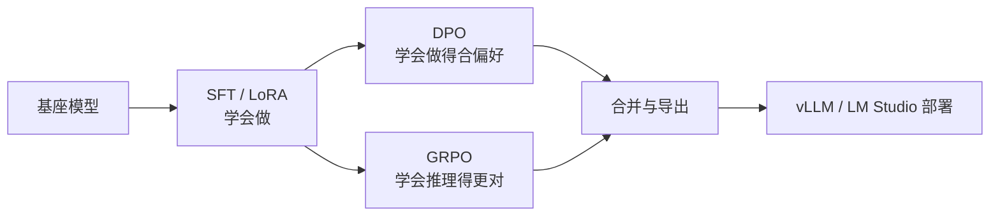

# LoRA到GRPO的微调路径

微调不是「一定要做」的步骤，而是三个不同目标对应三种手段：改格式与风格用 SFT，改偏好用 DPO，教推理用 GRPO。用错手段，数据再干净也训不出想要的效果。

## 1. 先判断该不该微调

| 目标 | 首选手段 | 为什么 |
|---|---|---|
| 输出格式稳定（JSON、字段名） | 提示词 + 结构化输出约束 | 无需训练，改一句 prompt 就生效 |
| 领域词汇、话术风格 | SFT（LoRA 足够） | 属于「模仿」，标注几条百条即可 |
| 回答更简洁 / 更礼貌 / 更安全 | DPO | 需要成对的好坏答案来定「偏好方向」 |
| 数学、代码、可验证推理 | GRPO | 有自动判分器，能给出可靠奖励 |

顺序上，SFT 是地基：模型连合格答案都写不出来时，直接做 DPO 的偏好信号全是噪声。DPO 与 GRPO 都是「在会做的基础上做得更好」。

## 2. 三种数据格式

### 2.1 SFT：指令三元组

```json
{
  "instruction": "回答以下用户问题，仅输出答案。",
  "input": "1+1等于几?",
  "output": "2"
}
```

角色扮演类任务同样用这个结构，把风格写进 `instruction`，把台词写进 `output`：

```json
{
  "instruction": "你父亲是谁？",
  "input": "",
  "output": "家父是大理寺少卿甄远道。"
}
```

### 2.2 DPO：一条样本里放两个答案

```json
{
  "messages": [
    {"role": "system", "content": "你是个有用无害的助手"},
    {"role": "user", "content": "告诉我明天的天气"},
    {"role": "assistant", "content": "明天天气晴朗"}
  ],
  "rejected_response": "我不知道"
}
```

`messages` 里最后那条 `assistant` 就是**被选择（chosen）**的答案，`rejected_response` 是**被拒绝**的答案。构造数据的关键不是数量，而是两条答案的差距要「有信息量」：一个好一个坏，且坏的那个不是胡言乱语，否则模型学不到细粒度偏好。

### 2.3 GRPO：prompt + 可自动判定的答案

```json
{
  "prompt": "求 101 的平方根，保留两位小数。",
  "answer": "10.05"
}
```

不需要参考答案的「解题过程」，只需要一个能判对错的 `answer`。过程由模型自己探索，这也是 GRPO 省掉奖励模型的根本原因——**奖励函数替代了奖励模型**。

## 3. 三级台阶的关系



两条分支可以叠加：先 SFT 固化格式，再 DPO 调偏好，或再 GRPO 提升可验证任务的正确率。反过来（先 GRPO 再 SFT）通常没意义，SFT 会把 RL 学到的探索策略重新压回模仿。

## 4. LoRA：最小可用的一次微调

### 4.1 数据要编码成 `input_ids` 与 `labels`

模型不认识 JSON，只认识 token。预处理函数负责把「指令」与「回答」拼成一条序列，并且**只在回答部分计算损失**：

```python
def process_func(example):
    MAX_LENGTH = 1024
    instruction = tokenizer(
        f"<|im_start|>system\n现在你要扮演皇帝身边的女人--甄嬛<|im_end|>\n"
        f"<|im_start|>user\n{example['instruction'] + example['input']}<|im_end|>\n"
        f"<|im_start|>assistant\n<think>\n\n</think>\n\n",
        add_special_tokens=False,
    )
    response = tokenizer(f"{example['output']}", add_special_tokens=False)

    input_ids = instruction["input_ids"] + response["input_ids"] + [tokenizer.pad_token_id]
    attention_mask = instruction["attention_mask"] + response["attention_mask"] + [1]
    labels = [-100] * len(instruction["input_ids"]) + response["input_ids"] + [tokenizer.pad_token_id]

    return {
        "input_ids": input_ids[:MAX_LENGTH],
        "attention_mask": attention_mask[:MAX_LENGTH],
        "labels": labels[:MAX_LENGTH],
    }
```

`-100` 是 PyTorch 交叉熵的忽略标记：指令部分的 token 不参与 loss，模型只学「怎么回答」，不学「怎么提问」。忘记这一步，模型会开始模仿用户的语气，甚至复读问题。

### 4.2 只训练一小部分参数

```python
from peft import LoraConfig, TaskType

config = LoraConfig(
    task_type=TaskType.CAUSAL_LM,
    target_modules=["q_proj", "k_proj", "v_proj", "o_proj",
                    "gate_proj", "up_proj", "down_proj"],
    inference_mode=False,
    r=8,
    lora_alpha=32,
    lora_dropout=0.1,
)
```

三个参数的直觉：

- `r`：低秩矩阵的秩，越大容量越强、显存越高，8 是安全的起点；
- `lora_alpha`：缩放因子，实际更新强度是 `alpha / r`，本例为 4 倍；
- `target_modules`：必须按模型实际层名写。Qwen/Llama 系是 `q_proj` 一类，GLM 系的投影层命名不同，照抄会直接报「找不到模块」。

### 4.3 训练与加载

```python
from transformers import Trainer, TrainingArguments, DataCollatorForSeq2Seq

args = TrainingArguments(
    output_dir="./output/qwen3_lora",
    per_device_train_batch_size=4,
    gradient_accumulation_steps=4,
    num_train_epochs=3,
    learning_rate=1e-4,
    logging_steps=2,
    save_steps=10,
    gradient_checkpointing=True,
    report_to="none",
)

trainer = Trainer(
    model=model,
    args=args,
    train_dataset=tokenized,
    data_collator=DataCollatorForSeq2Seq(tokenizer=tokenizer, padding=True),
)
trainer.train()
```

有效批量 = `per_device_train_batch_size × gradient_accumulation_steps`。显存不够时别急着砍学习率，先加梯度累积步数。`gradient_checkpointing=True` 用重算换显存，代价是训练慢 20% 左右。

推理时把 adapter 挂回基座：

```python
from peft import PeftModel

model = AutoModelForCausalLM.from_pretrained(基座路径, device_map="auto",
                                             torch_dtype=torch.bfloat16,
                                             trust_remote_code=True)
model = PeftModel.from_pretrained(model, model_id="./output/qwen3_lora/checkpoint-20")
```

LoRA 权重通常只有几十 MB，非常适合「一个基座 + 多个业务 adapter」。

## 5. 工具层：三种写法

同一件事有三条实现路径，按上手成本排序：

| 方式 | 上手成本 | 适合 |
|---|---|---|
| `peft` + `Trainer` | 中，要自己写预处理 | 需要精细控制训练过程 |
| `ms-swift` 命令行 | 低，参数即配置 | 标准 SFT / DPO / GRPO 流程 |
| `Unsloth` | 中，单卡友好 | 消费级显卡上做 SFT 与 GRPO |

### 5.1 ms-swift 跑 DPO

```bash
swift rlhf --rlhf_type dpo \
  --model /data/models/gpt-oss-20b \
  --dataset dpo_data.json \
  --train_type lora \
  --torch_dtype bfloat16 \
  --num_train_epochs 1 \
  --per_device_train_batch_size 2 \
  --gradient_accumulation_steps 4 \
  --learning_rate 4e-4 \
  --lora_rank 8 \
  --lora_alpha 32 \
  --target_modules all-linear \
  --deepspeed zero3 \
  --report_to swanlab \
  --swanlab_project swift-robot \
  --output_dir /data/output/gpt-oss-20b-dpo
```

`--target_modules all-linear` 让框架自动把线性层全覆盖，省掉手写层名的麻烦；代价是参数更多、显存更高。多卡时 `--deepspeed zero3` 负责把优化器状态切分到各卡。

### 5.2 Unsloth 跑 GRPO

单卡做强化学习的关键是省显存，Unsloth 的做法是「4-bit 加载 + 优化的梯度检查点 + 借 vLLM 生成」：

```python
from unsloth import FastLanguageModel

model, tokenizer = FastLanguageModel.from_pretrained(
    model_name="Qwen/Qwen3-8B",
    max_seq_length=2048,
    load_in_4bit=False,
    fast_inference=True,
    max_lora_rank=32,
    gpu_memory_utilization=0.7,
)

model = FastLanguageModel.get_peft_model(
    model, r=32, lora_alpha=64,
    target_modules=["q_proj", "k_proj", "v_proj", "o_proj",
                    "gate_proj", "up_proj", "down_proj"],
    use_gradient_checkpointing="unsloth",
)
```

`fast_inference=True` 会拉起一个 vLLM 后端专门负责**采样**——RL 需要每个 prompt 生成多个候选，采样速度直接决定训练时间。

## 6. GRPO 的核心：奖励函数

PPO 需要一个和策略一起训练的 Critic，GRPO 把 Critic 省掉：同一个 prompt 生成一组答案，用组内平均分当基线，高于平均的被强化，低于平均的被抑制。

```python
from trl import GRPOConfig, GRPOTrainer

training_args = GRPOConfig(
    temperature=1.0,
    learning_rate=5e-6,
    num_generations=4,
    max_steps=100,
    per_device_train_batch_size=1,
    gradient_accumulation_steps=1,
    report_to="none",
    output_dir="outputs",
)
```

`num_generations=4` 就是「一组几个答案」，太少组内均值不稳，太多显存吃紧。四个奖励函数组合出「格式 + 正确性」两类信号：

```python
import re

def match_format_exactly(completions, **kwargs):
    return [3.0 if "<answer>" in c[0]["content"] and "</answer>" in c[0]["content"] else 0.0
            for c in completions]

def match_format_approximately(completions, **kwargs):
    scores = []
    for c in completions:
        text = c[0]["content"]
        score = 0.0
        score += 0.5 if text.count("<answer>") == 1 else -1.0
        score += 0.5 if text.count("</answer>") == 1 else -1.0
        scores.append(score)
    return scores

def check_answer(prompts, completions, answer, **kwargs):
    scores = []
    for c, truth in zip(completions, answer):
        m = re.search(r"<answer>(.+?)</answer>", c[0]["content"], re.S)
        if not m:
            scores.append(-2.0)
            continue
        guess = m.group(1).strip()
        scores.append(5.0 if guess == truth.strip() else -1.5)
    return scores
```

设计要点只有一条：**格式分与正确性分要分开**。格式分让模型先学会「把答案放进指定标签」，正确性分再教它「答案要对」。混成一个函数时，模型常常学出「格式漂亮但内容乱写」的局部最优。

训练完保存并验证非空：

```python
model.save_lora("grpo_saved_lora")
```

## 7. 训练过程要看得见

微调是实验科学，曲线比日志有用。SwanLab 有两种接法：

**Trainer 系**用回调：

```python
import swanlab
from swanlab.integration.transformers import SwanLabCallback

swanlab.login(api_key="你的 key", save=True)
callback = SwanLabCallback(project="self-llm", experiment_name="qwen3-8b-lora")
trainer = Trainer(..., callbacks=[callback])
```

**ms-swift / TRL 系**用参数：

```bash
--report_to swanlab --swanlab_project swift-robot
```

```python
GRPOConfig(..., report_to="swanlab")
```

三件东西值得盯：loss 是否持续下降（不降先怀疑数据格式或学习率）、梯度范数是否爆炸、GRPO 的奖励均值是否随步数抬升。GRPO 的 loss 常常前几百步看不出变化，奖励曲线才是真信号。

## 8. 合并与导出

训练产出的是 adapter，部署前通常要合并：

```bash
swift export --adapters output/gpt-oss-20b-dpo/checkpoint-20 --merge_lora true
```

Unsloth 侧提供多种导出方法，按用途选：

| 方法 | 产物 | 用途 |
|---|---|---|
| `merged_16bit` | 合并后的 BF16 权重 | vLLM / Transformers 部署 |
| `lora` | 仅 adapter | 一个基座挂多个业务 |
| `merged_4bit` | 4-bit 合并权重 | 显存紧张的推理 |
| `gguf`（`q4_k_m` / `q8_0`） | GGUF 文件 | LM Studio / llama.cpp |

导出 GGUF 后即可回到第 5 篇的本地图形端流程，训练与部署在同一台机器上闭环。

## 9. 显存与时间的量级

| 任务 | 规模 | 参考配置 |
|---|---|---|
| LoRA SFT | 8B，单卡 | 24 GB 可跑，单卡数小时 |
| LoRA SFT | 20B，4 卡 | H20-96GB × 4，zero3 |
| DPO | 20B，4 卡 | 与 SFT 同量级，数据减半 |
| GRPO | 8B，单卡 | A100-80G 舒适，4B 24 GB 可跑 |

数字只能定档，不能当承诺：真正决定能不能跑的是序列长度、`num_generations` 与是否开梯度检查点。

## 10. 常见坑

| 现象 | 原因 | 处理 |
|---|---|---|
| loss 不降 | `labels` 没设 `-100`，或数据未编码 | 检查预处理输出 |
| 报找不到模块 | `target_modules` 与模型层名不匹配 | 先打印模型结构 |
| 显存 OOM | 序列过长 / batch 过大 | 降 `MAX_LENGTH`、开梯度检查点 |
| DPO 不收敛 | 未先做 SFT | 先 SFT 再 DPO |
| GRPO 奖励不涨 | 奖励函数太严或全为负 | 加格式分、调分值区间 |
| 合并后效果变差 | 合并时精度丢失 | 用 BF16 合并，别用 4-bit 合并后当 BF16 用 |

## 11. 可交付物与练习

产出一条可复现的训练命令（含数据路径、超参、日志开关）和一张训练曲线截图，再加一份 `adapter` 目录清单。三者合起来才能让别人复现你的结果。

练习：用同一份 SFT 数据分别以 `r=8` 与 `r=32` 各训一次，比较可训练参数占比、显存峰值与输出风格差异；再把 DPO 数据里的 `rejected_response` 换成「语义相近但格式错误」的答案，观察偏好学习是否更敏感。

## 写在最后

到这里，一条从权重到微调再到部署的链路已经闭合。最后一篇把这些动作按硬件平台重新排一遍。[8-硬件与模型适配速查](/source/大模型/开源模型实战篇/8-硬件与模型适配速查)给出 NVIDIA、AMD、昇腾、Apple 四条路线与故障定位表。
