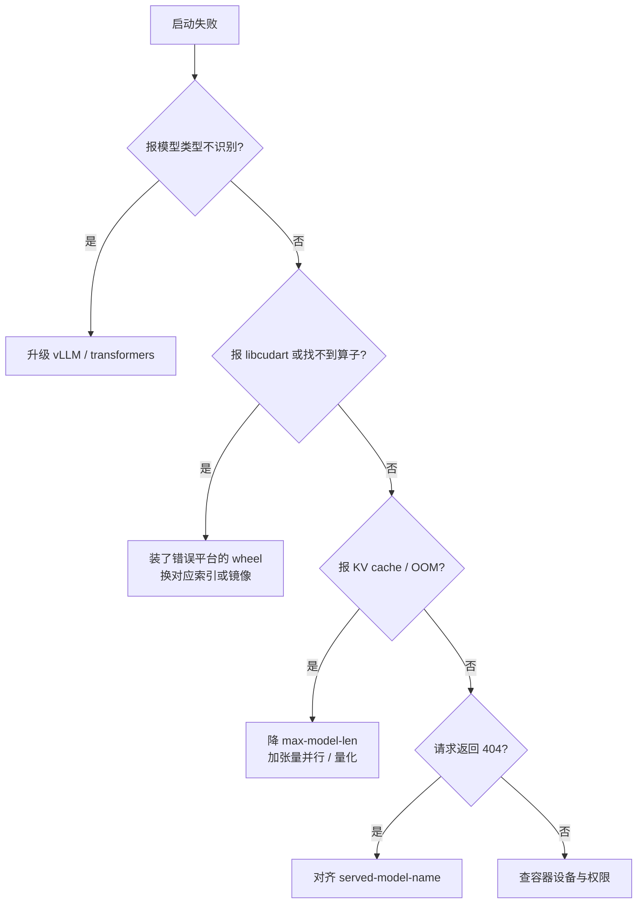

# 硬件与模型适配速查

前七篇默认 NVIDIA + CUDA。换到 AMD、昇腾或 Apple Silicon 时，上层代码大多不用改，变的是软件栈名称、安装方式与监控命令。把差异收进一张速查表，比逐平台重写一遍教程有用。

## 1. 四平台对照

| 维度 | NVIDIA | AMD | 昇腾 | Apple Silicon |
|---|---|---|---|---|
| 加速栈 | CUDA | ROCm | CANN | Metal |
| PyTorch | `torch`（cu 版） | `torch`（rocm 版） | `torch` + `torch-npu` | `torch`（MPS） |
| 推理后端 | vLLM / SGLang | vLLM ROCm 镜像 | vLLM-Ascend / MindIE | MLX-LM / llama.cpp |
| 监控 | `nvidia-smi` | `rocm-smi` | `npu-smi info` | 活动监视器 |
| 容器设备 | `--gpus all` | `--device /dev/kfd --device /dev/dri` | 厂商镜像 | 无容器 |
| 量化生态 | AWQ / GPTQ / FP8 | 同左 | 同左 | 4-bit MLX / GGUF |

一个共同点容易被忽略：**所有平台的 PyTorch 都沿用 `torch.cuda` 命名空间**，ROCm 版也不例外。代码里写 `torch.cuda.is_available()` 在 AMD 卡上返回真，不需要为它改分支。

## 2. NVIDIA：默认路线

前几篇的流程就是这条路线，无需额外适配。两条命令守住底线：

```bash
nvidia-smi                       # 驱动与显存占用
vllm serve <path> --max-model-len 8192
```

`nvidia-smi` 右上角的 CUDA Version 是驱动支持上限，不等同于运行时版本；真正要对齐的是 `torch.version.cuda` 与推理框架 wheel 的 cu 后缀。

## 3. AMD：镜像优先，wheel 次之

ROCm 路线最容易卡在「装环境」而不是「跑模型」，所以官方推荐直接使用镜像。

### 3.1 容器启动

```bash
docker run -it --rm \
  --device /dev/kfd \
  --device /dev/dri \
  --network=host \
  --ipc=host \
  --group-add=video \
  --cap-add=SYS_PTRACE \
  --security-opt seccomp=unconfined \
  -v ~/models:/app/models \
  -e HF_HOME="/app/models" \
  vllm/vllm-openai-rocm:latest \
  --model /app/models/Qwen3.5-4B \
  --served-model-name Qwen3.5-4B \
  --max-model-len 4096
```

设备参数是硬要求：`/dev/kfd`（计算）与 `/dev/dri`（渲染）缺一个，容器里就看不到 GPU；`--group-add=video` 决定当前用户能否访问设备节点。

镜像有两条路线：

| 镜像 | 说明 |
|---|---|
| `vllm/vllm-openai-rocm:latest` | vLLM 官方上游，跟随最新发布 |
| `rocm/vllm:rocm7.13.0_gfx1151_...` | ROCm 官方验证过的版本锁定镜像 |

版本锁定镜像适合「跑通优先」，名字里已经把 ROCm、GPU 架构（`gfx1151`）、Python、PyTorch、vLLM 版本全部写明，避免自行拼组合。旧文档里的 `rocm/vllm-dev:nightly` 不再作为主路径。

### 3.2 wheel 安装与两个坑

不想用容器时，走 ROCm 专用索引：

```bash
uv venv --python 3.12 --seed
source .venv/bin/activate
uv pip install vllm --extra-index-url https://wheels.vllm.ai/rocm/
```

坑一：**Python 版本不匹配会被回退成 CUDA wheel**，随后在 AMD 卡上报 `libcudart.so` 找不到。看到这个错误不要去装 CUDA 运行时，先检查 Python 版本与 glibc 是否满足要求。

坑二：**新模型类型不识别**。Qwen3.5 这类新架构在旧 vLLM 上直接报 `qwen3_5` 未知，升级框架或换新镜像即可。

查询本机架构用 `rocminfo | grep gfx`，源码编译时据此设置 `PYTORCH_ROCM_ARCH`。

### 3.3 云平台

AMD 生态有面向学习者的云入口，登录后即是配好 ROCm 的 Notebook / Code Server，适合先验证「代码能不能跑」再决定是否买卡。使用要点与通用云平台一致：代码与权重放持久化目录，临时工作区结束会被重置。

## 4. 昇腾：CANN + vLLM-Ascend

昇腾的软件栈由 CANN 提供，PyTorch 侧靠 `torch-npu` 插件把算子映射到 NPU。一个可用的基线组合：

```text
ubuntu 22.04
NPU 驱动 25.2.0
python 3.10
cann 8.3.RC2
torch 2.8.0
torch-npu 2.8.0
```

安装：

```bash
pip install modelscope
pip install vllm==0.13.0
pip install vllm-ascend==0.13.0rc1
```

`vllm-ascend` 是 vLLM 的硬件可插拔后端插件，装好之后 `vllm serve` 的用法与 NVIDIA 完全一致：

```bash
VLLM_USE_MODELSCOPE=true vllm serve /data/models/Qwen3-8B \
  --served-model-name Qwen3-8B \
  --max_model_len 8192
```

也可以直接用厂商镜像，省掉驱动与 CANN 的匹配：

```bash
# A2 系列
docker pull quay.io/ascend/vllm-ascend:v0.13.0rc1
# A3 系列
docker pull quay.io/ascend/vllm-ascend:v0.13.0rc1-a3
```

芯片系列决定镜像标签，拉错标签的表现通常是「容器起来了但看不到设备」。另一条路线是 MindIE（昇腾原生的推理引擎），接口与 OpenAI 兼容但配置体系独立，适合已经在用昇腾工具链的团队。

## 5. Apple Silicon：MLX 与统一内存

Mac 上没有独立显存，权重与系统共用**统一内存**，所以显存账本要换成「内存余量」来算。8B 的 4-bit 量化约 5 GB，16 GB 内存的机器可跑，32 GB 以上比较从容。

MLX 是苹果的原生框架，安装与使用都很轻：

```bash
conda create -n mlx-lm python=3.11
conda activate mlx-lm
pip install -r requirements.txt
```

模型侧用 MLX 量化格式（如 `Qwen3-0.6B-4bit`、`Qwen3.5-2B-4bit`），而不是 HF 的 safetensors。带界面的用法是跑一个 Gradio 应用，里面集成了模型下载、对话、参数调节：

```bash
python run_app_gradio.py
```

同一台机器也可以走 llama.cpp + GGUF，与第 5 篇 LM Studio 的权重通用。MLX 与 GGUF 都属 4-bit 量化，长链推理任务上要预期一定退化。

## 6. 跨平台不变的三件事

换硬件时，只有这三样东西是真正可移植的：

1. **OpenAI 兼容协议**：`base_url` 一改，客户端代码不动；
2. **`apply_chat_template`**：模板由模型仓库提供，与硬件无关；
3. **LoRA adapter 格式**：`adapter_model.safetensors` + `adapter_config.json`，在哪训的都能挂回同构基座。

反过来，**不要指望可移植的**是：镜像标签、wheel 版本号、设备挂载参数、监控命令。这四项按平台重写，其他照抄。

## 7. 适配故障定位

拿到一张新卡或一个新模型，按这个顺序排查，比漫无目的地重装环境快：



高频问题与处理：

| 现象 | 平台 | 处理 |
|---|---|---|
| `unknown model type qwen3_5` | 全平台 | 升级框架，别改 config |
| `libcudart.so` 找不到 | AMD | wheel 回退成 CUDA 版，重装 ROCm 索引 |
| 容器里看不到 GPU | AMD | 补 `/dev/kfd`、`/dev/dri` 与 `--group-add=video` |
| 拉到 A3 镜像跑在 A2 上 | 昇腾 | 换镜像标签 |
| 显存不足 | 全平台 | 降上下文 → 减并发 → 量化 → 加卡 |
| API 返回混着思考内容 | 全平台 | 请求体传 `chat_template_kwargs` 关闭 |
| 内存被系统吃掉 | Apple | 关掉其他大内存应用，降低上下文 |

## 8. 一页选型卡

| 场景 | 推荐组合 |
|---|---|
| 已有 NVIDIA 卡，追求生态 | CUDA + vLLM |
| 多卡高并发 | CUDA + SGLang |
| AMD 工作站 / 云实例 | ROCm 7 + `vllm-openai-rocm` 镜像 |
| 昇腾集群 | CANN + vllm-ascend（或 MindIE） |
| Mac 本地试验 | MLX-LM 或 LM Studio + GGUF |
| 只想快速看效果 | LM Studio / Ollama，4-bit 起步 |

选型卡的作用是**避免混搭**：AMD 卡装 CUDA wheel、A3 机器拉 A2 镜像、Mac 上找 `nvidia-smi`，这三类错误占了适配问题的大半。

## 9. 可交付物与练习

产出一张「环境卡」贴在项目 README 里：平台、加速栈版本、torch 版本、推理框架版本、可跑的最大模型与上下文、监控命令。换人接手时这张卡能省掉一整天。

练习：把同一份 8B 权重分别部署在两种平台上（例如 CUDA 与 ROCm，或 CUDA 与 MLX），用第 4 篇的压测脚本与第 6 篇的评测命令各跑一次，比较吞吐与分数，验证「上层接口不变、底层性能不同」这个判断。

## 写在最后

八篇走完，从算力估算到跨平台适配形成闭环。回到[开源模型实战篇目录](/source/大模型/开源模型实战篇/README)可以按流水线顺序重读；需要部署工程侧的补充，可对照[模型部署工程](/source/大模型/部署工程篇/README)。
