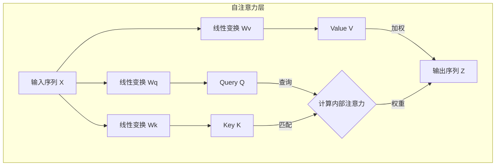

# 深入解析Transformer

## 1. 为什么还要再进一步：RNN 的最后瓶颈

注意力机制克服了 Seq2Seq 的信息瓶颈，但这些模型依然靠 RNN 处理序列——必须按顺序一个词元接一个词元计算，长序列效率低，长距离依赖信息丢失的问题也仍在。

2017 年 Google 团队发表《Attention Is All You Need》，提出 **Transformer**：**完全抛弃 RNN 和卷积，整个模型基于注意力机制构建**。它凭借出色的并行计算能力极大提升训练效率、更有效捕捉长距离依赖，成为后续 BERT、GPT 等大规模预训练模型的架构基础。

## 2. 自注意力：序列自己对自己做注意力

让模型理解一段文本，本质是提取「序列特征」——把序列中所有词元的信息整合起来。RNN 用依次传递隐藏状态来顺序整合，Transformer 选了截然不同的路：**把提取序列特征看作输入序列「自己对自己做注意力计算」**，每个词元「审视」所有其他词元，动态算出最能代表自己上下文含义的新表示。与交叉注意力的关键区别：**Query、Key、Value 均来源于同一个输入序列**。

例：「苹果公司发布了新款手机，**它**采用了最新的芯片」——要理解「它」指「新款手机」而非「苹果公司」，模型需要把「它」与句中所有词元关联，自注意力正是通过计算「它」对全句词的权重来实现的。

### 2.1 与交叉注意力的对照

| | 交叉注意力 | 自注意力 |
|---|---|---|
| Q 来源 | 解码器状态（目标序列） | 同一序列 X |
| K/V 来源 | 编码器全部输出（源序列） | 同一序列 X |
| 信息流向 | 两个不同序列之间 | 单个序列内部 |
| 架构目标 | **对齐**并**整合**两个序列的信息 | **理解**并**重构**序列内部依赖 |



### 2.2 计算四步

1. **生成 Q/K/V**：每个词元的词嵌入 $x_i$ 分别乘三个可学习、全模型共享的矩阵：$q_i = x_i W^Q$、$k_i = x_i W^K$、$v_i = x_i W^V$——把原始嵌入投影到专门用于注意力计算的三个表示空间；
2. **算分数**：第 $i$ 个词元的 $q_i$ 与**所有**词元（包括自己）的 $k_j$ 点积：$\text{score}(i,j) = q_i \cdot k_j$；
3. **缩放与归一化**：$\alpha_{ij} = \text{softmax}(q_i \cdot k_j / \sqrt{d_k})$——缩放原因同前：$d_k$ 大时点积方差大，会把 Softmax 推进梯度极小区域导致梯度消失；
4. **加权求和**：$z_i = \sum_j \alpha_{ij} v_j$。

输出 $z_i$ 不再只含 $x_i$ 自己的信息，而是融合全序列相关词元的上下文感知表示。本质：**每个词元同时扮演「查询者、被查询的索引、信息提供者」三种角色**。

> **为什么是三个矩阵而不是直接复用 X？** 源教程的图书馆类比很精辟：Q 是「要问的问题」（主动查询意图），K 是「书的索引/标签」（被动与问题匹配），V 是「书的具体内容」。三者虽同源于一份输入，但在检索任务中角色截然不同——$W^Q, W^K, W^V$ 让模型学会把 X 投影到三个功能空间，分别扮演好三种角色。Q-K 配对解决「如何定位相关信息」，V 回答「应该提取什么信息」。这个三元组在功能上完备且高效，成了注意力的标准范式。

### 2.3 矩阵化与并行

逐词循环算 $z_i$ 效率极低，实际实现把整个序列写成矩阵：$Q = XW^Q, K = XW^K, V = XW^V$，一次算完全部词元的 QKV；再由同一个公式收尾：

$$ Z = \text{softmax}\left(\frac{QK^T}{\sqrt{d_k}}\right)V $$

与交叉注意力公式**完全相同**，区别只在输入来源。$QK^T$ 是 $[T, T]$ 分数矩阵，第 $i$ 行第 $j$ 列 = 第 $i$ 词对第 $j$ 词的未归一化注意力分数。同一数学范式，因输入来源不同被用于解决「两序列对齐」与「单序列内部建模」两个问题。

PyTorch 实现如下——三个 `nn.Linear` 对应 $W^Q/W^K/W^V$，前向核心三行：

```python
scores = torch.matmul(q, k.transpose(-2, -1)) / math.sqrt(self.hidden_size)  # (B, T, T) 并行算全部配对
attention_weights = torch.softmax(scores, dim=-1)
context = torch.matmul(attention_weights, v)      # 加权求和，(B, T, H)
```

## 3. 多头注意力：雇一个专家团队

一组 $W^Q, W^K, W^V$ 只做一次自注意力，等于只从**一个视角**审视文本；而文本关系是多层次的——有头学会了关注指代（「它」指向谁），可能就没精力管主谓宾。

**多头注意力（Multi-Head Attention）** 的思路直接：并行执行多次自注意力，每次是一个独立「头」，各有专属的 $W^Q_i, W^K_i, W^V_i$，学习关注一种特定类型的上下文关系。流程：

1. **并行计算**：初始化 $h$ 组权重矩阵；
2. **独立注意力**：每头对输入独立做一次完整自注意力，输出 $Z_i$；
3. **拼接**：$h$ 个输出在特征维度 Concatenate；
4. **投影**：乘输出矩阵 $W^O$ 投影回原始输入维度。

> **与「给注意力加 A/B/C 新角色」的区别**：多头不是**深化**单次计算的复杂性，而是**拓宽**广度。类比：加新角色是给**一个**管理员配更复杂的工具，单次查询越来越繁琐；多头是**雇佣 8 个各有所长的专家**——每人只用标准 QKV 工具，但视角独立（有人专攻语法、有人专攻语义），最后汇总专家报告得到更全面结论。多头为模型提供从不同子空间、不同视角审视信息的能力，而不改变注意力范式本身。

实践上为保持计算总量不变，把 `embedding_dim` 均分给 $h$ 个头：`512/8=64`，每头在自己的 64 维子空间算注意力，再拼回 512 维。

高效实现不创建多个 `SelfAttention` 实例，而是把多头塞进**一次矩阵运算**——精髓全在形状变换：

```python
# 一次性算出所有头的 Q/K/V（输出维度仍是 hidden_size）
q = self.q_linear(x).view(B, T, num_heads, head_dim).transpose(1, 2)  # -> (B, h, T, d_k)
# transpose 让 num_heads 成为类似 batch 的维度，matmul 自动对每头并行
scores = torch.matmul(q, k.transpose(-2, -1)) / math.sqrt(self.head_dim)
context = torch.matmul(torch.softmax(scores, dim=-1), v)
# 合并多头：转回 -> contiguous() 保证内存连续 -> view 拼回 hidden_size
context = context.transpose(1, 2).contiguous().view(B, T, hidden_size)
output = self.wo(context)                               # W^O 融合各头信息
```

`assert hidden_size % num_heads == 0` 是必备防御；`.contiguous()` 不可省——`transpose` 后张量可能非连续存储，直接 `view` 会出错。

## 4. Transformer 整体结构

<div align="center">
    
    <p>图 1：Transformer 架构</p>
</div>

依然是 Encoder-Decoder 架构，但内部由标准化「积木」堆成：两侧各由 **N 个功能相同的层**堆叠（原论文 N=6）。

### 4.1 编码器层：两个子层

**多头自注意力（双向）** + **位置前馈网络（FFN）**，每个子层输出都过**残差连接（Add）与层归一化（Norm）**：`x -> Sublayer1 -> Add&Norm -> Sublayer2 -> Add&Norm`。多头层是**双向自注意力**——任何词元都能看到序列中所有其他词元（自己、前面、后面），因此极擅长**理解**完整输入。堆大量编码器层的 **Encoder-Only** 架构（如 **BERT**）在文本分类、NER 等 NLU 任务上大获成功。

### 4.2 解码器层：三个子层

比编码器多一个注意力子层：**带掩码的多头自注意力** + **交叉注意力** + **FFN**，同样每子层后接 Add & Norm。

- **子层 1 掩码自注意力**：生成必须自回归——生成第 $t$ 词只能依赖前 $t-1$ 词。并行的自注意力计算里靠**掩码**实现：Softmax 之前把所有未来位置的分数设为极小负数（`-inf`），归一化后权重变 0，物理上切断信息向后传播，保证单向性；
- **子层 2 交叉注意力**：连接编码器与解码器的桥梁——**K/V 来自编码器最终输出，Q 来自子层 1 的输出**，让解码器生成每个词时都能「关注」输入序列的任何部分；
- **子层 3 FFN**：与编码器相同，提供非线性变换。

堆大量解码器层的 **Decoder-Only** 架构（如 **GPT 系列**）因天然的自回归生成能力，引领了当前大语言模型浪潮。

### 4.3 FFN：升维-激活-降维

$$ \text{FFN}(x) = \text{ReLU}(xW_1 + b_1)W_2 + b_2 $$

独立作用于序列**每个位置**的两层全连接：$W_1$ 把 `embedding_dim` **放大 4 倍**（投影到更高维空间以提取更丰富复杂的模式），激活函数做非线性处理，$W_2$ 再**压缩回**原维度（对高维特征的筛选压缩，保留最重要信息）。注意力子层内部主要是 Softmax 归一化，逐位置的非线性主要靠 FFN 提供（常见 ReLU/GELU）。4 倍中间维是原论文的经验设定，因效果好被广泛沿用，并无严格理论证明。

### 4.4 Add & Norm：让堆叠成为可能

- **残差连接**：$y = x + \text{Sublayer}(x)$，解决深度网络「模型退化」。求导得 $\frac{\partial y}{\partial x} = 1 + \frac{\partial \text{Sublayer}}{\partial x}$——那个「1」为梯度创建了高速公路，无论多深梯度至少以 1 的幅度回传到最浅层。约束：所有子层输入输出维度必须一致才能相加。
- **层归一化（LayerNorm）**：对**每个样本每个词元**的特征向量（`hidden_size` 维）独立标准化到均值 0 方差 1，再加两个可学习参数缩放偏移：

    $$ y = \frac{x - \mu}{\sqrt{\sigma^2 + \epsilon}} \cdot \gamma + \beta $$

    既享受归一化的稳定，又能按任务需要恢复/调整分布。对比主要用在 CV 的 BatchNorm（对一批样本的同一特征归一化），LN 不受批次大小影响，更适合变长的自然语言序列。

这套设计让模型可以靠简单增加层数（深度）与特征维度（宽度）扩展，为后来参数量巨大的语言模型奠基。

> 原论文用 **Post-LN**（Sublayer → Add → LayerNorm）；许多现代实现（GPT 系列）改 **Pre-LN**（LayerNorm → Sublayer → Add），训练更稳、更易加深，功能等价。

### 4.5 位置编码：补上自注意力丢掉的语序

自注意力的主要缺陷是**位置无关性**——计算完全并行，模型感知不到词序：「猫追狗」与「狗追猫」的词元集合相同，「猫」「狗」会得到相同上下文表示，显然错误。Transformer 的做法是在词嵌入输入模型前**加**一个位置编码向量：

$$ input = token_\text{embedding} + positional_\text{encoding} $$

这是**绝对位置编码**（每个位置有固定编码向量），两种实现：

1. **可学习编码**：建一个 `[max_sequence_length, hidden_size]` 的 `nn.Embedding`，像学词嵌入一样自动学出每个位置的最佳向量。常见于 Encoder-Only 模型（BERT）；配置文件里的 `max_position_embeddings` 就是它，重要超参数。近年大型解码器模型多改用相对/旋转类编码（如 RoPE）。
2. **正弦固定编码**（原论文方案，免训练）：不同频率的正弦/余弦为每个位置生成独特向量：

    $$ PE_{(pos,2i)} = \sin\frac{pos}{10000^{2i/d_{model}}}, \qquad PE_{(pos,2i+1)} = \cos\frac{pos}{10000^{2i/d_{model}}} $$

    $pos$ 是绝对位置，$i$ 是维度索引（偶数维 sin、奇数维 cos，取到维度一半即可）。每个 (pos, i) 组合独一无二；不同位置的编码间存在固定线性关系，可能有助模型推断相对位置；优点是不需训练、理论上可外推到比训练时更长的序列。

> **绝对 vs 相对**：以上两种都是绝对位置编码（给第 1、第 10 个位置分配特定编码），超长文本泛化性存疑。许多现代大模型（Transformer-XL、Llama）转用**相对位置编码**——不关注绝对位置，直接在注意力计算中建模词元间相对距离（「当前词」与「前 2 个词」的关系），处理长序列更有效灵活。

### 4.6 两种注意力掩码

- **因果掩码（Causal Mask）**：专用于解码器 Masked Self-Attention，保证自回归。实现核心是让权重矩阵呈**下三角**——长度 $T$ 的序列在 $[T,T]$ 矩阵中主对角线及以下可关注、以上屏蔽，Softmax 前把屏蔽位置分数加极大负数（`-inf`）使权重归零。
- **填充掩码（Padding Mask）**：用于编码器与解码器的**所有**注意力层，解决变长批量填充问题。`<pad>` 无语义，分注意力既浪费算力又引噪声；填充掩码形状 `[batch, 1, 1, seq_len]`（可广播），Softmax 前加到分数上，涉及填充位（无论作 Q 还是 K）的分数变负无穷、权重趋 0。

解码器自注意力层常两者叠加：既不看未来，也不看填充。

### 4.7 KV 缓存：推理加速的关键

训练时可看完整答案序列、掩码并行算所有位置损失；推理必须逐词自回归：`[BOS]` → `token_1` → `[BOS], token_1` → `token_2` →……直接按此流程算，生成 `token_3` 时 `[BOS]`、`token_1` 的 Q/K/V 会被**重算**，而这些早已算过。

**KV 缓存**：解码器每层缓存已算出的所有词元 K、V 向量。生成第 $t$ 步时只为新输入词元算 $q, k, v$，从缓存取历史 $K_{cache}, V_{cache}$，追加新 $k, v$ 后用 $q$ 对完整缓存做注意力。每步计算量从与已生成序列长度的平方（$O(T^2)$）相关降到线性（$O(T$）），是实现高效大模型推理的常用技术。注意缓存占用随步数线性增长，多层多头设置下要盯显存。

## 5. 从零组装：模块化工程实践

源教程采用「**先整体框架，后组件实现**」的自顶向下方式，组件按独立性拆进 `src/`：

```text
code/C4/transformer/
├── src/
│   ├── transformer.py  # Transformer、EncoderLayer、DecoderLayer
│   ├── attention.py    # MultiHeadAttention
│   ├── ffn.py          # FeedForward
│   ├── norm.py         # LayerNorm
│   └── pos.py          # PositionalEncoding
└── main.py             # 组装模型、演示前向传播
```

### 5.1 主类骨架

`Transformer.__init__` 四块：源/目标各一个 `nn.Embedding` + `PositionalEncoding` + Dropout；`nn.ModuleList` 堆 N 个 `EncoderLayer`/`DecoderLayer`（ModuleList 支持按索引访问并自动注册参数）；`output = nn.Linear(dim, tgt_vocab_size)` 映射回词表。`forward` 即四步：`generate_mask` → `encode(src)` → `decode(tgt, enc_output)` → `output(dec_output)` 出 logits。

### 5.2 各组件要点

**位置编码**（`pos.py`）：`__init__` 一次性预计算 `[max_seq_len, dim]` 的 PE 矩阵——位置列向量 `position` 乘 `div_term`（用 `exp(2i·-log(10000)/dim)` 形式，数值更稳），偶数维填 sin、奇数维填 cos；`forward` 只需按输入长度切片相加 `x + self.pe[:, :x.size(1), :]`。关键工程细节是 `register_buffer('pe', pe)`：告诉 PyTorch「pe 属于模型状态、随 state_dict 保存加载，但不是参数、优化器不更新它」。

**多头注意力**（`attention.py`）：`wq/wk/wv/wo` 四个 `Linear(dim, dim)`（一个大线性层一次算所有头）；forward 七步——线性投影 → `view+transpose` 分头 → 缩放点积 → `masked_fill(mask == 0, -inf)` 应用掩码 → softmax + dropout → 乘 V → `transpose+contiguous+view` 合并多头 → `wo` 投影。

**FFN**（`ffn.py`）：一行式 `w2(dropout(relu(w1(x))))`，升 2048 降 512。

**LayerNorm**（`norm.py`）：`mean(-1)`/`var(-1, unbiased=False)` 在**最后维**统计（与 PyTorch 默认行为一致），`gamma/beta` 用 `nn.Parameter` 自动注册。

### 5.3 层组装与掩码生成

`EncoderLayer.forward` 的模式高度规整——备份 `_x`、子层、`norm(_x + dropout(x))`，注意力层 `self.attention(x, x, x, mask)` 即 Q=K=V=x 的自注意力；`DecoderLayer` 多一段交叉注意力 `self.cross_attention(x, enc_output, enc_output, src_mask)`——Q 来自解码器、K/V 来自编码器。

`generate_mask` 是两种掩码的落地示范：

```python
src_mask = (src != 0).unsqueeze(1).unsqueeze(2)                    # [B,1,1,src_len] 填充掩码
tgt_pad_mask = (tgt != 0).unsqueeze(1).unsqueeze(2)                 # [B,1,1,tgt_len]
tgt_subsequent_mask = torch.tril(torch.ones((tgt_len, tgt_len))).bool()   # 下三角因果掩码
tgt_mask = tgt_pad_mask & tgt_subsequent_mask.unsqueeze(0)          # 两者取与
```

另有两处细节：嵌入后先乘 `math.sqrt(dim)` 再叠加位置编码（放大嵌入量级相对位置编码的作用）；参数初始化对 `dim() > 1` 的张量统一 `xavier_uniform_`。

### 5.4 运行验证

`main.py` 以 `src_vocab=tgt_vocab=100, dim=512, n_heads=8, n_layers=6, hidden_dim=2048` 组装，随机喂 `src (2,10)`、`tgt (2,12)`，输出形状 `[2, 12, 100]`——batch、目标长度、词表三维全部符合预期。各组件单测同样以形状断言收尾（PE/MHA/FFN/LN 输入输出均 `(2,10,512)`）。

> **补记**：把全文串成一条「如果只用注意力，还缺什么」的清单更便于记忆——位置无关 → 位置编码；单视角 → 多头；深层难训 → 残差+LN；未来泄漏 → 因果掩码；pad 噪声 → 填充掩码；推理重复计算 → KV 缓存。Transformer 论文的贡献不是发明了注意力，而是把「纯注意力也能组成完整序列模型」这件事一次性做成了工程闭环，此后 NLP 进入「架构统一、参数Scaling」的时代。

## 练习

- 按源教程目录结构自行实现 PositionalEncoding、MultiHeadAttention、FeedForward、LayerNorm 四个组件并组装 Transformer，以形状测试驱动验证。

## 参考文献

- Vaswani, A. et al. (2017). *Attention Is All You Need*. NeurIPS
- Hendrycks, D. & Gimpel, K. (2016). *Gaussian Error Linear Units (GELUs)*
- Ba, J. L. et al. (2016). *Layer Normalization*
- Su, J. et al. (2021). *RoFormer: Enhanced Transformer with Rotary Position Embedding*

## 写在最后

架构的积木齐了，下一个问题是往这套积木里灌什么训练信号——下一篇[预训练模型BERT与GPT](7-预训练模型BERT与GPT)记录 Encoder-Only 与 Decoder-Only 两条路线各自的预训练任务设计。
